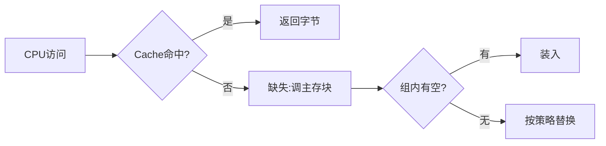
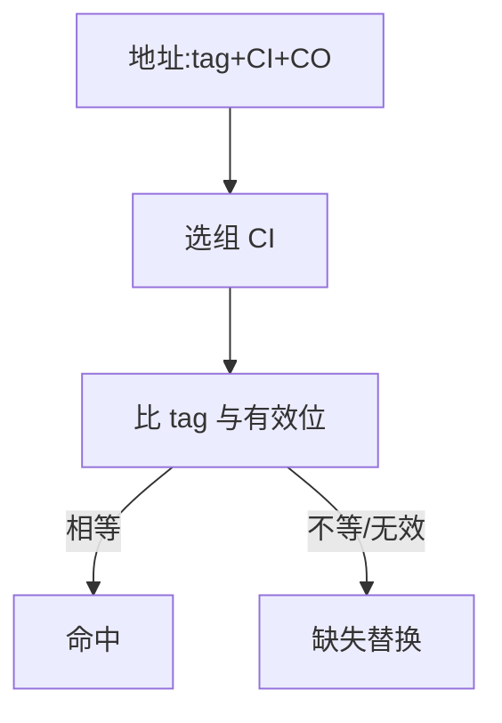

# Cache 命中与缺失分析（读写过程、替换策略）

## 它是什么与为什么需要

Cache 是 CPU 与主存之间的 SRAM 小仓库。程序访问数据先查 Cache：==命中则直接返回==，==缺失则调块并可能替换==。为什么需要？因为 SRAM 快但贵，DRAM 慢但便宜，用层次结构折中速度与成本。

## 读写过程与替换策略

读缺失：从主存取块放入 Cache，再读出字。写命中常有写直达（同时写主存）和写回（只写 Cache，脏位标记，替换时回写）两种；如实验 2 写回须加脏位，Cache 行格式 = 有效位 + 脏位 + tag + 数据。写缺失常先调块再写。替换策略有随机、FIFO、LRU 等；组相联哪个组满就按策略逐出，实验中 miss(eviction) 就是组内有旧行但 tag 不一致而驱逐。

## 相近概念与常见坑

常和 TLB、页表混淆：TLB 查虚拟页号换物理页号，Cache 用物理地址分组；Cache 缺失不陷入内核（选择 3），缺页才陷入。坑有三：

> [!WARNING]
> 组数算错：$CI=\log_2(\text{组数})$；tag 位数要扣 CI 和块内地址（CO）。
> [!WARNING]
> 命中率与主存存取速度无关（选择 2），只和 Cache 大小、映射、容量有关。
> [!TIP]
> 先看有效位 + tag，再判 miss/hit，驱逐看 tag 是否不一致且组内满。

## 算对了的例子（取自实验 1）

地址 `0000001 00 010`：组索引选中块 0，tag 与已有行一致，==hit==。而 `0010000 10 000` 选块 2，块内虽有数据但 tag 不同，故 miss 且 eviction。六步为 `miss, miss, hit, miss, miss(eviction), miss(eviction)`，结果 hits:1、miss:5、evictions:2。
