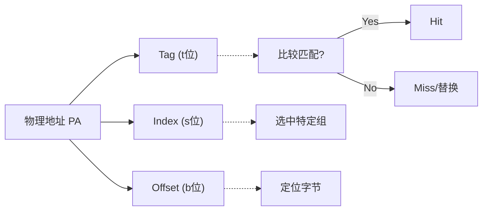

# Cache 组织结构（组相联、直接映射、全相联，S/E/B/m/t/s/b）

## Cache 组织结构与地址解析

Cache 是 CPU 与主存之间的高速缓冲存储器，其核心目标是利用局部性原理降低平均访问延迟。理解 Cache 的关键在于掌握物理地址如何被拆解为标记（Tag）、组索引（Index）和块内偏移（Offset）。

设物理地址位数为 $m$，Cache 总容量为 $C$，块大小（Block Size）为 $B=2^b$ 字节，组数（Number of Sets）为 $S=2^s$，每组行数（Associativity）为 $E$。则地址结构如下：
$$ m = t + s + b $$
其中：
- **块内偏移 $b$**：由块大小决定，$b = \log_2 B$。
- **组索引 $s$**：由组数决定，$s = \log_2 S$。注意 $S = C / (B \times E)$。
- **标记 $t$**：剩余高位，$t = m - s - b$，用于在组内比对是否命中。

## 三种映射方式对比

映射方式决定了主存块可以放置在 Cache 中的位置，直接影响冲突概率和硬件复杂度。

| 映射方式 | 特点 | 优点 | 缺点 |
| :--- | :--- | :--- | :--- |
| **直接映射** | $E=1$，每块只能去固定组 | 硬件简单，速度快 | 冲突失效高 |
| **全相联** | $S=1$，每块可去任意行 | 冲突失效最低 | 比较器多，速度慢 |
| **组相联** | $1 < E < S/C$，折中方案 | 平衡速度与命中率 | 设计较复杂 |

> [!IMPORTANT]
> ==核心结论==：组相联是直接映射和全相联的折中。南邮考题中常考察 **组索引 $s$** 的计算，务必先算出组数 $S$。

## 常见误区与解题陷阱

1.  **混淆 $S$ 与 $E$**：$S$ 是组的数量，$E$ 是每组的行数。直接映射时 $E=1$；全相联时 $S=1$。
2.  **地址位数计算**：题目若给出“按字节编址”，则偏移量 $b$ 对应字节；若“按字编址”，需注意字长。通常默认按字节。
3.  **有效位与脏位**：Cache 行不仅存数据和 Tag，还需 **有效位（Valid Bit）** 标识数据是否合法。若采用写回（Write-Back）策略，还需 **脏位（Dirty Bit）** 标识数据是否被修改过，以便替换时决定是否写回主存。

> [!WARNING]
> 易错点：计算 Cache 总位数时，不要漏掉 **Tag、Valid、Dirty** 等非数据位。
> 公式：$\text{Total Bits} = S \times E \times (\text{Tag} + \text{Data} + \text{Valid} + \text{Dirty})$

## 典型例题解析

参考实验题场景：假设物理地址 12 位，块大小 8B ($b=3$)，2 路组相联 ($E=2$)，Cache 总容量 64B。

1.  **计算参数**：
    -   块数 $= 64 / 8 = 8$ 块。
    -   组数 $S = 8 / 2 = 4$ 组 $\Rightarrow s = \log_2 4 = 2$ 位。
    -   标记 $t = 12 - 2 - 3 = 7$ 位。
2.  **地址解析**：
    若访问地址 `0x0A` (二进制 `0000 1010`)：
    -   Offset (低3位): `010`
    -   Index (中2位): `10` (第2组)
    -   Tag (高7位): `0000001`
3.  **命中判断**：
    检查第 2 组的两行，若某行 Valid=1 且 Tag=`0000001`，则命中；否则缺失。若需替换且该行 Dirty=1，则需先写回主存。

> [!TIP]
> 记忆技巧：**“低偏中组高标记”**。低位定块内字节，中位定哪一组，高位定是不是它。
