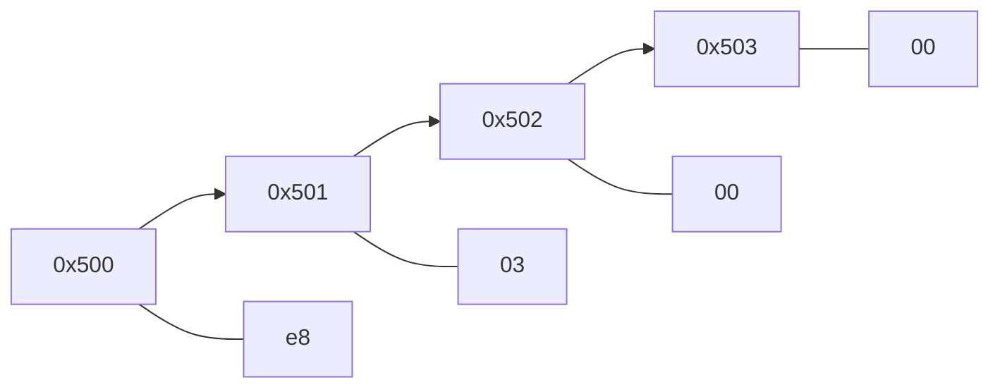

# 基本C数据类型的典型大小（sizeof）

## 它是什么

`sizeof` 是 C 语言的内置运算符，返回一个对象（类型）所占的**字节数**。它回答的问题是：“这个东西在内存里占几格？”

在几乎所有机器上，多字节对象都被存储为连续的字节序列，对象地址就是其中最低的字节地址。所以只要知道类型大小和首地址，就能算出任意元素的位置。

## 为什么需要

- 指针只能加一个元素，不能跨类型乱跳：`p + 1` 前进的是 `sizeof(*p)` 个字节。
- 数组元素地址必须靠类型大小才能算出来，否则没法解释 `A[3]` 到底跳了多远。
- 写内存、定义协议头、跨平台移植时，字节数直接决定布局是否一致。

## 典型大小对照表

| C 声明（有符号） | C 声明（无符号） | 32 位机器 | 64 位机器 |
| :--- | :--- | :--- | :--- |
| `[signed] char` | `unsigned char` | 1 | 1 |
| `short` | `unsigned short` | 2 | 2 |
| `int` | `unsigned int` | 4 | 4 |
| `long` | `unsigned long` | 4 | 8 |
| `int32_t` | `uint32_t` | 4 | 4 |
| `int64_t` | `uint64_t` | 8 | 8 |
| `char *` | — | 4 | 8 |
| `float` | — | 4 | 4 |
| `double` | — | 8 | 8 |

> [!IMPORTANT]
> ==核心结论==：`sizeof(char) == 1`（C 标准规定），但 `sizeof` 的返回值单位是**字节**，而 `char` 恰好是 1 字节、8 位。因此 `sizeof(int)` 返回 4 意味着 4 字节 = 32 位，而不是 4 位。

64 位机器上 `long` 和指针变 8 字节，是"LP64"模型；32 位上的 `long` 只有 4 字节（ILP32）。这正是同一段 C 代码在不同平台内存布局可能不同的根源。

## 数组元素地址怎么算

设 `T A[L];`，则：

$$
\&A[i] = \&A[0] + sizeof(T) \times i,\quad 0 \le i \le L-1
$$

例如 `int A[5]`，`sizeof(int) = 4`，若 `&A[0] = 0x1000`：

| 元素 | 地址 |
| :--- | :--- |
| `A[0]` | `0x1000` |
| `A[1]` | `0x1004` |
| `A[2]` | `0x1008` |

## 顺带记住字节序

大小确定了"占几格"，字节序确定了"格子里怎么排"。Intel 机器用小端：低位字节放低地址。

`unsigned int x = 1000;`（`0x000003E8`），地址 `0x500`：

若 `x = 0x12345678`，地址 `0xFFFFC000`，则小端下 `0xFFFFC000` 存 `0x78`，`0xFFFFC001` 存 `0x56`，`0xFFFFC002` 存 `0x34`，`0xFFFFC003` 存 `0x12`。

> [!WARNING]
> 上面那道单选题给出的参考答案 B（`0x34`）与小端规则冲突：按小端，`0xFFFFC001` 只能是 `0x56`。遇到这类题，先确认题目问的是哪个地址、机器是否真是 Intel 小端，别被印刷错误带偏。

## 常见坑

- **`sizeof` 与"位数"混淆**：`sizeof(int) = 4` 是 4 字节；位数 = `sizeof × 8`。
- **以为类型大小固定**：表里给的是"典型值"，`sizeof` 的真正结果由实现决定，跨平台编程应优先用 `int32_t`/`int64_t` 这类定宽类型。
- **指针不是类型的一部分**：`sizeof(char *)` 是指针本身的大小（32 位机 4、64 位机 8），与它指向的 `char` 无关；`sizeof(*p)` 才是目标类型的大小。
- **数组名退化为指针后 sizeof 失效**：`sizeof(A)` 是整个数组字节数，`sizeof(A[0])` 才是元素大小。

> [!TIP]
> 记一个口诀：**"char 一字节，short 两字节，int 四字节；float 四、double 八；long 和指针看平台：32 位是四，64 位是八。"** 考选择题时先在草稿上写下一行 sizeof 表，再逐项比对。

> [!NOTE]
> 补码与本知识点配合使用：`int x = -1000;` 的 32 位补码为 `0xFFFFFA18`，用 GDB 的 `x/4xb` 查看会得到 `18 fa ff ff`——正是小端存储的直观证据。
