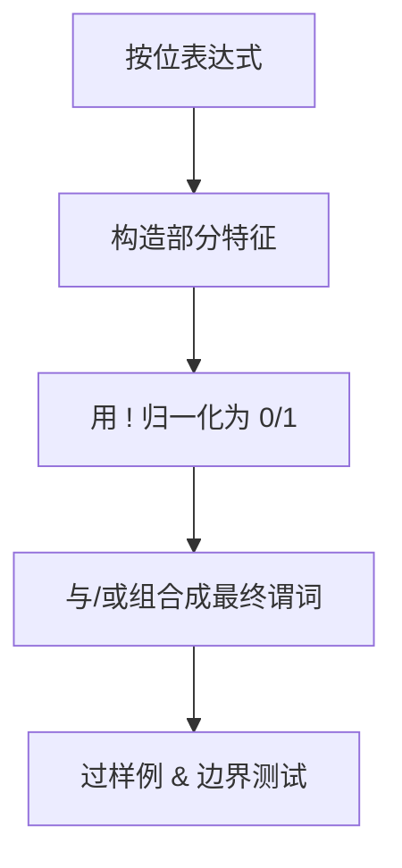

# DataLab：用位级运算实现逻辑功能（如isTmin等限制操作符题目）

## 位级运算与 DataLab 限制操作符题

DataLab 是《深入理解计算机系统》（CS:APP）配套的著名实验。它要求你在**非常受限的规则**下（比如只能用 `~ & | ^ << >>` 这些按位运算符，禁止使用 `if`、`for`、`>`, `<`, `==` 等控制流和比较符号，运算符总数也有上限），仅凭**位级视角**去实现一些看似简单、实则烧脑的逻辑功能。

因为机器是二进制的，所有信息——整数、负数、判断条件——最终都落在 32 个 bit 上。位级运算的最低门槛只有两个东西：

- **位模式（bit pattern）**：变量在寄存器/内存里是 0/1 串。
- **按位算子**：`& | ^ ~` 是把 0/1 串逐位重新组合的规则。

所以你的任务不是“写程序”，而是**把布尔函数翻译成按位表达式**。这是后续理解整数表示、ALU 设计、机器级编程的重要铺垫。

---

## 核心工具：按位算子是什么意思

设单个比特 $a, b \in \{0,1\}$：

| 运算 | 记法 | 真值特点 |
|---|---|---|
| 按位与 | `a & b` | 两个都是 1 才为 1 |
| 按位或 | `a | b` | 至少一个为 1 |
| 按位异或 | `a ^ b` | 恰好一个为 1（不同为 1） |
| 按位取反 | `~a` | 1 变 0，0 变 1 |

> [!TIP]
> `x ^ x = 0`，`x & ~x = 0`，`x | ~x = ~0`。这些恒等式在 DataLab 里反复出现，值得刻进肌肉记忆。

---

## 如何把“比较/判断”转成位运算

思考一个具体问题：**如何判断一个数是不是 TMin（最小的补码整数）？**

补码里 TMin 的位模式是 `1000...0`，也就是最高位为 1，其余 31 位全为 0。在 32 位机器上：

$$
\text{TMin} = 1\underbrace{00\cdots0}_{31\text{ 个 }0}
$$

你**不能用** `==`，也不能直接返回 `x == 0x80000000`。那怎么用按位运算表达“只有最高位是 1”？

步骤拆解：

1. 先问：`x` 和 TMin 的位模式在哪一位上不同？——所有不同的位，异或后会变成 1。
2. 所以先得到所有与 TMin 不同的位：
   $$
   d = x \wedge \text{TMin}
   $$
   （这里 $\wedge$ 即 C 中的 `^`。）
3. 若 `x == TMin`，则 `d` 的每一位都应该是 0，即 `d == 0`。
4. 在受限条件下，我们经常用一个技巧：把“是否非零”压成 1 bit。

于是可以把“判断 $d \neq 0$”看成：

```c
!!d
```

其中 `!` 是逻辑非。DataLab 通常允许 `!`，不允许 `==`、`if`。于是 `isTmin(x)` 可以写成：

```c
return !(x ^ 0x80000000);
```

如果题目进一步**连 `!` 也不让用**，就需要利用算术性质，例如 TMin 的相反数仍是它自己：

```c
return !((x + x) | (x ^ 0x80000000));
```

这里利用了 `x == TMin` 时 `x + x = 0`（溢出回绕）且 `x ^ TMin = 0`，二者按位或后非零位全消掉，`!` 把 0 映射成 1，非零映射成 0。

> [!WARNING]
> 补码加法溢出是“定义好的行为”还是“未定义行为”？在 CS:APP 的模型里，按位级视角假设回绕（wrap-around），DataLab 也在这个假设下进行。实际 C 标准对有符号溢出是未定义行为，这正是为什么 DataLab 题目是“位级实验”而非普通 C 编程。

---

## 两步看懂 DataLab 题目怎么做

以经典题 `isTmax` 为例：判断 x 是不是最大补码整数 `0111...1`。

思路：Tmax 有个特殊性质——`x + 1` 得到 TMin，`x + 1 + 1` 回绕到 `x` 自己吗？并不。但利用按位性质：

- Tmax 的补码特点是：`x ^ (x + 1) == ~0`（全 1），因为从 `0111...1` 到 `1000...0`，每一位都翻转。
- 同时要排除 `x = ~0` 这个特殊情况，因为 `~0 ^ 0 = ~0` 也成立。

表达式可以写成：

```c
return !( ~(x ^ (x + 1)) | !(x + 1) );
```

其中：

- `~(x ^ (x+1))` 在 x=Tmax 时为 0，否则非零；
- `!(x+1)` 在 `x = ~0` 时为 1，用来排除误判；
- 最后整体 `!` 把“全 0”变为 1。

---

## 位级加减乘除的每次推进



这个过程的核心是：**不要一上来就写 C 代码，先写所需位模式，再想表达式如何产生它。**

> [!Important]
> DataLab 的评分不只是看样例通过，还限制运算符数量。要先做对，再压缩运算符。

---

## 常犯的坑

1. **把逻辑值（0/1）和位模式（32 bit）混在一起**：`x & 1` 只取最低位，而 `!!x & 1` 才是“x 是否为真”的低位。
2. **忽略移位越界**：在 C 中位移位数超过类型宽度是未定义行为。DataLab 要求写清楚，比如对 32 位整数，`x << 31` 可以，`x << 32` 不行。
3. **直接写 `x > y` 被判为违规**：必须用位级手法构造比较逻辑，例如 `((x - y) >> 31) & 1` 这类思想（注意溢出边界）。
4. **不懂 `!` 的关键作用**：没有 `!` 时，“非零/零”无法直接映射成 0/1，后面所有逻辑判断都会塌方。
5. **把不同定义混用**：`>>` 对负数分为算术右移和逻辑右移，机器不同结果不同。DataLab 明确规定使用算术右移（符号位扩展），写题时不要自作主张用逻辑移位。

---

## 算对了的例子

题目要求：用位运算实现 `isLessOrEqual(x, y)`，即判断 $x \le y$，不允许比较符号。

一种实现思路：

```c
int isLessOrEqual(int x, int y) {
    int sign_x = x >> 31;            // x 的符号位：0 正，-1 负
    int sign_y = y >> 31;
    int diff = y + (~x + 1);         // y - x，位级补码加法
    int sign_diff = diff >> 31;      // diff 的符号位

    return ( (sign_x ^ sign_y) & (sign_x >> 31) )
         | ( !(sign_x ^ sign_y) & !(sign_diff) );
}
```

思路分两条路：

- 当 `x` 与 `y` **异号**时，只有当 `x < 0`（`sign_x = -1`）才成立，故取 `(sign_x ^ sign_y) & (sign_x >> 31)`。
- 当 `x` 与 `y` **同号**时，减法不溢出，`y - x >= 0` 意味着 `$x \le y$`，故取 `!(sign_x ^ sign_y) & !(sign_diff)`。
- 最后两项按位或合并。

假设 `x = -2, y = 5`：

$$
\text{sign\_x} = -1,\ \text{sign\_y} = 0,\ \text{diff} = 7,\ \text{sign\_diff} = 0
$$

第一项为 `1 & 1 = 1`，第二项为 `0 & 1 = 0`，结果 `1`，正确判定 `-2 <= 5`。

---

## 一个提醒：看硬件，别看数学

位级实验最大的思维切换在于：

> 不要用“数学意义上的整数”想问题，要用“32 bit 位模式 + 规则”想问题。

当你把每个数都看成 0/1 串，把比较看成位模式的差别时，DataLab 的题目就不会显得玄乎，而是一套有限的组合游戏。
