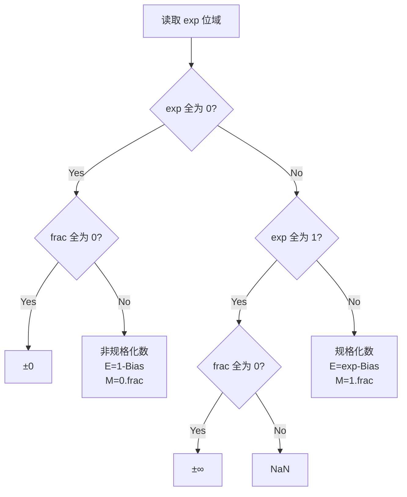

# 浮点数表示与 IEEE 754 标准（S、E、M 的计算）

## 浮点数表示与 IEEE 754 标准

计算机如何用有限的二进制位表示无限且连续的实数？IEEE 754 标准通过科学计数法的二进制变体解决了这一问题。其核心公式为：
$$ V = (-1)^S \times M \times 2^E $$
其中 $S$ 为符号位，$M$ 为尾数（Significand），$E$ 为阶码（Exponent）。

> [!IMPORTANT]
> **核心结构**：浮点数在内存中分为三部分：`s` (1 bit), `exp` (k bits), `frac` (n bits)。注意 `exp` 和 `frac` 是编码值，不等于真实的 $E$ 和 $M$。

## 三种数值情况的判定

根据 `exp` 位域的值，浮点数分为三类。这是解题的关键第一步。

### 1. 规格化数（Normalized）
最常见情况。条件：$\text{exp} \neq 00\dots0$ 且 $\text{exp} \neq 11\dots1$。
- **指数 $E$**：$E = \text{exp} - \text{Bias}$。
  - 单精度 ($k=8$)：$\text{Bias} = 127$。
  - 双精度 ($k=11$)：$\text{Bias} = 1023$。
- **尾数 $M$**：$M = 1.\text{frac}$。隐含前导 1，提高精度。

### 2. 非规格化数（Denormalized）
用于表示接近 0 的极小值。条件：$\text{exp} = 00\dots0$。
- **指数 $E$**：$E = 1 - \text{Bias}$（注意不是 $-\text{Bias}$，是为了平滑过渡）。
- **尾数 $M$**：$M = 0.\text{frac}$。无前导 1。
- **特例**：若 $\text{frac}=0$，则值为 $\pm 0$。

### 3. 特殊值
条件：$\text{exp} = 11\dots1$。
- $\text{frac}=0$：$\pm \infty$（除以零产生）。
- $\text{frac} \neq 0$：NaN（Not a Number，如 $\sqrt{-1}$）。

## 实战演练：单精度转换

**题目**：将十进制数 $15213.0$ 转换为 IEEE 754 单精度浮点数十六进制表示。

**步骤 1：二进制转换与规格化**
$15213 = 11101101101101_2$。
规格化形式：$1.1101101101101_2 \times 2^{13}$。
由此得出：
- $S = 0$（正数）
- 真实指数 $E = 13$
- 尾数部分 $\text{frac} = 1101101101101$

**步骤 2：计算编码值**
- **Exp**：$\text{exp} = E + \text{Bias} = 13 + 127 = 140$。
  $140_{10} = 10001100_2$。
- **Frac**：取小数点后 23 位，不足补 0。
  $\text{frac} = 11011011011010000000000_2$。

**步骤 3：组装与十六进制转换**
二进制串：
`0` `10001100` `11011011011010000000000`
分组（4位一组）：
`0100` `0110` `0110` `1101` `1011` `0100` `0000` `0000`
十六进制：
`4` `6` `6` `D` `B` `4` `0` `0`

==最终结果==：`0x466DB400`

> [!WARNING]
> **常见坑**：
> 1. 混淆 `exp` 和 $E$。`exp` 是无符号整数，$E$ 是有符号真值。
> 2. 非规格化数的 $E$ 是 $1-\text{Bias}$ 而非 $0-\text{Bias}$，这保证了从非规格化到规格化的平滑过渡。
> 3. 尾数 $M$ 在规格化时隐含了整数位的 1，存储时只存小数部分 `frac`。
