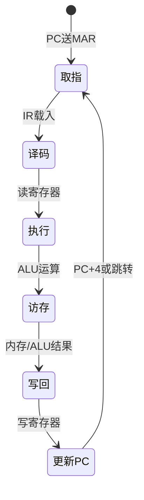

# SEQ 顺序处理器实现（取指、译码、执行、访存、写回、更新PC）

SEQ 顺序处理器是理解 CPU 硬件行为的==最基础抽象模型==。它将每条指令的执行严格划分为取指、译码、执行、访存、写回、更新 PC 六个阶段，且==每个时钟周期仅处理一条指令的一个阶段==。为什么需要这个“慢”模型？因为它是验证数据通路正确性的基准，也是后续学习流水线、乱序执行等优化技术的前提。

## 六阶段工作流与数据通路

SEQ 处理器的核心在于控制信号驱动数据通路完成状态转移。若将指令执行看作一个状态机，其流转过程如下：

> [!IMPORTANT]
> ==PC 更新在最后一步==，而非取指后立即自增。这保证了异常或中断发生时，PC 仍指向当前指令，便于精确断点恢复。

在取指阶段，PC 值送入地址总线，从存储器读取指令放入 IR；译码阶段解析操作码并生成控制信号；执行阶段 ALU 根据控制信号完成算术逻辑运算或地址计算；访存阶段仅在 load/store 指令时激活；写回阶段将结果写入目的寄存器；最后根据是否为跳转指令决定 PC 的新值。

## 标志位计算与实例验证

SEQ 模型中，ALU 运算会同步更新条件码寄存器。这是条件跳转 `Jcc` 的基础。以真题为例：已知 `R[ax]=FFFAH`，`R[bx]=FFF0H`，执行 `addw %bx, %ax`。

$$ \text{FFFAH} + \text{FFF0H} = \text{1FFEAH} $$

由于是 16 位运算，结果截断为 `FFEAH`，进位输出为 1。

| 解释方式 | 真值计算 | CF | OF | ZF | SF |
| :--- | :--- | :--- | :--- | :--- | :--- |
| 无符号数 | $65530+65520=131050$ (溢出) | 1 | - | 0 | 1 |
| 带符号数 | $(-6)+(-16)=-22$ (未溢出) | - | 0 | 0 | 1 |

> [!WARNING]
> ==CF 仅对无符号运算有效，OF 仅对带符号运算有效==。本题中 `-22` 在 16 位补码表示范围内（-32768~32767），故 OF=0；但无符号和超过 65535，故 CF=1。两者不可混淆。

## SEQ 与微程序控制的区别

课件中常对比硬布线与微程序控制器，这直接影响 SEQ 的实现方式：

| 特性 | 硬布线 SEQ | 微程序 SEQ |
| :--- | :--- | :--- |
| 信号产生 | 组合逻辑电路 | 控制存储器读出 |
| 执行速度 | ==快== | 慢 |
| 灵活性 | 差，修改需重布线路 | 好，改微代码即可 |
| 适用场景 | 简单指令集/RISC | 复杂指令集/CISC |

> [!TIP]
> 考试中若问“SEQ 处理器控制单元特点”，优先答==硬布线、组合逻辑、速度快==。微程序虽灵活，但在现代高性能处理器中已较少用于核心指令译码。

## 常见误区警示

> [!CAUTION]
> ==通用寄存器属于数据通路的状态元件==。选择题中“通用寄存器不包含在数据通路中”是典型错误表述。数据通路由 ALU、寄存器文件、多路选择器等组成，寄存器正是其核心存储节点。

此外，不要将 SEQ 的“顺序”误解为“单周期”。SEQ 是多周期的，只是指令间串行、阶段间串行。真正的单周期处理器所有阶段在一个时钟内完成，而 SEQ 用多个时钟周期分时复用硬件资源，这也是它比单周期更贴近实际的原因。
