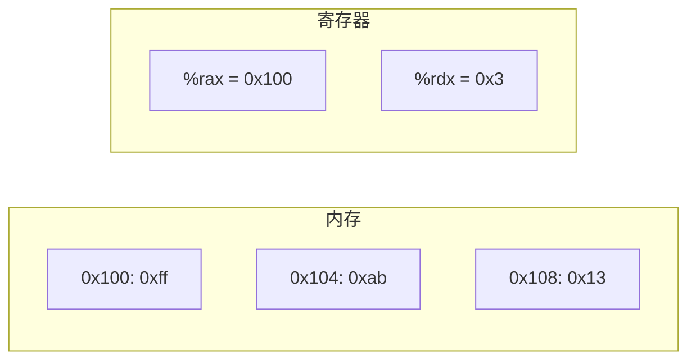

# x86-64 指令概述（指令存放格式、操作数类型）

## 指令存放格式

在 x86-64 系统中，指令以二进制字节序列的形式存放在内存中。一条指令可能由多个字节组成，这些字节在内存中==**连续存放**，且遵循**小端法**==。

> [!IMPORTANT]
> **小端法规则**：多字节操作数的低位字节存放在低地址单元，高位字节存放在相邻的高地址单元。

比如，一条传送指令 `mov $0x12345678, %eax` 存放在内存地址 `0x40110a` 处。立即数 `0x12345678` 的四个字节如何排列？

- 最低字节 `0x78` 放在最低地址 `0x40110a`
- 字节 `0x56` 放在地址 `0x40110b`
- 字节 `0x34` 放在地址 `0x40110c`
- 最高字节 `0x12` 放在地址 `0x40110d`

指令中的其他部分（如操作码、寄存器编码等）同样遵循这一规则。反汇编时，处理器自动按小端法将字节序列还原为完整的指令语义。

## 操作数类型与寻址方式

x86-64 指令的操作数可以来自三个地方，对应三种基本类型：

| 类型 | 存放位置 | 寻址方式示例 | 特点 |
| :--- | :--- | :--- | :--- |
| **立即数** | 指令编码中 | `$0x108` | 常数值，以 `$` 开头 |
| **寄存器操作数** | CPU 寄存器中 | `%rax` | 访问最快，以 `%` 开头 |
| **存储器操作数** | 内存中 | `(%rax)`, `4(%rax,%rdx)` | 以括号表示地址计算 |

> [!TIP]
> 判断一个操作数类型的关键：看到 `$` 是立即数，看到 `%` 是寄存器，看到括号 `(...)` 是存储器引用。

存储器操作数的计算需要理解**有效地址**的构成。x86-64 支持的通用寻址形式为：

$$ \text{Effective Address} = \text{Imm} + \text{BaseReg} + \text{IndexReg} \times \text{Scale} $$

其中 `Scale` 只能取 1、2、4 或 8。例如 `9(%rax, %rdx)`，若 `%rax` 为 `0x100`，`%rdx` 为 `0x2`，则有效地址 = `0x9 + 0x100 + 0x2 = 0x10b`。

> [!WARNING]
> 初学者常见错误：看到数字 `0x104` 就直接认为是立即数。在 x86-64 汇编语法中，**不带 `$` 的数字单独出现**，通常表示一个内存地址（相当于 `(0x104)`），属于存储器操作数，而非立即数。

## 算一算：看清楚操作数的值

以下是一组寄存器与内存的已知状态，我们据此计算不同操作数对应的值：

- 寄存器：`%rax = 0x100`，`%rdx = 0x3`
- 内存内容：`(0x100) = 0xff`, `(0x104) = 0xab`, `(0x108) = 0x13`

| 操作数 | 类型 | 计算过程 | 结果值 |
| :--- | :--- | :--- | :--- |
| `%rax` | 寄存器 | 直接取寄存器内容 | `0x100` |
| `$0x108` | 立即数 | 数值就是指令中的值 | `0x108` |
| `(%rax)` | 存储器 | 访问地址 `0x100` 处内存 | `0xff` |
| `4(%rax)` | 存储器 | 访问地址 `0x100 + 4` 处内存 | `0xab` |
| `9(%rax,%rdx)` | 存储器 | 访问地址 `0x9 + 0x100 + 0x3` 处内存 | `0x13` |

> [!CAUTION]
> `0x104`（不带 `$` 的单独数字）与 `$0x104` 完全不同。前者“去地址 `0x104` 取数据”，得到 `0xab`；后者就表示数值 `0x104` 本身。考试中务必看清是否有 `$` 前缀。
