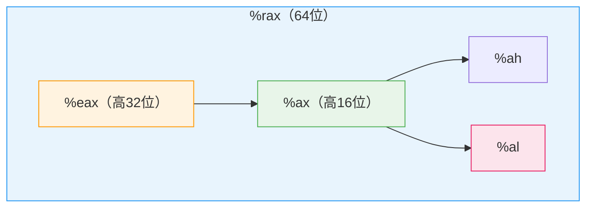

# x86-64 整数寄存器（%rax~%r15及其子寄存器）

## 寄存器是什么

x86-64 CPU 内部有 16 个==通用整数寄存器==，每个 64 位宽，记作 `%rax ~ %r15`，外加一个专用寄存器 `%rip`（指令指针，存下一条指令地址）。汇编指令的操作数大多来自寄存器或内存，理解寄存器是读写汇编代码的第一步。

> [!IMPORTANT]
> 每个 64 位寄存器都可以只取低 32 位、低 16 位、低 8 位来单独读写，形成一套"子寄存器"命名体系。

## 子寄存器映射关系

| 64 位 | 低 32 位 | 低 16 位 | 低 8 位 | 64 位 | 低 32 位 | 低 16 位 | 低 8 位 |
|---|---|---|---|---|---|---|---|
| `%rax` | `%eax` | `%ax` | `%al` | `%r8`  | `%r8d`  | `%r8w`  | `%r8b`  |
| `%rbx` | `%ebx` | `%bx` | `%bl` | `%r9`  | `%r9d`  | `%r9w`  | `%r9b`  |
| `%rcx` | `%ecx` | `%cx` | `%cl` | `%r10` | `%r10d` | `%r10w` | `%r10b` |
| `%rdx` | `%edx` | `%dx` | `%dl` | `%r11` | `%r11d` | `%r11w` | `%r11b` |
| `%rsi` | `%esi` | `%si` | `%sil`| `%r12` | `%r12d` | `%r12w` | `%r12b` |
| `%rdi` | `%edi` | `%di` | `%dil`| `%r13` | `%r13d` | `%r13w` | `%r13b` |
| `%rsp` | `%esp` | `%sp` | `%spl`| `%r14` | `%r14d` | `%r14w` | `%r14b` |
| `%rbp` | `%ebp` | `%bp` | `%bpl`| `%r15` | `%r15d` | `%r15w` | `%r15b` |



> [!WARNING]
> 对低 32 位子寄存器（如 `%eax`）写入时，**高 32 位会被自动清零**；但对 16 位或 8 位子寄存器（如 `%ax`、`%al`）写入时，其余高位**保持不变**。

## 各寄存器的惯用角色

| 寄存器 | 典型用途 |
|---|---|
| `%rax` | 返回值、累加器 |
| `%rbx` | 被调用者保存的基址 |
| `%rcx` | 循环计数器（第 4 个参数） |
| `%rdx` | 第 3 个参数、乘除法辅助 |
| `%rsi` / `%rdi` | 第 2 / 第 1 个参数 |
| `%rsp` | ==栈顶指针==，管理栈帧 |
| `%rbp` | 栈帧基址（可选） |
| `%r8 ~ %r11` | 临时寄存器（调用者保存） |
| `%r12 ~ %r15` | 被调用者保存 |

## 常见坑

> [!CAUTION]
> - `%rsp` 专用于栈操作，**不要随意改写**，否则函数返回会出错。
> - 写 `%eax` 会连带清掉 `%rax` 高 32 位；若只想改低 16 位，请用 `%ax`。
> - `%r8 ~ %r15` 没有 `%ah / %al` 这种历史命名，统一加后缀 `d / w / b`。

## 算例

设 `%rax = 0x00000000FFFFFA18`（即 -1000 的补码扩展），执行：

```asm
movl %eax, %ebx    ; %ebx ← 0xFFFFFA18，%rbx 高32位被清零
addl $1, %eax      ; %eax ← 0xFFFFFB19
```

结果：`%rbx = 0x00000000FFFFFA18`，`%rax = 0x00000000FFFFFB19`。可见对 `%eax` 的写操作同时影响了整个 `%rax` 的高半部分。
