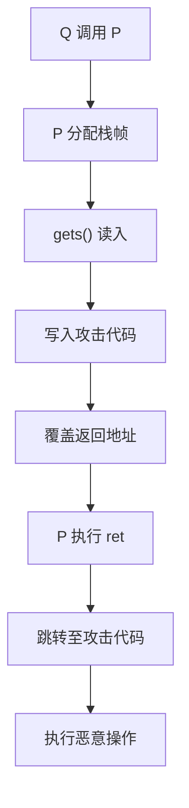

# 代码注入攻击 Code Injection Attacks（构造恶意攻击字符串）

> [!IMPORTANT]
> 代码注入攻击的核心思想：==输入给程序一个字符串，这个字符串包含一些可执行代码的字节编码（称为攻击代码 exploit code），用攻击代码的地址覆盖原返回地址，使得函数执行 `ret` 指令时跳转到攻击代码并执行。==

## 为什么能注入？

思考一个问题：当程序调用 `gets(buf)` 读取用户输入时，CPU 或操作系统会检查你输入的究竟是“普通文本”还是“机器指令”吗？

答案是不会。在冯·诺依曼体系结构中，数据与指令没有本质区别，内存中的字节既可以被当作数据处理，也可以被 CPU 取指执行。如果程序存在缓冲区溢出漏洞（如使用不安全的 `gets`），攻击者就能把精心构造的**恶意机器指令序列**写进栈帧，并篡改控制流。

## 攻击如何发生？

结合课件中 Q 调用 P 时的栈帧结构，整个流程如下：

1. **布置攻击代码**：输入的字符串前段填入可执行指令的字节编码（exploit code）。
2. **覆盖返回地址**：继续输入填充字节（padding），直到恰好覆盖 Q 栈帧中保存的 P 的返回地址，将其改写为 ==攻击代码在栈中的起始地址==。
3. **劫持控制流**：P 执行完毕遇到 `ret` 指令，从栈顶弹出已被篡改的地址，PC 跳转到攻击代码处执行。

## 位置无关代码（PIC）的必要性

假设你要在攻击代码里调用 `system("/bin/sh")`。由于每次运行程序时栈的基址可能变化（尤其是开启 ASLR 后），你怎么保证写死的绝对地址能正确找到 `/bin/sh` 字符串？

这就引出了考点：**位置无关代码（Position-Independent Code, PIC）**。攻击代码必须能够在加载到内存任意位置时都能正确执行。通常利用 PC 相对寻址（如 x86 中通过 `call` / `pop` 获取当前指令地址作为基准计算偏移）来动态定位数据，而不是硬编码绝对地址。

## 算对了的例子

设 Q 调用 P，P 中局部缓冲区 `buf` 距保存的返回地址共 $16$ 字节。若攻击代码放置在 `buf` 起始处，且运行时 `buf` 的地址为 $\text{0xffffd140}$。

| 偏移量 | 内容 | 说明 |
| :--- | :--- | :--- |
| $+0 \sim +3$ | 攻击代码指令 | exploit code 起始 |
| $+4 \sim +15$ | 填充垃圾字节 | 占满缓冲区及对齐空间 |
| $+16 \sim +19$ | $\text{0xffffd140}$ | ==覆盖后的新返回地址== |

构造的输入字符串 = `[攻击代码(4B)] + [填充(12B)] + [\x40\xd1\xff\xff]`（小端序存放地址）。当 P 执行 `ret` 时，弹出 $\text{0xffffd140}$，CPU 转而执行 `buf` 开头的攻击代码。

> [!WARNING]
> 常见坑点：
> 1. **字节序写反**：x86 是小端序，地址 $\text{0xffffd140}$ 在内存中必须按 `\x40\xd1\xff\xff` 的顺序输入。
> 2. **攻击代码含 `\0`**：若 exploit code 中包含空字符 `\x00`，会被 `gets()` 误认为字符串结束而截断，导致注入失败。因此编写 PIC 时需避免产生零字节。

> [!NOTE]
> 代码注入 vs 返回导向编程（ROP）：代码注入是直接向栈中写入新的机器指令；而 ROP 不注入新指令，而是复用程序中已有的代码片段（gadgets）拼接出恶意逻辑，专门用于绕过“数据执行保护（DEP/NX）”。
