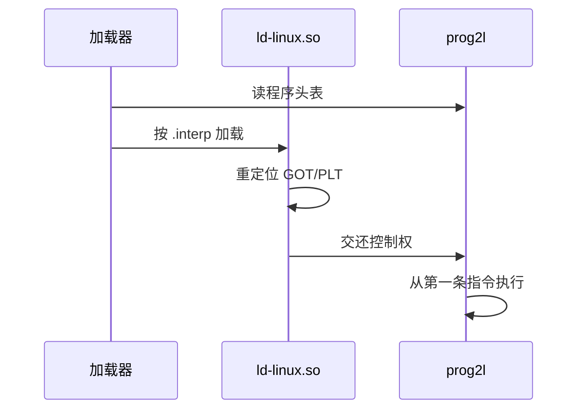

# 加载时动态链接与位置无关代码（PIC）

## 什么是加载时动态链接

静态链接把库代码直接复制进可执行文件，带来两个麻烦：磁盘上每个程序都存一份 `printf` 的副本，内存里运行多份时又各占一份物理页。加载时动态链接的思路是：==链接时不把库代码复制进可执行文件，推迟到程序加载时，由动态链接器把共享库映射进地址空间并完成重定位==。

以 `main → addvec → printf` 为例，可执行文件 `prog2l` 的程序头表中有一个特殊的 `.interp` 段，里面存着动态链接器的路径名（如 `/lib64/ld-linux.so`）。加载器读到它之后，不是直接跳转到 `main`，而是先加载并启动动态链接器：



动态链接器完成 GOT/PLT 等重定位工作后，才把控制权交给 `prog2l`，从入口点执行。

## 为什么需要位置无关代码

共享库被加载到哪个地址，编译时无法预知；同一台机器上不同程序甚至可能把它映射到不同虚拟地址。如果库代码里写死了绝对地址，加载器就得逐条修改指令——既慢，又会破坏代码段在进程间的共享（每个进程都要一份私有的、改过的副本）。

解决办法就是 ==PIC（位置无关代码）==：代码中不出现任何绝对地址，所有寻址都相对于当前指令位置（PC）计算，因此无论被加载到哪个地址都能正确运行。用 `gcc -fPIC` 即可指示编译器生成 PIC 代码，共享库必须这样编译。

> [!IMPORTANT]
> 要实现动态链接，必须生成 PIC 代码。链接器无需修改代码即可将共享库加载到任意地址运行；即使共享库代码长度变化，也不影响调用它的程序。

## 四类引用的处理方法

PIC 的关键是把"位置无关"贯彻到每一种引用。可以问自己：代码里可能出现的引用，哪些地址是编译期未知的？

| 引用情况 | 地址是否已知 | 处理办法 |
|---|---|---|
| 模块内过程调用/跳转 | 相对偏移固定 | PC 相对寻址 |
| 模块内数据（全局/静态变量） | 与代码距离固定 | PC 相对寻址 |
| 模块外过程调用 | 运行期才确定 | PLT + GOT 间接跳转 |
| 模块外数据访问 | 运行期才确定 | GOT 间接取址 |

前两类在模块内部，目标与当前指令的距离在链接期就是常数，直接写成 `call rel32`、`jmp rel32` 或 `lea offset(%rip), %reg` 即可。后两类跨模块，地址要到运行期由动态链接器填进 GOT，代码通过 GOT 间接拿到真实地址。

## 从反汇编里读出 PIC

看 `main` 中的两条 `lea`：

```
4011b6: lea 0xe47(%rip),%rdi   # 取字符串常量的地址
4011bd: call 401080 <__isoc99_scanf@plt>
4011c6: call 401176 <f1>
```

第一条 `lea 0xe47(%rip),%rdi` 是模块内数据访问：`%rip` 是当前指令下一条的地址（`0x4011bd`），加上 `0xe47` 得到 `0x402004`，全程不依赖绝对地址，这就是 PC 相对寻址。第二条 `call` 目标是 `__isoc99_scanf@plt`——`@plt` 后缀说明它跳进了过程链接表（PLT），PLT 再从 GOT 里取出 `scanf` 的真实地址完成间接跳转，这就是模块外调用的标准做法。

而 `call 401176 <f1>` 直接给出模块内目标地址，同样是 PC 相对跳转。

> [!WARNING]
> 易错点：不要把 `lea 0xe47(%rip),%rdi` 当成"加载地址 `0xe47` 处的数据"。`0xe47` 只是相对偏移，真实地址 = 下一条指令地址 + 偏移。另外 `endbr64` 是间接跳转目标的安全标记，与 PIC 无关，读反汇编时可忽略。

> [!TIP]
> 看到 `@plt` 就想到"跨模块调用"；看到 `(%rip)` 就想到"PC 相对、位置无关"。两者结合，就是动态链接下 PIC 的典型痕迹。
