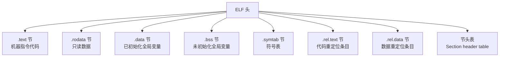

# 可重定位目标文件格式（ELF头信息举例、各节的作用）

## 可重定位目标文件：谁也看不懂的“半成品”

在 C 程序变成可执行文件之前，需要先经过**预处理、编译、汇编**三步，生成一个中间产物——**可重定位目标文件**（`.o` 或 `.obj`）。它不是完整的程序，只是你写的那个 `.c` 文件的“编译结果快照”。符号地址还没最终确定，像一本只有章节内容却没有页码的书——链接器（Linker）的任务就是给这些“章节”配上最终的内存地址，并把多个目标文件拼成一个完整的可执行文件。

**为什么需要它？**
- **模块化编译**：你改了 `main.c`，只需要重新编译 `main.c` → `main.o`，不用把整个项目从头编译一遍。
- **链接基础**：无论静态链接还是动态链接，入口都是可重定位目标文件。

### ELF 头里藏了什么？

Unix / Linux 系统使用 **ELF**（Executable and Linkable Format）格式。每个 `.o` 文件一开头就是 **ELF 头**，它像身份证一样定义了这个文件的基本属性：

| 字段       | 含义举例 | 作用的例子 |
| :--- | :--- | :--- |
| ELF 魔数   | 前 4 字节 `\x7fELF` | 文件类型识别 |
| 类别       | 32 位 / 64 位 | 决定指令宽度 |
| 数据编码   | 小端 / 大端 | 跨平台兼容 |
| 操作系统   | Linux / ... | ABI 约束 |
| 目标文件类型 | `REL`（可重定位） | 告诉链接器这是“半成品” |
| 机器类型   | `x86-64` 等 | 架构匹配 |
| 节头表偏移 | 节头表起始位置 | 定位各节 |

`readelf -h main.o` 就能看到上面这些信息。

### ELF 文件的构成：各节各司其职

ELF 头之后，是按功能划分的“节”（Section），每个节都是字节序列，用途明确：



> [!IMPORTANT]  
> 核心考点：这些节各自存什么、为什么分 `.data` / `.bss`  

- **`.text`**：==机器指令==。编译后的汇编代码就躺在这儿。  
- **`.rodata`**：==只读数据==。`printf` 的格式串、`switch` 的跳转表，全在这。不能写，只能读。  
- **`.data`**：==已初始化的全局变量==。比如 `int count = 10;`，**占据磁盘空间**，因为初始值必须存下来。  
- **`.bss`**：==未初始化的全局变量==，**不占实际磁盘空间**，只是一个标记位。比如 `int arr[1000000];`，完全没必要在 `.o` 文件里占 4MB 的空间——链接时再分配内存即可。这纯粹是为了**空间效率**。

> [!TIP]  
> 记法：**B**etter **S**ave **S**pace（省空间） → 不初始化的全局变量扔进 `.bss`。  

- **`.symtab`**：==符号表==，记录本模块定义和引用的全局符号（函数、全局变量）。  
  - 有哪些符号？局部 `static` 变量 / 函数、外部引用的函数（如 `printf`）、本模块定义的全局变量。  
  - 注意：**局部变量（栈上的临时变量）不在符号表里**，链接器不关心它们。  

- **`.rel.text`** 与 **`.rel.data`**：==重定位条目==。链接器不知道最终地址，所以把所有“需要填地址的地方”都记在这两个节里。  
  - **`.rel.text`**：代码中未确定的地址引用（如 `call <函数>` 的偏移量）。  
  - **`.rel.data`**：数据中未确定的地址引用（如指向全局变量的指针）。  

- **节头表**：元数据表，记录所有节的名称、大小、在文件中的偏移等，给链接器“导航”用。

### 一个重定位计算的例子

你写 `main.c`，调用了外部函数 `swap`。汇编器不知道 `swap` 的地址，只能预留 0：

```asm
d:  e8 00 00 00 00    call 12 <main+0x12>
    偏移: R_X86_64_PLT32  swap-0x4
```

链接时，假设：  
- `main` 从 `0x401106` 开始。  
- `swap` 紧跟 `main` 之后，`main` 长度 `0x1C`，所以 `swap` 在 `0x401122`。  
- **PC 相对地址**的偏移 = 目标地址 - 下一条指令地址  
  下一条指令地址 = `ADDR(.text) + r.offset - r.addend`  
  = `0x401106 + 0x0e - (-4)` = `0x401118`  
- 计算偏移：`0x401122 - 0x401118 = 0xa`

最终机器码变成：  
`e8 0a 00 00 00`（小端，0xa 放在第一字节）。

> [!WARNING]  
> 常见坑：算 PC 时**不要忘了 `r.addend`**。在 `R_X86_64_PLT32` 中，`r.addend = -4`，补回来才行。很多人直接用 `当前指令地址 + offset` 当 PC，少减了个 4，算出来偏移总是少 4 字节。
