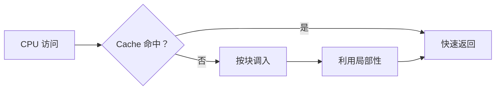

# 局部性原理（时间局部性与空间局部性）

## 局部性是什么

程序访问存储器时，地址并不是均匀随机分布的，而是倾向于集中在一小片区域，这就是**局部性原理**。它分两种：

- **时间局部性**：刚被访问过的数据或指令，很可能不久后再次被访问。例如循环体反复执行、循环变量反复读写。
- **空间局部性**：刚被访问地址附近的数据或指令，很可能随后被访问。例如顺序执行指令、依次遍历数组。

> [!IMPORTANT]
> ==时间局部性强调“同一地址会再用”，空间局部性强调“附近地址会接着用”。== 前者支持保留近期内容，后者支持按块预取相邻内容。

## 为什么存储器层次结构依赖它

SRAM 快而贵，DRAM 较慢，磁盘更慢但容量大。若访问完全随机，把数据放入 Cache 的收益很有限；局部性使“小容量高速存储器保存当前活跃信息”成为可能。

Cache 不命中时通常调入整个**块**，而不只是所需字节：空间局部性使同块其他字节可能随后使用；时间局部性则使近期装入的块值得暂时保留。虚拟存储器中的**工作集**思想同样依赖局部性：一段时间内集中使用的页面应尽量留在内存，TLB 也能缓存近期页表项。

## 怎样判断程序的局部性

看访问序列时，先问两个问题：同一地址是否反复出现？相邻地址是否连续出现？

| 程序行为 | 时间局部性 | 空间局部性 |
|---|---|---|
| 循环反复执行同一小段代码 | 好 | 通常较好 |
| 顺序遍历一维数组 | 单元素通常弱 | 好 |
| 以大步长跨数组访问 | 通常弱 | 较差 |
| 随机访问大量数据 | 通常弱 | 弱 |

例如按行优先存储的二维数组 `a[M][N]`，用 `for i` 外层、`for j` 内层访问 `a[i][j]`，地址连续，空间局部性好；若交换循环顺序，按列跳跃访问，就可能增加 Cache 不命中。

## 一个算对的例子

设 Cache 块大小为 $4\ \mathrm B$，程序依次读取字节地址 $100,101,102,103$，随后再次读取地址 $100$，且该块未被替换。

- 首次读 $100$ 不命中，将地址 $100\sim103$ 的整个块调入。
- 读 $101,102,103$ 均命中，体现==空间局部性==。
- 再次读 $100$ 命中，体现==时间局部性==。

因此共 $1$ 次不命中、$4$ 次命中，命中率为
$$
\frac{4}{5}\times100\%=80\%.
$$

> [!WARNING]
> “访问过附近地址”不等于时间局部性；时间局部性必须是**同一数据或指令再次使用**。另外，首次访问某块产生的不命中不能因空间局部性好而省略。

## 与相近概念的区别

局部性是程序访问呈现的规律，Cache、TLB 和虚拟存储器是利用这一规律的机制；**命中率**是运行结果，不是局部性的同义词。空间局部性好也不保证一定命中，因为还受块大小、映射方式、替换策略和访问间隔影响。时间局部性同样不保证数据一直留在 Cache 中，冲突替换仍可能将其移出。

> [!TIP]
> 答题时按“重复访问看时间，相邻访问看空间；保留近期内容靠时间，按块预取靠空间”判断。
