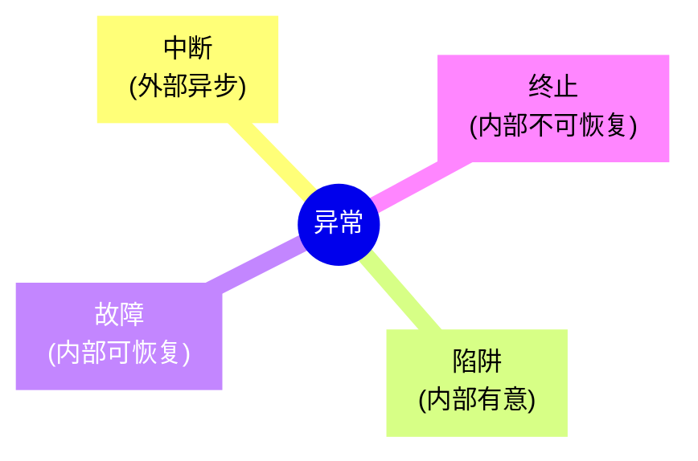
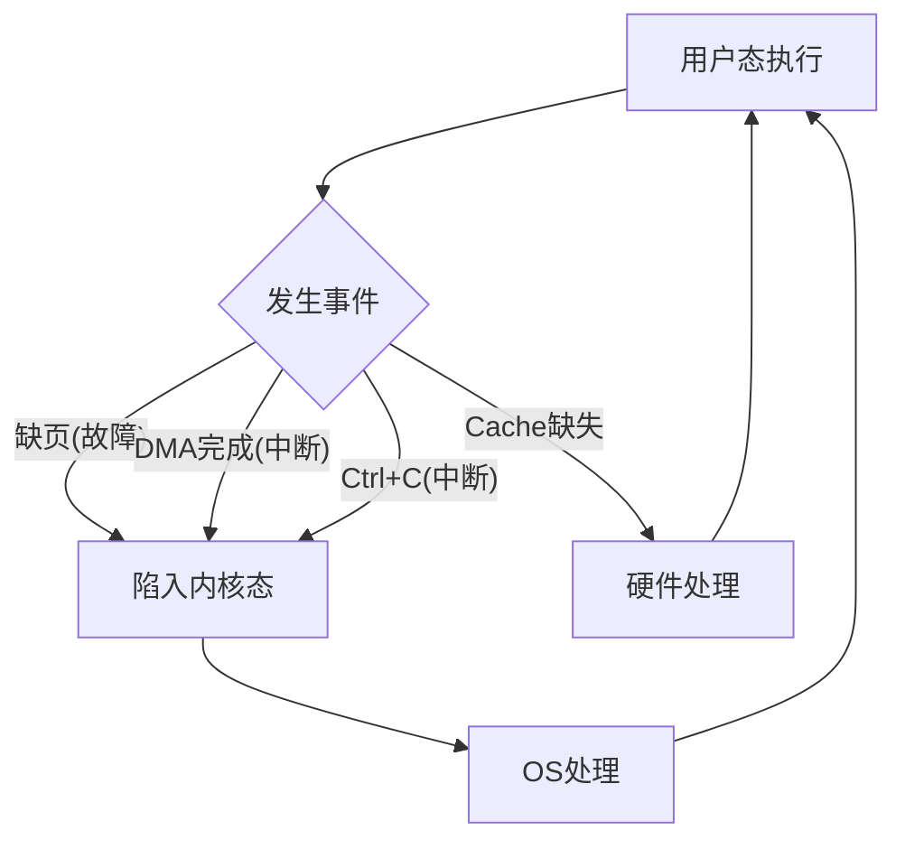

# 异常控制流机制（异常、陷阱、中断、故障、终止）

正常程序是一条指令接一条指令顺序执行的，但如果除数为 $0$ 了怎么办？如果用户程序想读文件（需要操作系统权限）怎么办？CPU 不能“假装无事发生”，必须有一种机制打断当前流程，跳转到专门的处理代码。这就是==异常控制流（Exceptional Control Flow, ECF）==。

## 异常的分类与辨析

在《计算机系统基础》中，“异常”是广义概念，指任何打断正常执行流的事件。根据**来源**和**行为**，它被细分为四类：

| 类别 | 来源 | 是否异步 | 返回行为 | 典型例子 |
| :--- | :--- | :--- | :--- | :--- |
| **中断 (Interrupt)** | 外部 I/O 设备 | 异步 | 返回下一条指令 | 键盘输入、DMA 传送完成 |
| **陷阱 (Trap)** | 内部指令 | 同步 | 返回下一条指令 | `int 0x80` 系统调用 |
| **故障 (Fault)** | 内部指令 | 同步 | ==重新执行当前指令== | 缺页异常 |
| **终止 (Abort)** | 内部硬件错误 | 同步 | 不返回，直接结束 | 硬件奇偶校验错 |

> [!IMPORTANT]
> ==故障处理完后会重新执行引发故障的那条指令==，而陷阱和中断处理完后执行的是下一条指令。这是考试最爱考的区分点。

- **中断**来自 CPU 外部，与当前执行的指令无关（异步）。
- **陷阱**是程序员“故意”触发的，目的是从用户态陷入内核态请求服务。
- **故障**是执行指令时遇到的潜在可恢复错误。OS 处理完（如把缺失的页调入内存）后，让该指令再跑一次。
- **终止**是致命的硬件错误，无法挽救。

## 特权级切换：为什么会陷入内核态？

思考一个问题：Cache 缺失会引起从用户态陷入内核态吗？

不会。因为 Cache 缺失完全由==硬件自动处理==，对操作系统和应用程序都是透明的，不需要 OS 介入，自然不涉及特权级切换。

> [!WARNING]
> 浮点数除以 $0$ 的结果是 $\pm \infty$，==不会触发溢出异常==！只有**整数**除以 $0$ 才会触发异常（故障或终止）。这是课件特别强调的坑。

## 真题实战

来看这道经典选择题：

> 以下给出的选项中，不会引起从用户态陷入内核态的是（）。
> A. 执行指令过程中发生缺页
> B. DMA 传送完成
> C. 执行指令过程中发生 cache 缺失
> D. 按下 `Ctrl+C` 键

**逐步分析：**

1. **A. 缺页**：属于**故障**。当前页不在内存，必须让 OS 介入调页，因此会陷入内核态。
2. **B. DMA 完成**：属于**中断**。外设通过中断信号通知 CPU，CPU 响应中断进入内核态处理。
3. **C. Cache 缺失**：纯硬件行为。CPU 自动去主存取数据填入 Cache，整个过程无需 OS 参与，==不会改变特权级==。
4. **D. Ctrl+C**：终端产生外部**中断**，OS 捕获后会向进程发送信号，需陷入内核态。

> [!TIP]
> 判断是否陷入内核态的核心标准：这件事需不需要操作系统出面解决？需要就陷，不需要（如 Cache 缺失、TLB 命中）就不陷。

**答案：C**
