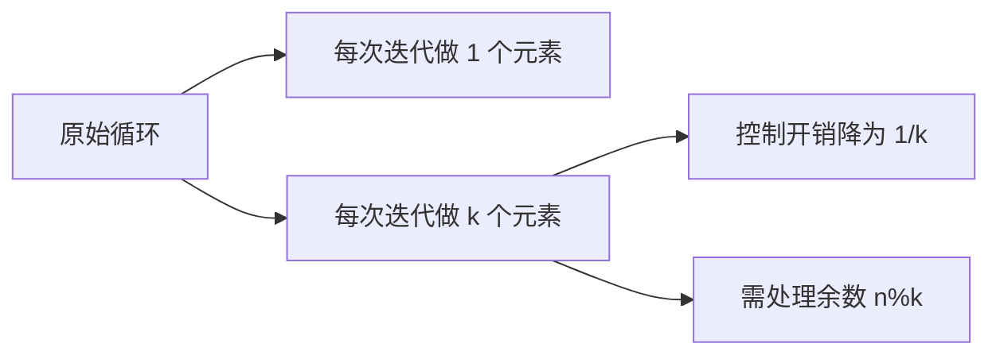
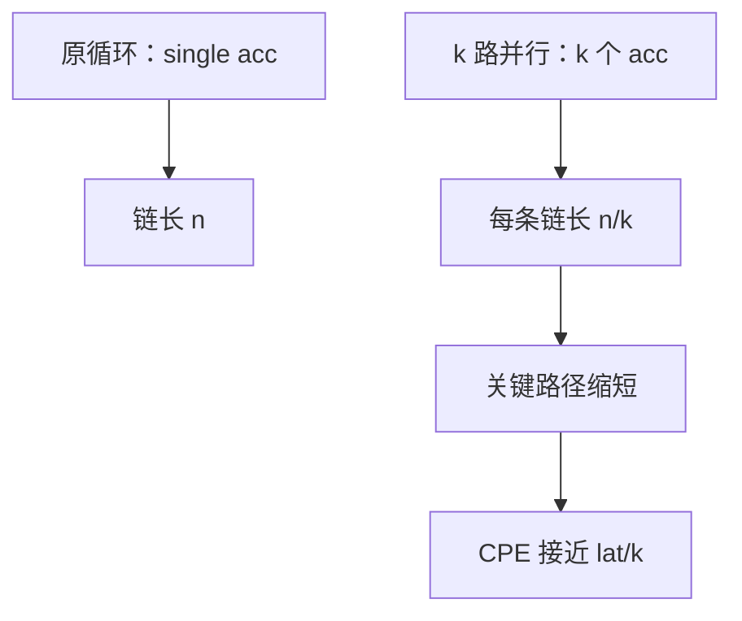
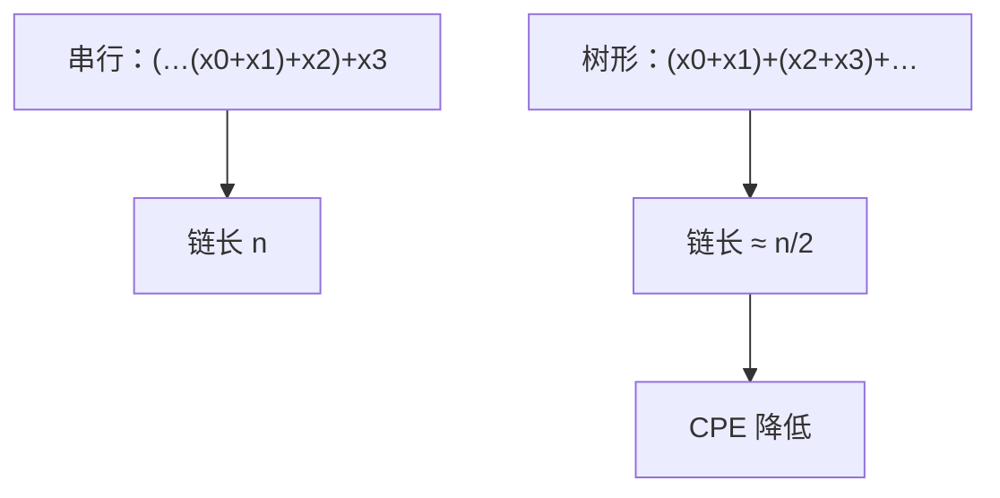

# 循环展开、多路并行与结合律变换

## 循环展开

循环展开就是每次迭代不只做原循环一件事，而是把**后面几次迭代的循环体一起做完**，从而减少循环控制开销（比较、跳转、计数器更新）在总执行时间中的占比。

```c
// 展开前
for (i = 0; i < n; i++)
    a[i] = b[i] + c[i];

// 2×2 展开后
for (i = 0; i < n - 1; i += 2) {
    a[i]   = b[i]   + c[i];
    a[i+1] = b[i+1] + c[i+1];
}
// 处理剩余元素（n 为奇数时补一次）
```



[!IMPORTANT]
> 循环展开的本质是**用更多代码换取更少的循环控制开销**，它本身不改变指令级并行，只是为后续优化（如多路并行）创造机会。

**为什么需要？** 现代 CPU 是流水线结构，循环的 `cmp/jump` 指令会打断执行流，分支预测失败代价高。展开后跳转次数减少，指令流更连续。

**常见的坑：**

[!WARNING]
> 展开后必须处理**尾部剩余元素**。若 `n` 不是展开因子 $k$ 的整数倍，直接访问 `a[i+k-1]` 会越界。正确做法是主循环跑 `n - (n % k)`，剩余部分单独处理。

[!TIP]
> 编译器 `-O1` 及以上等级会自动做循环展开，手工展开不一定比编译器好。考试中手工展开的价值在于**配合多路并行**。

---

## 多路并行

多路并行就是把一个循环的计算拆成**多个独立的累加器（或结果链）**，每条链各自维护自己的部分和，最后合并。目的是打破单条数据依赖链对吞吐率的限制。

对比 CPE（每元素周期数）就清楚了：

| 方案 | 累加器数 | 关键路径 | CPE（以浮点乘为例） |
|------|---------|---------|--------------------|
| 朴素循环 | 1 | 串行 lat 链 | ≈ lat（如 5.00） |
| 循环展开但不并行 | 1 | 仍串行 | ≈ lat（如 5.00） |
| ==多路并行== | k | 每条链长度 ÷k | ≈ lat / k |



[!IMPORTANT]
> ==多路并行的核心是打破数据依赖链==。如果只用循环展开但始终写同一个累加器 `sum += ...`，关键路径长度仍是 $n$，CPE 不变。

**怎么做（以 4 路并行求内积为例）：**

```c
float inner4(vec_ptr u, vec_ptr v) {
    long i;
    float acc0 = 0, acc1 = 0, acc2 = 0, acc3 = 0;
    long limit = len - 3;
    for (i = 0; i < limit; i += 4) {
        acc0 += u[i]   * v[i];
        acc1 += u[i+1] * v[i+1];
        acc2 += u[i+2] * v[i+2];
        acc3 += u[i+3] * v[i+3];
    }
    for (; i < len; i++)
        acc0 += u[i] * v[i];        // 剩余元素
    return (acc0 + acc1) + (acc2 + acc3);  // 合并
}
```

这里 `acc0~acc3` 四条链互不依赖，CPU 的多个浮点单元可以同时运算，单条链的长度从 $n$ 降为 $n/4$。

---

## 结合律变换

结合律变换就是通过**改变运算的先后顺序**（重新加括号）来缩短关键路径。对于整数加法，结果完全相同；对于浮点数，结果会有舍入差异。

```c
// 变换前（串行链，CPE = lat）
sum = ((((a[0] + a[1]) + a[2]) + a[3]) + ...);

// 变换后（树形结构，CPE 接近 lat/log₂k）
sum = (a[0] + a[1]) + (a[2] + a[3]) + ...;  // 或分治成对求和
```



[!CAUTION]
> 浮点运算不满足结合律。$(a+b)+c$ 与 $a+(b+c)$ 的舍入结果可能不同。编译器在 `-O2` 下也**不做浮点结合律变换**，除非显式用 `-ffast-math`。考试中如要求“优化程序性能”可做此变换，但需注明浮点结果可能有舍入差异。

**三者的关系：**

[!NOTE]
> 循环展开是“减少控制开销”，多路并行是“拆依赖链用满多个功能单元”，结合律变换是“重排运算缩短关键路径”。三者常组合使用：先展开，再给展开体配多个累加器（多路并行），最后用树形结合汇总。

---

## 一个算对了的例子

**题目**：某处理器整数加法延迟为 1 个周期，浮点乘法延迟为 5 个周期，除法延迟为 12 个周期。对数组 `a[0..n-1]`（`n = 1000`）求元素和。总周期数如何随优化变化？

**解**：

| 方案 | 关键路径长度 | 总周期（忽略其余开销） |
|------|------------|----------------------|
| 朴素 `sum += a[i]` | $1000 \times 1 = 1000$ | 1000 |
| 循环展开 ×2（仍单累加器） | $1000 \times 1 = 1000$ | 1000（不改善） |
| 两路并行 | $1000/2 \times 1 = 500$ | ==500== |
| 四路并行 | $1000/4 \times 1 = 250$ | ==250== |

[!TIP]
> 若把题目中的加法换成浮点乘法（lat=5），则朴素 CPE=5.00，两路并行 CPE≈2.50，四路并行 CPE≈1.25，展开不并行仍是 5.00——这就是“展开不加速，并行才加速”的典型考点。

[!WARNING]
> 手工优化前先确认瓶颈确实是**延迟受限**。如果循环体里有 `printf` 或数组访问不命中缓存，内存延迟（数百周期）会完全淹没这几周期的差别，优化运算顺序毫无意义。
