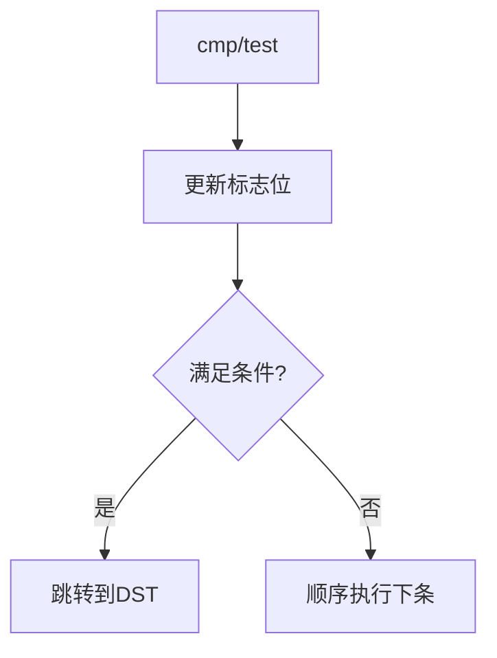

# 控制流指令（cmp、test、jmp、jxx、setxx）

> [!IMPORTANT]
> 控制流指令是机器级程序实现分支、循环等逻辑的基石，核心由==比较/测试指令==与==跳转指令==配合完成。

## 它是什么与为什么需要

高级语言中的 `if`、`while`、`for` 在机器级如何表示？CPU 只能顺序取指执行，要改变执行方向，就必须借助**控制流指令**。

一个完整的条件判断通常分两步：
1. **设置条件码**：用 `cmp` 或 `test` 产生标志位（CF、ZF、SF、OF）。
2. **根据条件码跳转**：用 `jmp`（无条件）或 `jxx`（有条件）决定下一条指令地址。



## 怎么做：三类核心指令

### 比较与测试

- `cmp S1, S2`：计算 $S2 - S1$（AT&T 语法中操作数顺序为 `cmp src, dst`），**只更新标志位，不保存结果**。
- `test S1, S2`：计算 $S1 \text{ AND } S2$，同样只更新标志位。常用于判断寄存器是否为零（如 `test %rax, %rax`）。

### 跳转指令

| 类别 | 指令格式 | 说明 |
| :--- | :--- | :--- |
| 无条件直接跳转 | `jmp 标号` | 直接修改 PC 到目标地址 |
| 无条件间接跳转 | `jmp *%rdx` / `jmp *(%rdx)` | 目标地址存在寄存器或内存中（常用于 `switch`） |
| 条件跳转 | `jxx 标号` | xx 代表条件，如 `je`（ZF=1）、`jg`（SF=OF 且 ZF=0） |

> [!WARNING]
> 区分无符号与带符号比较！无符号看 `ja/jb`（依赖 CF、ZF），带符号看 `jg/jl`（依赖 SF、OF、ZF）。混用会导致边界溢出时判断错误。

### 条件设置指令 `setxx`

`setxx DST` 根据条件码将单字节目标置为 0 或 1，**不引起跳转**，常用于将布尔结果存入变量。

## 相近概念的区别

| 对比项 | `cmp` | `test` |
| :--- | :--- | :--- |
| 底层运算 | 减法 $S2 - S1$ | 按位与 $S1 \text{ AND } S2$ |
| 典型用途 | 比较大小、判断相等 | 判零、检测特定位 |

| 对比项 | `jmp` | `call` |
| :--- | :--- | :--- |
| 压栈行为 | 不压栈 | 将返回地址压入栈 |
| 用途 | 循环/分支内跳转 | 过程调用 |

## 常见坑与编码细节

> [!CAUTION]
> 跳转指令的机器码采用**相对偏移量**编码，而非绝对地址！偏移量 = 目标地址 - 跳转指令下一条指令的地址。

以课件中的反汇编为例：

| 地址 | 机器码 | 汇编指令 |
| :--- | :--- | :--- |
| 3 | `eb 03` | `jmp 8` |
| 5 | `48 d1 f8` | `sar %rax` |
| 8 | `48 85 c0` | `test %rax,%rax` |

`jmp` 在地址 3，占 2 字节，下一条指令地址为 5。机器码第二字节为 `03`，因此目标地址 $= 5 + 3 = 8$。

## 算对了的例子

来看这道真题：解释以下两条指令的作用并对照 C 语句。

```text
401192: 39 f8    cmp %edi,%eax
401194: 7c f5    jl 40118b <f1+0x15>
```

**逐步分析：**

1. `cmp %edi,%eax`：计算 `%eax - %edi` 并设置标志位。`%edi` 存第一个整型参数（如 `x`），`%eax` 存某变量（如 `y`）。
2. `jl 40118b`：`jl` 是带符号“小于则跳转”（Jump if Less，即 $\text{SF} \neq \text{OF}$）。偏移量为 `f5`（补码即 $-11$），下一条指令地址为 $401194 + 2 = 401196$，目标地址 $= 401196 + (-11) = 40118b$，计算吻合。

> [!TIP]
> 这两条指令组合对应的 C 代码逻辑就是：`if (y < x) goto loop_label;`，通常出现在 `while` 循环的条件判断处。遇到此类题，先找 `cmp` 的两个操作数对应哪个变量，再看 `jxx` 的跳转方向即可。
