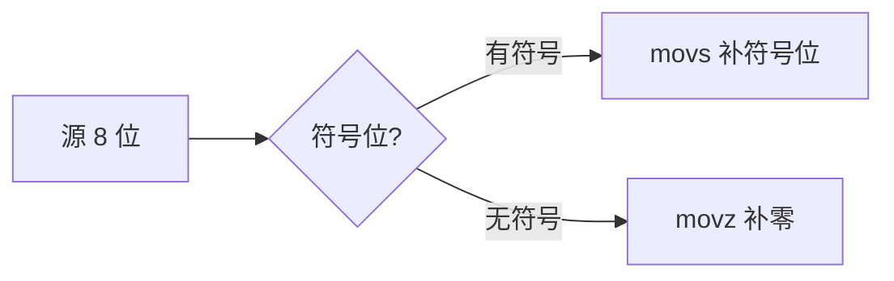
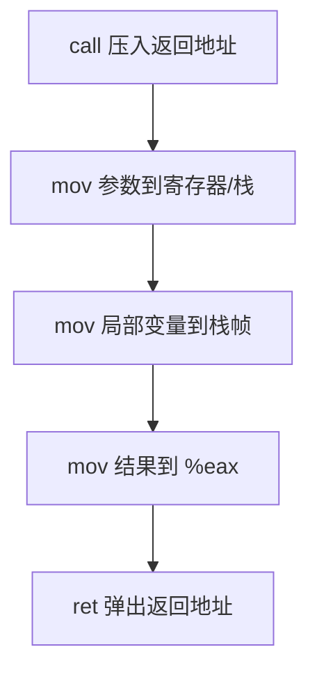

# 数据传送指令（mov、movs、movz及扩展）

数据传送指令是机器级程序中出现频率最高的一类指令。它不改变数据的值，只把操作数从一处==搬到==另一处——从立即数到寄存器、从寄存器到寄存器、在寄存器与存储单元之间来回搬运。学好它，是读懂汇编、分析栈帧、理解调用约定的前提。

## mov 家族：先把"搬"这件事做对

x86-64 的 `mov` 系列按"是否做符号/零扩展"分成几档，名字后缀说明了操作数宽度，也决定了搬运后高位怎么补。

| 指令 | 含义 | 典型用途 |
|---|---|---|
| `mov` | 原样复制，宽度由后缀 `b/w/l/q` 决定 | 通用搬运 |
| `movs` | 带符号扩展后搬运 | 把小类型转为大类型（如 `char` → `int`） |
| `movz` | 零扩展后搬运 | 无符号类型扩展（如 `unsigned char`） |

`mov` 的常见形式（AT&T 记号 `mov src, dst`，源在前、目的在后）：

```text
mov $0x12345678, %eax      # 立即数 → 寄存器
mov %rdi, %rax             # 寄存器 → 寄存器
movw %ax, %dx              # 16 位寄存器互搬
mov 0x4(%rsp), %edi        # 内存 → 寄存器
mov %rax, 0x8(%rsp)        # 寄存器 → 内存
```

> [!NOTE]
> `mov` 不能直接"内存 → 内存"。若要搬，必须经寄存器中转，先 `mov` 到寄存器，再 `mov` 到目标内存。

## 小端法：多字节操作数怎么放

x86-64 采用 ==小端法==：低位字节放在==低地址==，高位字节放在相邻的==高地址==。以 `mov $0x12345678, %eax` 为例：

```text
地址 40110a: 78 56 34 12    ← 0x78 是最低位字节，放在最低地址
```

若在调试器中直接看 `objdump` 的机器码，`b8 78 56 34 12` 中 `b8` 是 `mov` 到 `%eax` 的操作码，后面 5 个字节正是立即数，按小端展开就是 `0x12345678`。

## movs 与 movz：扩展的两种态度

把小宽度搬到大宽度时，高位要补齐。==补什么，取决于源操作数的类型==：

| 指令 | 语义 | 适用 C 类型 |
|---|---|---|
| `movsbl %al, %eax` | 按符号扩展后搬到 `%eax` | `char` → `int` |
| `movzbl %al, %eax` | 按零扩展后搬到 `%eax` | `unsigned char` → `unsigned int` |



> [!TIP]
> 记忆口诀：==`movs` 认"号"，`movz` 认"零"==。C 里 `signed` 用 `movs`，`unsigned` 用 `movz`。

## 寻址方式：操作数到底在哪

`mov` 的操作数可以来自多个地方。南邮课件把寻址方式分为：

- **立即寻址**：操作数直接在指令中，如 `$0x12345678`
- **寄存器寻址**：操作数在寄存器，如 `%rax`
- **存储器操作数**：按字节编址，分
  - 绝对寻址（直接给出地址）
  - 基址 + 偏移量寻址：`mov 0x8(%rsp), %rax`
  - 间接寻址：寄存器里存的就是地址
- **I/O 端口寻址**：访问外设端口

> [!WARNING]
> AT&T 记号 `mov 0x4(%rsp), %edi` 中，`0x4(%rsp)` 是==内存==而不是"把 4 加到 rsp 再搬到 edi"。括号里的是基址寄存器，括号外的是偏移量，最终地址 = 基址 + 偏移量。

## 栈帧中的 mov：把知识用起来

过程调用时，`mov` 承担了保存返回地址、传递参数、布置局部变量、恢复现场的全部工作。下面是常见场景：



## 一个算对的例子

指令序列：

```text
401196: 89 c8          mov %ecx,%eax
4011cb: 89 c2          mov %eax,%edx
```

若执行前 `ECX = 0x00000001`，则：

- `mov %ecx, %eax`：`EAX ← 0x00000001`（==32 位搬运会自动把 %rax 高 32 位清零==）
- `mov %eax, %edx`：`EDX ← 0x00000001`

最后 `%eax = %edx = %ecx = 0x00000001`。

> [!CAUTION]
> 常见误区：以为 `mov` 搬 32 位时只影响低 32 位。实际上在 x86-64 中==对 32 位寄存器的任何写操作都会把 %rax 等 64 位寄存器的高 32 位清零==，而对 8 位、16 位寄存器写入则不会。

## 易错小结

- AT&T 顺序 `mov src, dst`，别和 Intel `mov dst, src` 混。
- `mov` 不支持内存到内存；扩展用 `movs` / `movz`。
- 多字节立即数在指令中按小端展开，读反了会看错值。
- 32 位写会清高 32 位，8/16 位写不会，调试时容易被坑。
