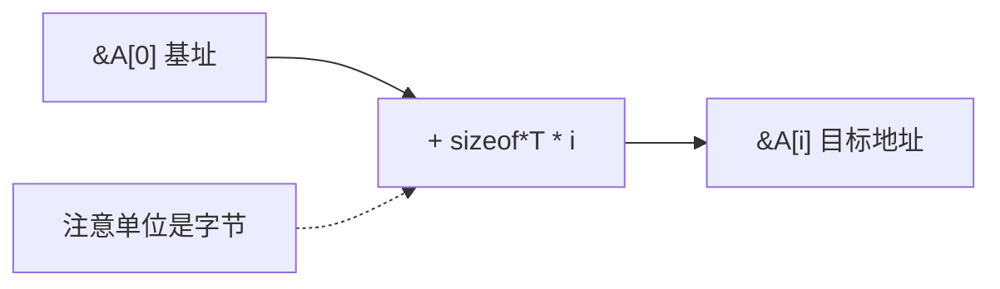

# 数组、结构体和联合的内存分配与访问

> [!IMPORTANT]
> 核心定义：在机器级表示中，==数组名 `A` 本质上是一个指向首元素的指针（`T*`）==，而非存放所有元素的“容器”。

## 它是什么与为什么需要

C 语言里我们写 `int A[5];`，但在第 3 章的汇编视角下，CPU 并不认识“数组”这个概念。编译器必须把高级语言的数组访问翻译成**基址 + 偏移量**的内存寻址模式。理解这一点，才能看懂 x86-64 汇编中形如 `(%rax, %rdx, 4)` 的操作数到底在算什么地址。

## 怎么做：分配与寻址公式

对于声明 `T A[L];`（类型 `T`，长度 `L`）：

- **分配**：在栈或数据段连续划出 $L \times \text{sizeof}(T)$ 字节。
- **标识符**：`A` 代表数组起始地址，类型为 `T*`。
- **索引**：用 $0$ 到 $L-1$ 的整数访问元素。
- **地址计算**：第 $i$ 个元素的地址为：

$$\&A[i] = \&A[0] + \text{sizeof}(T) \times i$$

> [!TIP]
> 记忆口诀：**地址 = 起点 + 步长 × 第几步**。步长就是 `sizeof(T)`。

## 算对了的例子

假设 `int A[5];`，已知 `%rax` 存的是 `&A[0]`，其值为 `0x100`；`%rdx` 存的是索引 `i=1`。我们要访问 `A[1]`。

根据公式，`int` 的 `sizeof` 为 4，所以：
$$\&A[1] = 0x100 + 4 \times 1 = 0x104$$

对应 x86-64 的变址寻址操作数写法为 `(%rax, %rdx, 4)`。若此时内存地址 `0x104` 处存的值是 `0xab`，那么执行 `mov (%rax, %rdx, 4), %ecx` 后，`%ecx` 的值就是 `0xab`。

> [!WARNING]
> 课件表格中常出现 `0x104` 对应值 `0xab` 的表述。务必分清：==带括号的 `(%rax)` 或 `4(%rax)` 是访存（取值），不带括号的 `$0x104` 是立即数（值本身）==。

## 结构体、联合体与数组的区别

| 特性 | 数组 `T A[L]` | 结构体 `struct S` | 联合体 `union U` |
| :--- | :--- | :--- | :--- |
| **内存布局** | 连续同类型元素 | 成员按顺序排列（含对齐填充） | ==所有成员共享同一块内存== |
| **总大小** | $L \times \text{sizeof}(T)$ | $\ge$ 各成员大小之和 | $\max(\text{各成员大小})$ |
| **访问方式** | 基址 + 比例因子×索引 | 基址 + 固定偏移量 | 基址 + 固定偏移量（通常为0） |

## 局部变量是数组或结构时

当局部变量是数组或结构体时，它们被分配在**栈帧**中。编译器通过 `%rbp`（或 `%rsp`）加上负偏移量来定位它们的起始地址。例如，若局部数组 `A` 的首地址在 `%rbp - 32`，则访问 `A[2]`（假设为 `int`）的汇编代码会计算 `%rbp - 32 + 2*4`，即 `%rbp - 24`。

> [!CAUTION]
> 常见坑：C 语言不检查数组越界！若 `i` 超出 $0 \sim L-1$，地址公式依然会机械地算出一个内存地址并去访问，导致**破坏相邻栈帧数据**或引发段错误。这也是缓冲区溢出攻击的根源。
