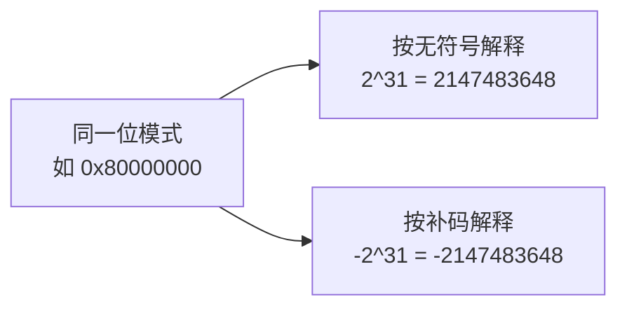

# 无符号数和有符号数的转换（位级不变，解释改变）

## 核心规则：位模式不变，解释方式改变

计算机中，无符号数和有符号数（补码）在机器层面都是一串二进制位。所谓"转换"，**不是改变这串位本身，而是改变 CPU（或编译器）对这串位的解释方式**。

> [!IMPORTANT]
> 处理同样字长的有符号数和无符号数之间相互转换的一般规则是：==数值可能会改变，但是位模式不变==。强制类型转换的结果保持位值不变，只是改变了解释这些位的方式。



## 为什么需要转换

C 语言中同时存在 `int` 和 `unsigned` 等类型。当发生强制类型转换、赋值或混合运算时，同一段二进制数据需要在两种解释之间切换。若不理解"位不变、解释变"，就无法预测程序输出，也无法正确分析标志位。

## 两种解释的数学关系

设字长为 $w$，位模式对应的无符号值为 $u$，补码值为 $t$：

- 无符号数范围：$0 \sim 2^w - 1$
- 补码范围：$-2^{w-1} \sim 2^{w-1} - 1$

转换公式：

$$t = \begin{cases} u, & u < 2^{w-1} \\ u - 2^w, & u \geq 2^{w-1} \end{cases}$$

$$u = \begin{cases} t, & t \geq 0 \\ t + 2^w, & t < 0 \end{cases}$$

**关键对应关系**：

| 位模式 | 无符号解释 | 补码解释 |
| :--- | :--- | :--- |
| 全 0（如 `0x00000000`） | $0$ | $0$ |
| 全 1（如 `0xFFFFFFFF`） | $UMax_w = 2^w - 1$ | $-1$ |
| 最高位 1 其余 0（如 `0x80000000`） | $2^{w-1}$ | $TMin_w = -2^{w-1}$ |

> [!NOTE]
> 注意：$-1$ 和 $UMax$ 有同样的位表示——一个全 1 的串；数值 $0$ 在两种表示方式中都是全 0 的串。补码的真值范围不对称，负数个数比正数多一个，且没有负零。

## 一个算对了的例子

考虑课件中的 C 代码：

```c
int x = -1;
unsigned u = 2147483648;
printf("x=%d u=%d\n", x, u);
```

**分析**：

1. $u = 2147483648 = 2^{31}$，其 32 位无符号表示为 `100…0`（最高位为 1，其余为 0），即 `0x80000000`。
2. `printf` 中 `u` 用 `%d` 打印，要求按**有符号 int** 解释。位模式不变，但 `0x80000000` 作为补码时，值为 $-2^{31} = -2147483648$。
3. `x = -1` 的补码为全 1，按 `%d` 正常输出 $-1$。

**输出结果**：

```
x=-1 u=-2147483648
```

## 常见坑与辨析

> [!WARNING]
> **格式符决定解释方式**：`%d` 按有符号解释，`%u` 按无符号解释。上例中若将 `u` 改用 `%u` 打印，则输出 `2147483648`；位模式始终是 `0x80000000`，只是解释不同。

> [!CAUTION]
> **混合运算的隐式转换**：C 语言中，当有符号数与无符号数混合运算时，有符号数会被隐式转换为无符号数（位模式不变）。例如 `-1 < 1U` 的结果为假，因为 `-1` 被解释为 $UMax$。

| 相近概念 | 区别 |
| :--- | :--- |
| 强制类型转换 | 位模式不变，仅改变解释方式 |
| 算术运算（如取负） | 位模式可能改变，得到新的数值 |
| 扩展字长 | 无符号数零扩展，有符号数符号扩展，位模式会变 |

> [!TIP]
> 解题口诀：**先看位模式，再看解释方式**。遇到转换题，先写出十六进制或二进制位串，再根据目标类型套公式：最高位为 0 时两者相等；最高位为 1 时，无符号值 = 补码值 + $2^w$。
