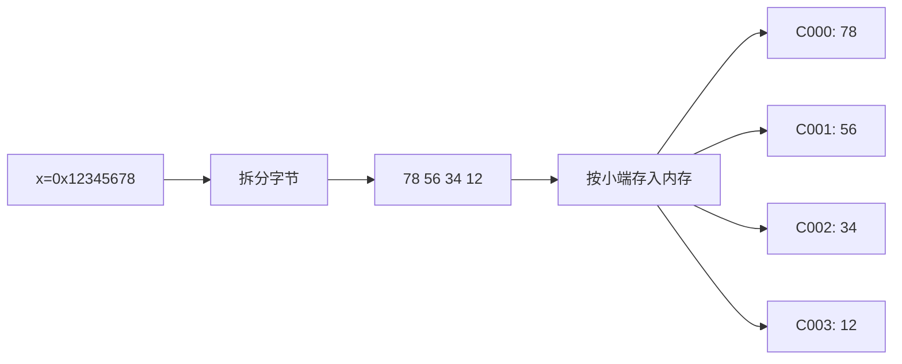

# 无符号整数编码（二进制加权求和）

## 无符号整数编码：二进制加权求和

如果给你一串机器位模式 `1011`，在不告知任何上下文时，它代表什么？要让它唯一对应一个数值，我们必须约定一种解释规则。对于不需要表示负数的场景（如内存地址、数组索引），计算机采用==无符号整数编码==。

### 核心定义与计算公式

无符号整数的本质是**二进制加权求和**。对于一个 $n$ 位的位向量 $\vec{x} = [x_{n-1}, x_{n-2}, \dots, x_0]$，其表示的十进制值 $B2U(\vec{x})$ 为：

$$
B2U(\vec{x}) = \sum_{i=0}^{n-1} x_i \cdot 2^i
$$

> [!IMPORTANT]
> ==每一位的权重由其位置决定==，最低位 $x_0$ 权重为 $2^0=1$，最高位 $x_{n-1}$ 权重为 $2^{n-1}$。这与补码编码中最高位权重为 $-2^{n-1}$ 形成本质区别。

该编码可表示的值范围为 $0 \sim 2^n - 1$。例如 8 位无符号数最大值为 $2^8-1=255$。

| C数据类型 | 位数 ($n$) | 最小值 | 最大值 ($2^n-1$) |
| :--- | :--- | :--- | :--- |
| `unsigned char` | 8 | 0 | 255 |
| `unsigned short` | 16 | 0 | 65,535 |
| `unsigned int` | 32 | 0 | 4,294,967,295 |

### 从位模式到存储：结合字节序理解

单纯掌握公式还不够，考试中常将无符号编码与**小端存储**结合考察。请看这道经典题：

> Intel机器中，`int x = 0x12345678` 存放在地址 `0xFFFFC000`，问 `0xFFFFC001` 的内容？

解题需分两步走：

1.  **拆分**：将 32 位无符号数按字节拆分为 `0x12`, `0x34`, `0x56`, `0x78`。
2.  **映射**：Intel 采用小端序，==低位字节存低地址==。因此 `0xFFFFC001` 存放的是次低字节 `0x56`。

> [!WARNING]
> 部分旧题库或印刷资料中此题答案可能误标为 `0x34`。请牢记：==标准小端模式下，偏移+1的地址永远对应次低字节==。若考试遇到选项无 `0x56`，再考虑题目是否暗指大端模式。

### 与有符号编码的关键区分

为什么要把无符号单独拿出来学？因为**相同的位模式在不同解释下数值完全不同**。

| 对比维度 | 无符号 (Unsigned) | 有符号补码 (Two's Complement) |
| :--- | :--- | :--- |
| 最高位含义 | 正常权重 $2^{n-1}$ | 负权重 $-2^{n-1}$ |
| 位模式 `10000000` | 128 | -128 |
| 零的表示 | 唯一 (`00...0`) | 唯一 (`00...0`) |
| 典型用途 | 地址、长度、掩码 | 算术运算、计数器 |

> [!TIP]
> 判断题型关键词：看到“地址”“索引”“大小”默认无符号；看到“运算结果”“比较大小”且未声明类型时，注意 C 语言中 `int` 默认为有符号补码。

### 计算验证示例

以 8 位位模式 `11101001` 为例，按无符号编码计算：

$$
\begin{aligned}
B2U &= 1\times2^7 + 1\times2^6 + 1\times2^5 + 0\times2^4 \\
&\quad + 1\times2^3 + 0\times2^2 + 0\times2^1 + 1\times2^0 \\
&= 128 + 64 + 32 + 8 + 1 = 233
\end{aligned}
$$

而同样的位模式作为补码时值为 $-23$。这再次印证：==编码本身只是位到数的映射函数，脱离解释规则的位模式没有意义==。掌握 $B2U$ 公式并时刻警惕字节序陷阱，是本章得分的关键。
