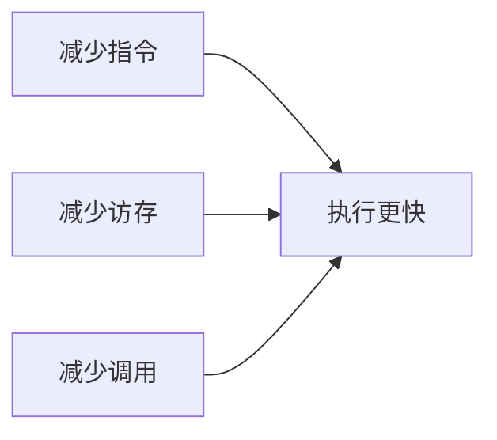
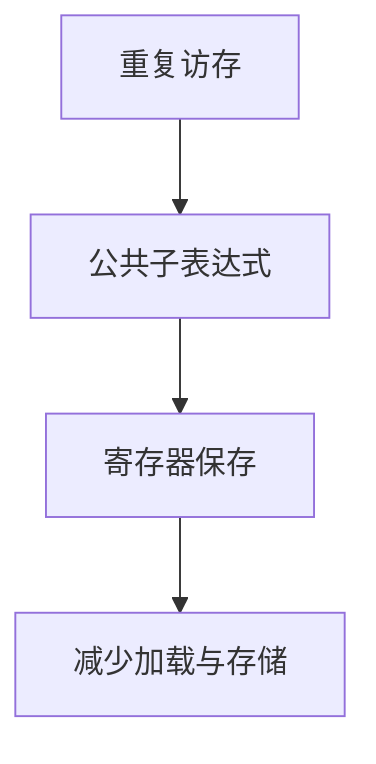

# 机器级优化策略（消除不必要的内存引用、减少过程调用）

## 优化目标与基本思路

机器级优化是指在程序语义不变的前提下，==让程序执行得更短、更快==。编译器虽然会自动完成部分优化，但程序员仍可通过改写代码减少指令数、访存次数和过程调用开销。



机器程序中，寄存器访问通常比内存访问快，过程调用又需要保存现场、传递参数并跳转。因此，优化时不能只看源代码行数，更应关注**实际生成的机器指令及访存行为**。

## 消除不必要的内存引用

在表达式求值过程中，编译器可能把同一个变量反复写入内存，再从内存读回；这些中间结果本可保存在寄存器中。

例如：

```c
int t = a[i] + a[j];
```

若数组元素尚在缓存中，一次加载通常就够；但复杂表达式可能产生多个可合并的访存。优化器会尽量进行**公共子表达式消除**和**寄存器分配**，把暂时不用的值保存在寄存器里。



需要注意：

- 寄存器数量有限，寄存器分配并非“全部存进去”。
- 编译器可能因寄存器压力把值溢出到栈。
- 指针别名、函数调用或易失变量可能限制优化。

> [!TIP]  
> 若同一表达式使用某个值两次，可考虑先算到一个局部变量中，让编译器更容易复用该值；但不要仅凭源代码断定一定更快。

## 减少过程调用

过程调用会带来固定开销：压入返回地址、保存寄存器、传递参数、执行跳转，返回时还要恢复现场。短小且经常执行的过程，如果调用开销与函数体工作量接近，就值得考虑优化。

常见方法包括：

1. **内联**：把过程体直接放入调用处，消除调用与返回。
2. **函数合并**：功能相同或相近的函数共用一个实现。
3. **减少包装层**：避免只做少量转发、层层调用的接口。


这种结构使每次调用多执行一次跳转和现场管理。若实际函数很小，内联后通常更快；但函数很大、调用次数很少或必须保持独立接口时，强行内联会增加代码体积，并可能损害指令缓存性能。

> [!IMPORTANT]  
> ==减少过程调用不是删除所有函数，而是权衡调用开销、代码大小和可维护性。==

## 与相近概念的区别

| 概念 | 优化对象 | 典型手段 |
|---|---|---|
| 消除不必要内存引用 | 数据搬运 | 公共子表达式消除、寄存器分配 |
| 减少过程调用 | 控制转移与现场保存 | 内联、函数合并 |
| 循环优化 | 重复执行结构 | 循环展开、强度削弱 |
| 数据选择优化 | 指令选择 | 向量化、专用指令 |
| 并行化 | 多核资源利用 | 线程、SIMD、流水线并行 |

循环优化主要减少“重复做同一件事”，过程调用优化主要消除“进入和退出函数的固定成本”，二者可以同时使用。

## 常见坑

> [!WARNING]  
> 不要把“源码更简洁”直接等同于“机器级更快”。

- 缓存未命中时，多一次访存可能远大于几条算术指令的代价。
- 内联会让程序体积增大，代码段放不进指令缓存后反而变慢。
- 编译器通常已能内联普通静态函数；手写展开有时反而妨碍优化。
- 必须保持副作用顺序时，不能随意合并或删除访存。
- `volatile` 对象、函数指针和别名会限制某些优化。

## 算例

原程序：

```c
int square(int x) {
    return x * x;
}

int sum_square(int a, int b) {
    return square(a) + square(b);
}
```

按每次调用需执行 4 条指令、一次调用需额外 6 条指令估算：

$$
T_{\text{原}}=(4+6)+(4+6)=20
$$

若编译器把两个 `square` 都内联，调用开销消失：

$$
T_{\text{内联}}=4+4=8
$$

节省比例：

$$
\frac{20-8}{20}=60\%
$$

这个例子说明，小过程的调用开销可能占很大比例；但实际机器级优化还应结合缓存命中、寄存器压力和生成代码判断，不能只按固定指令数机械计算。
