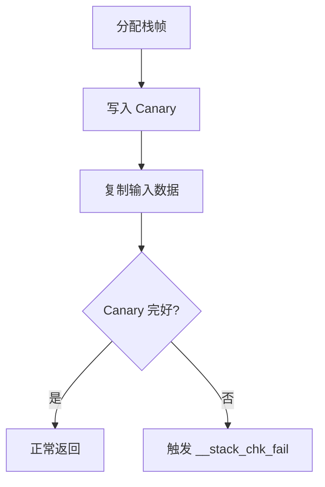

# 对抗缓冲区溢出攻击（Setting Up Canary、ASLR、DEP/NX）

## 为什么需要系统级防御

即使程序员使用了 `fgets` 等安全函数，历史遗留代码或第三方库仍可能存在漏洞。当攻击者成功注入恶意代码后，系统如何阻止其执行？这就引出了三道系统级防线：==栈金丝雀（Canary）==、==地址空间布局随机化（ASLR）== 和 ==数据执行保护（DEP/NX）==。它们分别从“检测破坏”、“隐藏地址”和“禁止执行”三个维度构建纵深防御。

## 栈金丝雀检测机制

Canary 的核心思想是在缓冲区与返回地址之间插入一个“哨兵值”。若溢出发生，该值必先被覆盖，函数返回前检查此值即可判断栈是否被破坏。

> [!IMPORTANT]
> Canary 值通常包含 `\0` 字节，可防止 `strcpy` 类字符串操作意外泄露或绕过检测；其值在进程启动时随机生成，而非编译期固定。

[!WARNING]
Canary 仅能**检测**溢出并终止程序，无法修复漏洞。且对非连续写（如格式化字符串漏洞）或精确跳过 Canary 的高级攻击无效。

## ASLR 与 DEP/NX 协同防御

若攻击者绕过了 Canary，系统还有两道屏障：

-   **ASLR**：每次加载程序时，随机化栈、堆、共享库的基地址。攻击者无法预知返回地址或 shellcode 位置，使硬编码地址失效。
-   **DEP/NX**：将数据区（栈/堆）标记为不可执行。即使 shellcode 被注入，CPU 在执行时会触发异常，阻止指令流跳转到数据区。

| 防御机制 | 防护目标 | 失效场景 |
| :--- | :--- | :--- |
| Canary | 检测线性溢出 | 信息泄露、非线性写 |
| ASLR | 隐藏内存布局 | 信息泄露、未启用PIE |
| DEP/NX | 禁止数据区执行 | ROP/JOP 代码复用攻击 |

> [!NOTE]
> 三者常组合使用：DEP 阻止直接执行 shellcode，ASLR 增加 ROP gadget 定位难度，Canary 作为最后一道检测关卡。==单一机制均不足以应对现代攻击==。

## 典型例题解析

某程序启用了 Canary 保护，局部数组 `buf[64]` 后紧跟 Canary（8 字节），再是保存的 `%rbp`（8 字节）和返回地址。若攻击者输入 72 字节 'A' 后程序崩溃于 `__stack_chk_fail`，说明什么？

分析：`buf` 占 64 字节，输入 72 字节恰好覆盖 Canary 的前 8 字节（即整个 Canary）。由于 Canary 被改写，返回前校验失败，触发保护机制。这验证了 ==Canary 位于缓冲区与返回地址之间==，且长度为 8 字节（64位系统）。若输入 ≤71 字节则不会触发，因未完全覆盖 Canary。

[!TIP]
解题关键：牢记栈帧布局顺序 `buf → Canary → saved rbp → ret addr`，计算偏移时注意对齐与字节数。Canary 长度在 x86-64 下通常为 8 字节，x86 下为 4 字节。
