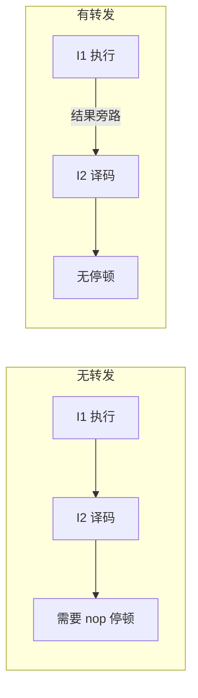

# 流水线冒险（数据冒险与控制冒险）及转发机制

## 流水线冒险与转发机制

先从一个问题开始：下面的指令序列在 5 段流水线上执行时，第 3 条指令的译码阶段能不能拿到正确的 `$t1` 值？

```asm
I1: add  $t1, $t2, $t3
I2: sub  $t4, $t1, $t5
I3: and  $t6, $t1, $t7
```

I1 在写回阶段才把结果写入 `$t1`，而 I2 的译码阶段在 I1 写回之前就要读 `$t1`，I3 更早。这种“前面指令还没写出结果，后面指令就要读”的情况，就是**数据冒险**。

### 数据冒险的两类

| 类型 | 定义 | 触发条件 |
|------|------|----------|
| **数据相关** | 后面指令用到前面指令的结果 | 存在“写后读”依赖 |
| **控制相关** | 分支指令改变了取指流向 | 转移目标在译码/执行后才确定 |

> [!IMPORTANT]
> 上述指令序列发生的是**数据相关**，且是最常见的“写后读（RAW）”相关。考试中看到“两条相邻指令用同一个寄存器，前者写后者读”，先判断为数据相关。

### 为什么要引入转发

流水线各阶段同时工作，如果一律等写回再读，就得插入大量 `nop` 停顿，性能损失大。**转发（Forwarding）**的思路是：结果在**执行阶段结束时**其实已经算出来了，只不过还没来得及写回寄存器堆，如果能直接从流水线寄存器里“抄近路”送到需要它的地方，就不必等写回。



### 关键前提：时钟前后半周的读写约定

课件中的原题给了条件：“**时钟的前半周期写寄存器堆，后半周期读寄存器堆**”。同一个时钟周期内，前半周写入的新值在后半周就能被读到。这意味着即使不转发，只要写和读在同一周期内“交错”进行，某些相关也能自然消解。

据此分析：

- **不采用转发**：I2 的译码读 `$t1` 时，I1 还没写入，需要停顿。按题中时钟约定，I2 与 I1 之间需要 **2 个 nop**。
- **采用转发**：I1 执行阶段结束即可把 ALU 结果旁路给 I2 的译码/执行，只需 **1 个 nop**。

> [!WARNING]
> 为什么转发后还需要 1 个 nop？因为 I2 的“译码”发生在 I1“执行”之前，转发的最早时刻是 I1 执行结束时，仍晚于 I2 译码读寄存器的时刻。除非在译码阶段就能从执行阶段的流水线寄存器旁路，否则这个 1 拍停顿无法消除。

### 加载延迟：转发也救不了的坑

如果前一条指令是 `lw`（加载字），情况更糟：

```asm
I1: lw   $t1, 0($t2)
I2: add  $t3, $t1, $t4
```

`lw` 的结果要到**访存阶段**结束时才真正从数据存储器读出来，比 ALU 指令晚一拍。转发的最早时刻推后了，I2 译码时仍然拿不到，必须额外插气泡。这就是**加载延迟（load-use delay）**。

> [!NOTE]
> 课件里提到的“避免使用/加载技术”指的是：编译器或程序员在 `lw` 和依赖它的指令之间填入独立指令，把停顿“填充”成有用工作。这是软件层面的优化，和硬件转发互补。

### 一个算对了的例子

设流水线阶段为：取指(F)、译码(D)、执行(E)、访存(M)、写回(W)，时钟前半周写、后半周读。

```
无转发：        F  D  E  M  W
I1              F  D  E  M  W
I2              F  D  nop nop E  ...
I3                 F  nop nop D  ...
```

I2 的 D 在 I1 的 W 之前，差了 2 拍 → 插 2 个 nop。

```
有转发：        F  D  E  M  W
I1              F  D  E  M  W
I2              F  D  nop E  ...
I3                 F  nop D  ...
```

I2 的 E 可以从 I1 的 E/M 流水线寄存器旁路到 ALU 输入，只差 1 拍 → 插 1 个 nop。

> [!TIP]
> 计算 nop 个数的通用方法：设“写后读”相关的两条指令，前者产生结果的最早阶段为 $p$，后者需要结果的阶段为 $q$。不转发时，停顿数等于 $(p+1) - q$；转发时，若结果可旁路到执行阶段，则按执行阶段对齐计算。考试务必先判断“有无转发”和“是否 lw”，再代公式。

### 与控制冒险的区别

数据冒险针对**寄存器数据依赖**，控制冒险针对**分支/跳转导致取指地址不确定**。比如 `beq` 在译码阶段才知道是否跳转，而取指阶段已经取了下一顺序指令，跳转成立时就得冲刷该指令。两者都可能插气泡，但机制和解决方法不同：数据冒险靠转发和停顿，控制冒险靠分支预测、延迟槽等。

> [!CAUTION]
> 不要把“控制相关”答成“数据相关”。判断标准只有一条：**数据相关**是`后面指令用前面指令的结果`；**控制相关**是`分支改变了后续取指流向`。题目若写“下面指令序列发生哪类相关”，通常先看有没有同一个寄存器被相邻指令一写一读。
