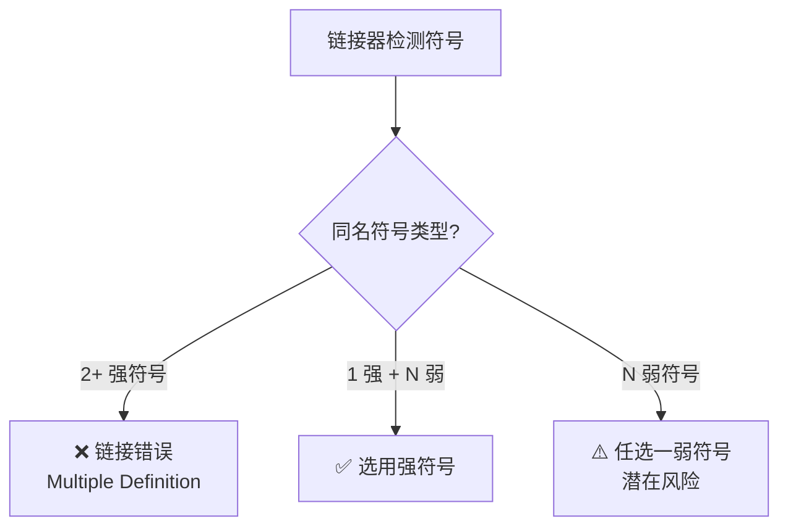

# 符号和符号解析（强符号、弱符号、多重定义规则）

# 符号和符号解析（强符号、弱符号、多重定义规则）

在链接过程中，编译器将每个源文件编译成可重定位目标文件后，链接器需要解决的核心问题之一是**符号解析**：如何将一个模块中对符号的引用，与另一个模块中该符号的定义关联起来。

## 符号的分类

链接器处理的符号分为三类，理解其作用域是基础：

| 符号类型 | 定义来源 | 可见性 | 示例 |
| :--- | :--- | :--- | :--- |
| **全局符号 (Global)** | 本模块定义的非 `static` 函数/全局变量 | 其他模块可引用 | `int buf;` `void swap(){}` |
| **外部符号 (External)** | 其他模块定义的全局符号 | 本模块引用 | `extern int buf;` |
| **局部符号 (Local)** | 本模块定义的 `static` 函数/全局变量 | 仅本模块可见 | `static int bufp;` |

> [!IMPORTANT]
> 链接器的“局部符号”指文件作用域的 `static` 变量/函数，**绝非**栈上的局部变量。链接器不关心函数内部的局部变量。

## 强符号与弱符号

为了处理多重定义，编译器将符号标记为**强**或**弱**：

*   **强符号**：函数名、已初始化的全局变量。
*   **弱符号**：未初始化的全局变量（如 `int x;`）。

> [!TIP]
> 记忆技巧：函数必须有实体（强），未初始化的变量只是预留空间（弱）。

## 多重定义解析规则

当链接器遇到多个同名符号时，遵循以下三条规则（Unix 链接器行为）：

1.  **不允许**多个同名的**强符号**。
2.  若有一个强符号和多个弱符号，选择**强符号**。
3.  若有多个弱符号，任选一个**弱符号**（通常选第一个遇到的，且大小可能不一致导致隐患）。

## 常见陷阱与实例分析

**陷阱**：不同模块中定义了同名的弱符号（未初始化全局变量），但类型或大小不同。

**示例**：
*   `main.c`: `int x = 15213;` (强符号, 4字节)
*   `f.c`: `double x;` (弱符号, 8字节)

根据规则 2，链接器选择 `main.c` 中的强符号 `x`。但在 `f.c` 中访问 `x` 时，代码期望它是一个 8 字节的 `double`，而实际内存中存放的是 4 字节的 `int`。这会导致读取到错误的数值或内存越界。

> [!WARNING]
> 这种错误链接器**不会报错**，但运行时会产生难以调试的逻辑错误。务必避免在不同文件中定义同名全局变量，即使一个是未初始化的。

==核心结论==：链接器通过强弱符号规则解决命名冲突，但程序员应确保全局符号名称的唯一性，尤其是避免弱符号的类型歧义。
