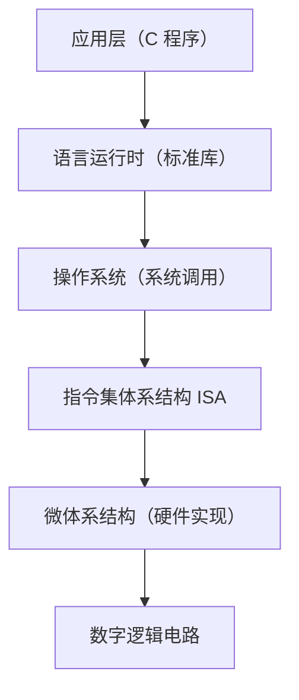
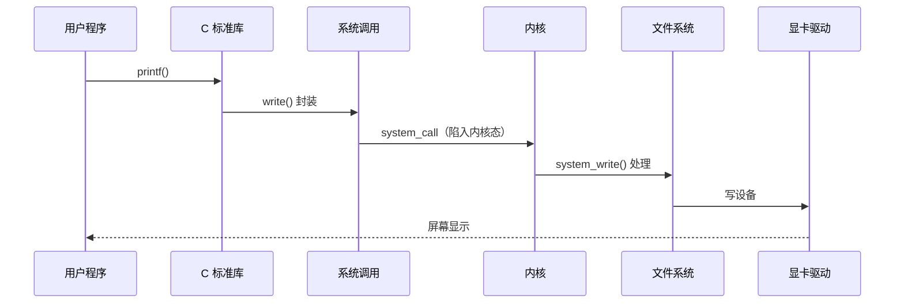

# 计算机系统的层次结构与抽象

## 从一次 `printf` 说起

你在 C 程序里写下一句 `printf("hello")`，按下回车，屏幕上出现 `hello`。这中间发生了什么？

把它拆开看：`printf` 是 C 标准库函数，它并不直接操作硬件，而是调用操作系统提供的 `write` 系统调用；系统调用陷入内核，内核找到对应的服务函数，再经过文件系统层和显卡驱动，最终让像素点亮起来。

这就是计算机系统中最重要的思想之一：==层次结构==。每一层只做自己该做的事，使用下一层提供的服务，并向上一层隐藏实现细节。

> [!IMPORTANT]
> 层次结构的核心作用有两个：**抽象**（隐藏下层细节）与**接口**（规定上下层之间的调用约定）。上层只关心"做什么"，下层决定"怎么做"。

## 计算机系统的层次模型

从高到低，每一层的职责如下表：

| 层次 | 典型内容 | 使用者看到的是 |
|---|---|---|
| 应用层 | C 程序、Shell | 问题求解逻辑 |
| 语言运行时 | `printf`、`malloc` | 函数调用 |
| 操作系统 | 进程、文件、虚拟内存 | 系统调用 |
| ISA（指令集体系结构） | x86-64、RISC-V | 机器指令、寄存器 |
| 微体系结构 | 流水线、Cache | 执行指令的硬件行为 |
| 数字逻辑 | 加法器、寄存器 | 逻辑门与电路 |

> [!NOTE]
> 其中 ISA 这一层尤其关键：它既是软件能看到的最低层（机器指令），又是硬件实现的最高层（规定硬件必须执行什么）。==ISA 是软件与硬件之间的"合同"==。

## 为什么需要分层

假设没有分层，你每次 `printf` 都要自己操作显卡寄存器、处理键盘中断——程序将完全无法移植，换个显卡就得重写代码。

分层带来三个直接好处：

1. **隔离变化**：硬件升级不影响上层软件，只要 ISA 不变。
2. **可移植性**：同一套 C 代码编译后能在不同硬件上运行。
3. **可组合性**：每一层可以被独立测试与替换。

> [!TIP]
> 记忆口诀：**"上层调用下层，下层服务上层，每层只隔一层打交道"**。不允许跨层直接访问（除非有特殊理由）。

## 抽象的两种方向

"抽象"在计算机系统里同时指向两个相反的方向：

- **向上抽象**：把复杂硬件包装成简单接口。例如把磁盘抽象成"文件"，把内存抽象成"虚拟地址空间"。
- **向下抽象**：把高层意图翻译成底层操作。例如编译器把 `a[i]` 翻译成 `&A[0] + sizeof(T) * i` 的地址计算。

数组访问公式 `&A[0] + sizeof(T) * i` 就是一次典型的跨层翻译：你在 C 语言里写 `A[i]`，编译器负责把它变成按字节计的地址偏移。

## 和"封装"的区别

初学者容易把层次的抽象和面向对象里的"封装"混为一谈。

| | 系统层次抽象 | 面向对象封装 |
|---|---|---|
| 关注点 | 计算机系统的纵向结构 | 程序内部的模块化 |
| 交互方式 | 层间调用、数据传递约定 | 对象间消息传递 |
| 描述对象 | 软件 + 硬件整体 | 纯软件设计 |
| 典型例子 | `printf` → 系统调用 → 驱动 → 硬件 | 类的私有成员与公有方法 |

它们共享"隐藏细节"的思想，但作用范围完全不同。

## 一个算对了的例子

题中要求从 `printf` 到屏幕显示写出调用路径，可以这样整理：

这个路径的关键识别点是：==从用户态到内核态的切换发生在 `system_call` 这一步==。前面都是普通函数调用，后面才进入操作系统内核的管辖范围。

> [!WARNING]
> 常见错误：有人认为"`printf` 本身就是系统调用"。实际上 `printf` 是标准库函数，它内部才调用 `write` 这个真正的系统调用封装。考试时区分"库函数"与"系统调用"是常设考点。

分层与抽象不是让你背的术语，而是理解一切后续内容——存储层次、虚拟内存、异常控制流——的地基。遇到新知识时，先问一句：**它在哪一层，对上提供什么接口，对下依赖什么服务**。
