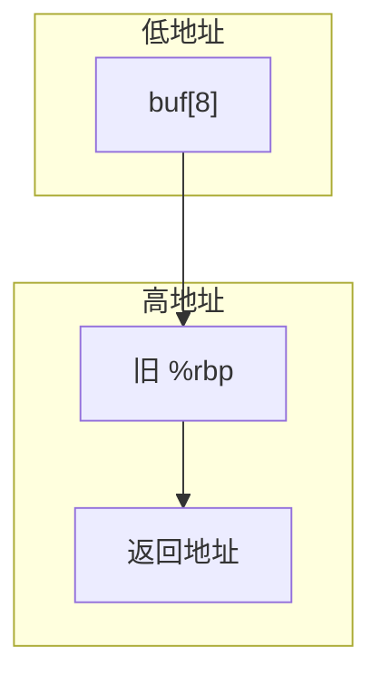
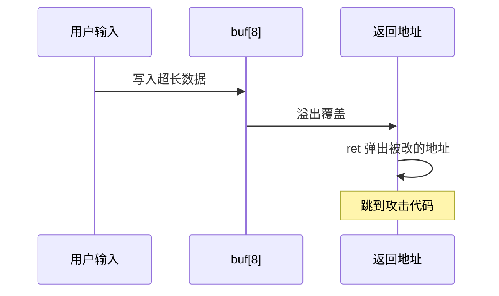
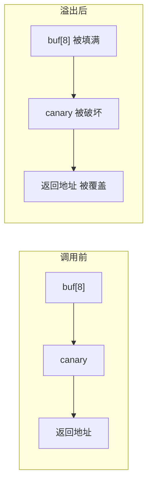

# 内存越界引用和缓冲区溢出（栈溢出原理）

## 内存越界引用与缓冲区溢出

程序在栈上为局部变量分配固定大小的空间。如果向某个缓冲区写入的数据超过了它被分配的大小，多出来的字节就会覆盖栈上相邻的数据——这就是**缓冲区溢出**的根本原因。

思考一个细节：栈帧里除了局部变量，还存着什么？调用函数时，`call` 指令会把**返回地址**压入栈中，函数返回时执行 `ret` 指令从栈中弹出这个地址跳回去。如果返回地址恰好在缓冲区“隔壁”，攻击者就能用溢出覆盖它。

### 从越界到攻击

看下面这段有缺陷的代码：

```c
void echo() {
    char buf[8];
    gets(buf);   // 不检查长度！
    puts(buf);
}
```

`gets` 不限制输入长度。当输入超过 8 个字符时，`buf` 之后的内存被覆盖。栈帧布局大致如下：



攻击者构造一个特殊输入，结构是：`填充字节 + 攻击代码地址 + 攻击代码`。执行流程变成：



> [!IMPORTANT]
> 缓冲区溢出的本质：==越界写入破坏了栈上的控制信息（返回地址）==，使程序的控制流被劫持。攻击代码本身只是一段字节序列，CPU 无法区分“数据”和“指令”，它只会执行被指向的字节。

### 对抗缓冲区溢出攻击

防御分两个层面。

**程序员层面**——写代码时避免漏洞：

| 危险函数 | 安全替代 |
| --- | --- |
| `gets(buf)` | `fgets(buf, size, stdin)` |
| `strcpy(dst, src)` | `strncpy(dst, src, n)` |
| `sprintf(buf, ...)` | `snprintf(buf, size, ...)` |

核心原则：==永远指定边界==。

**系统层面**——即使代码有漏洞，也尽量让攻击难以成功：


**栈随机化**让每次进程启动时栈的起始地址都不同，攻击者无法预先知道注入代码的地址，覆盖返回地址就变成了“盲猜”。

**限制可执行代码区域**依靠硬件支持的 NX 位（No-eXecute），把栈标记为不可执行。即使攻击代码被写入栈，CPU 也会拒绝执行，直接触发异常。

**栈破坏检测**由编译器插入一个“金丝雀值”（canary）。调用危险函数前，在返回地址旁边放置一个随机数：



函数返回前检查 canary 是否被改动。若被破坏，说明发生了溢出，程序立即终止而不是跳转到攻击代码。

> [!WARNING]
> 栈随机化并非绝对安全——攻击者可以用“空操作雪橇”（NOP sled）增大命中的概率；canary 也可能因信息泄露被绕过。防御是分层叠加的，单靠任何一层都不够。

### 一个算对了的例子

假设栈帧布局：`buf` 起始于 `%rsp+0`，canary 在 `%rsp+8`，返回地址在 `%rsp+16`。输入 24 个 `'A'`（十六进制 `0x41`）后：

- `buf[0..7]`：正常填入 8 个 `A`
- `canary`（8 字节）：被 `A` 覆盖，值为 `0x4141414141414141`，与原始随机值不匹配
- 返回地址（8 字节）：也被 `A` 覆盖

函数返回前的 canary 校验失败，`__stack_chk_fail` 被调用，程序终止。

> [!TIP]
> 做题时先画栈帧图，标清每个元素的偏移。攻击输入的长度 = 填充字节数 = **缓冲区到返回地址之间的距离**。
