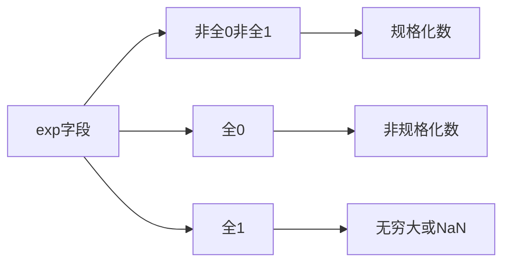

# Normalized numbers（规格化数）与 Denormalized numbers（非规格化数）

## 它是什么：先看浮点公式
在 IEEE 754 标准里，单精度（`float`）与双精度（`double`）都用下面这个统一公式表示一个浮点数：

$$v = (-1)^s \ M \ 2^E$$

其中机器里存的三个字段分别是：符号位 `s`、阶码字段 `exp`、尾数字段 `frac`。但要注意，`exp` 并不等于真正的指数 $E$，`frac` 也不直接等于尾数 $M$。

| 类型 | s | exp | frac | Bias |
|---|---|---|---|---|
| float | 1 bit | 8 bits | 23 bits | $127$ |
| double | 1 bit | 11 bits | 52 bits | $1023$ |

根据 `exp` 的值，编码分成三类：规格化的、非规格化的、以及无穷大/NaN。

## 为什么需要：从规格化到非规格化
先问一句：如果 `frac` 全 0、`exp` 最小合法值（规格化）是 1，那最小的正规格化数是多少？对 float 来说，$E=1-127=-126$，$M=1.0$，所以是 $1.0 \times 2^{-126}$。那比它更靠近 0 的正数怎么表示？规格化数做不到，因为尾数隐含最高位总是 1。

于是标准设计了非规格化数：它让 `exp` 全 0，此时不再隐含那个“1”，而是直接令

> [!IMPORTANT]
> 非规格化数中指数固定为 $E = 1 - Bias$，而不是直觉上的 $0 - Bias$。

对 float 就是 $E=-126$，对 double 就是 $E=-1022$。这样最小非规格化数约为 $2^{-149}$（float），填补了 0 与最小规格化数之间的空隙。

## 怎么做：两类数的计算规则

### Normalized numbers（规格化数）
条件是 $\exp \neq 00\dots0$ 且 $\exp \neq 11\dots1$：

- 指数：$\exp = E + Bias$，即 $E = \exp - Bias$
- 尾数：$M = 1.\text{frac}_2$，最高位 1 是隐含的

所以通用公式为：

- float：$v = (-1)^s (1+frac) \times 2^{(exp-127)}$
- double：$v = (-1)^s (1+frac) \times 2^{(exp-1023)}$

### Denormalized numbers（非规格化数）
条件是 $\exp = 00\dots0$：

- 指数：$E = 1 - Bias$（==核心：不是 $0-Bias$==）
- 尾数：$M = 0.\text{frac}_2$，不再隐含前导 1

> [!WARNING]
> 常见坑：看到 `exp=0` 就写成 $E=0-127=-127$（float），这是错的，正确是 $-126$。

## 相近概念的区别

| 对比 | 规格化数 | 非规格化数 |
|---|---|---|
| exp | 非全0非全1 | 全 0 |
| E | $exp-Bias$ | $1-Bias$ |
| M | $1.frac$ | $0.frac$ |
| 用途 | 常规数值 | 极接近0的小数 |

另外，`exp` 全 0 且 `frac` 全 0 表示 $\pm 0$；`exp` 全 1 且 `frac` 全 0 表示 $\pm\infty$，全 1 且 `frac` 非 0 表示 NaN。

## 算对了的例子
以课件中的 `float F = 15213.0` 为例：

1. 十进制转二进制：$15213 = 11101101101101_2$
2. 规格化：$1.1101101101101_2 \times 2^{13}$，所以 $E=13$
3. 计算 `exp`：$exp = E + Bias = 13 + 127 = 140$
4. `frac` 取小数点后部分，隐含最高位 1 不存

最终按 $v=(-1)^s(1+frac)\times2^{13}$ 存储，这就是一个==正确的规格化数编码过程==。
