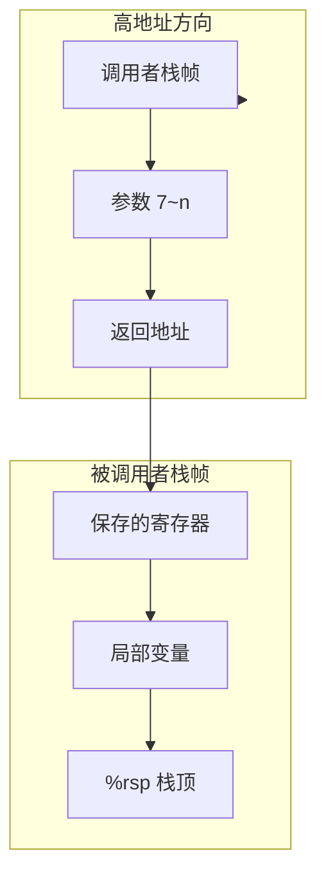
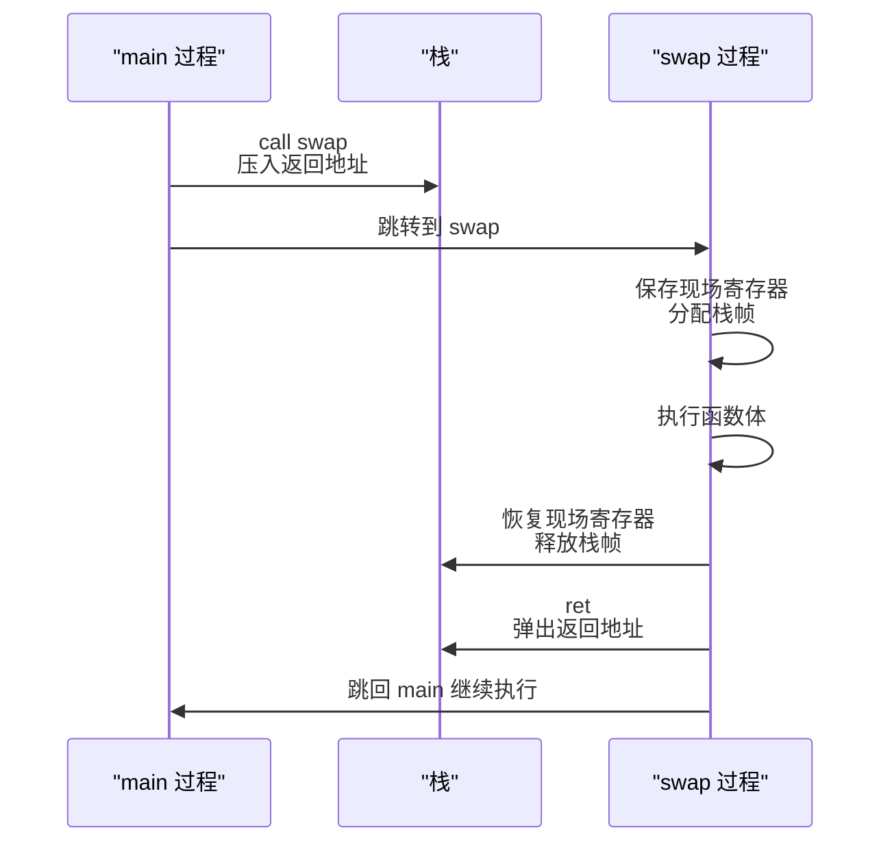

# 过程调用与栈帧（call、ret、栈帧结构、寄存器使用惯例）

## 过程调用与栈帧

### 为什么需要“过程调用约定”

一个 C 程序由多个函数组成。函数 A 调用函数 B 时，机器层面必须解决三个问题：

1. **传递控制**：CPU 当前在 A 的代码里执行，怎么跳到 B？B 执行完怎么回到 A？
2. **传递数据**：A 的实参怎么给到 B？B 的返回值怎么送回 A？
3. **分配与释放内存**：B 的局部变量放哪里？B 返回后这些空间如何回收？

x86-64 并没有“函数”这个硬件概念，只有指令和寄存器。所谓过程调用，本质上是一套**软件与硬件协作的约定**：编译器按照约定生成代码，硬件按约定执行指令。这套约定的核心就是 `call` / `ret` 指令和**栈帧**。

---

### call 与 ret：控制转移的两条指令

`call` 和 `ret` 是 x86-64 中专门用于过程调用与返回的一对指令，它们都隐含地操作栈指针 `%rsp`。

**`call` 指令做了两件事：**

1. 将**返回地址**（即 `call` 后面那条指令的地址）压入栈中——`%rsp` 先减 8，再把返回地址写入栈顶；
2. 跳转到目标过程的起始地址执行。

`call` 的目标地址有两种给出方式：

| 形式 | 示例 | 含义 |
| :--- | :--- | :--- |
| 直接调用 | `call 标号` | 目标地址即标号所在地址 |
| 间接调用 | `call *operand` | 目标地址从操作数指定的寄存器或内存中读出 |

**`ret` 指令则做相反的两件事：**

1. 从栈顶弹出返回地址——读取 `%rsp` 指向的 8 字节，`%rsp` 加 8；
2. 跳转到这个返回地址继续执行。

> [!IMPORTANT]
> `call` 压栈的是**下一条指令的地址**，不是 call 指令自己的地址。这是最容易看错的细节——反汇编中 `call` 指令的偏移量计算就是从下一条指令的地址（即当前 PC）开始算的。

**一个计算 `call` 机器码的例子：**

某目标文件中有如下反汇编片段：

```text
d:  e8 00 00 00 00    call 12 <main+0x12>
```

假设链接时目标过程定义在相对此 `call` 下一条指令偏移 `+10` 字节处。`call` 的机器码格式为 `e8` 后跟 4 字节小端偏移量，偏移量 = 目标地址 − 下条指令地址 = `0x0a`，于是机器码为：

```text
e8 0a 00 00 00
```

在完整的可执行文件反汇编中，经常能看到像 `e8 be fe ff ff` 这样的 `call`，偏移量为负数（小端），说明目标在此 call 下一条指令的**前面**。

---

### 栈帧：一个函数在栈上的“私有区域”

%rsp 始终指向栈顶。函数执行时，往往需要在栈上存放局部变量、额外的参数、保存的寄存器等。**栈帧**就是当前函数在栈上占用的那一整块区域。



栈帧中通常包含：

- **返回地址**：由 `call` 指令自动压入；
- **第 7 个及以后的参数**：前 6 个参数用寄存器传，放不下的才入栈；
- **局部变量**：当寄存器不够用、局部变量需要取地址（`&`）、或是数组/结构体时，必须放在栈上；
- **被保存的寄存器**：函数若要用 `%rbx`、`%rbp`、`%r12`~`%r15` 这些“被调用者保存”寄存器，需要先把原值压栈，返回前恢复。

> [!NOTE]
> x86-64 的栈帧是**按需分配**的。若一个函数的所有局部变量都能放进寄存器，而且不再调用其他函数（叶子过程），它可能完全不需要栈帧。

---

### 寄存器使用惯例：谁保存谁

x86-64 的通用寄存器在过程调用中分两种角色：

| 类型 | 寄存器 | 规则 |
| :--- | :--- | :--- |
| **调用者保存** | `%rax`（返回值）、`%rdi`、`%rsi`、`%rdx`、`%rcx`、`%r8`、`%r9`、`%r10`、`%r11` | 调用者若在调用后还要用，必须自己先压栈保存 |
| **被调用者保存** | `%rbx`、`%rbp`、`%r12`~`%r15` | 被调用者若要使用，必须先保存原值，返回前恢复 |

参数传递的寄存器约定（整数/指针）：

| 参数序号 | 1 | 2 | 3 | 4 | 5 | 6 | 返回值 |
| :--- | :--- | :--- | :--- | :--- | :--- | :--- | :--- |
| 64 位 | `%rdi` | `%rsi` | `%rdx` | `%rcx` | `%r8` | `%r9` | `%rax` |
| 32 位 | `%edi` | `%esi` | `%edx` | `%ecx` | `%r8d` | `%r9d` | `%eax` |
| 16 位 | `%di` | `%si` | `%dx` | `%cx` | `%r8w` | `%r9w` | `%ax` |
| 8 位 | `%dil` | `%sil` | `%dl` | `%cl` | `%r8b` | `%r9b` | `%al` |

> [!WARNING]
> 前 6 个参数用寄存器，**第 7 个及以后才入栈**。很多新手误以为所有参数都压栈，这是 32 位 x86 的旧习惯，在 x86-64 下不再是默认方式。

**浮点参数**则用 XMM 寄存器：`%xmm0`~`%xmm7` 依次传前 8 个浮点参数，`%xmm0` 返回浮点值。混合参数时各走各的通道：

```c
double f1(int x, double y, long z);
// x → %edi    y → %xmm0    z → %rsi

double f2(float x, double *y, long *z);
// x → %xmm0   y → %rdi     z → %rsi
```

---

### 一个完整的调用/返回序列

以 `main` 调用 `swap` 为例：



> [!TIP]
> 判断“这个函数需不需要栈帧”，问自己三个问题：
> 1. 局部变量总数是否超过可用寄存器？
> 2. 有没有对局部变量取地址（`&x`）？
> 3. 局部变量是否是数组或结构体？
> 只要有任一答案为“是”，就需要在栈上分配空间。

---

### 常见坑

> [!CAUTION]
> **踩坑 1：把 `call` 的压栈操作忘了**
> `call` 会隐式地修改 `%rsp`（减 8）。看反汇编时，若一条 `call` 前刚调整过 `%rsp`，调用后 `%rsp` 又变了，往往导致对栈上偏移量的误读。

> [!CAUTION]
> **踩坑 2：弄混调用者保存与被调用者保存**
> 调用者不能假设 `%rax`、`%rdi` 等在调用后还保持原值；被调用者则不能随意破坏 `%rbx` 等的值。混用会导致难以复现的 bug。

> [!CAUTION]
> **踩坑 3：以为 `ret` 会自动清理参数**
> x86-64 下 `ret` 只弹出返回地址，不清理栈上的参数。清理工作由调用者在 `call` 之后负责（调整 `%rsp`）。

---

### 小测试

已知函数 `f3(long a, long b, long c, long d, long e, long f, long g, long h)`，它接收 8 个长整型参数。问：

1. 参数 `g` 和 `h` 放在哪里？
2. 若 `f3` 内部只做简单运算，不调用其他函数，它需要栈帧吗？

**答案**：

1. `a`~`f` 依次放在 `%rdi`、`%rsi`、`%rdx`、`%rcx`、`%r8`、`%r9` 中；`g` 和 `h` 按顺序压入栈中，`g` 在较低地址（先压），`h` 在较高地址。
2. 不一定需要。8 个参数不全是它的局部变量，如果局部变量能全放在寄存器里，它就是一个叶子过程，可以没有自己的栈帧。但 `g`、`h` 在调用者的栈帧里，`f3` 通过 `%rsp` 的偏移来访问它们。
