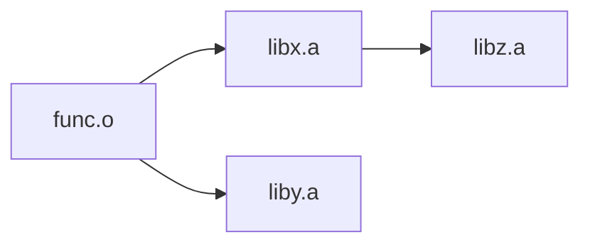

# 静态库的创建与使用（ar命令）

## 它是什么

前面我们已经知道，GCC 编译一个程序会经过==预处理→编译→汇编→链接==四步，其中链接阶段负责把多个 `.o` 文件（目标模块）和库函数合成一个可执行文件。问题是：标准库函数成千上万，如果每次都把整个 `libc` 全塞进可执行文件，文件会肥得离谱，内存也浪费。

==静态库（static library）==就是解决这个问题的打包方案：把一批 `.o` 文件==打包成一个归档文件==（archive，扩展名通常为 `.a`），链接器只从中==抽取被真正引用到的成员==，其他成员丢弃。这样既享受了"重用代码"的便利，又没有把无用代码塞进最终程序。

## 怎么创建：ar 命令

Linux/Unix 提供一个叫 Archiver（归档器）的工具，命令是 `ar`：

```bash
gcc -c fun1.c fun2.c          # 先汇编出 .o
ar rcs libmylib.a fun1.o fun2.o
```

`ar` 常用参数：

| 参数 | 含义 |
| --- | --- |
| `r` | 将目标模块插入（替换）静态库 |
| `c` | 创建库（不输出创建提示） |
| `s` | 生成索引表（链接器按索引查符号） |

[!TIP]
> 记一句话：`ar` 把一堆 `.o` ==打包成一个 `.a`==，链接器再按需=="点菜"抽取==成员。这也是它区别于直接传多个 `.o` 的最大价值——可以==增量更新==，改了哪个源文件就只重新汇编那个 `.o`，再用 `ar r` 替换进库，其他成员不动。

## 怎么使用：链接时指定

```bash
gcc -static -o myprog func.o libmylib.a
```

`-static` 表示完全静态链接，不再依赖动态库。GCC 默认会隐式链接 `libc.a`，==你不需要在命令行显式写出==。

## 链接顺序：最容易考的坑

链接器扫描库时是==从左到右、按需解析==的：如果遇到一个未解析符号，就从当前库里找；找到后该成员引入的**新的**未解析符号，也只能在==**之后**的库里找==。所以在命令行里，==被调用方的库必须放在调用方之后==。

> [!IMPORTANT]
> ==链接顺序铁律：调用者在前，被调用者在后==。

看一个典型考题：



由于 `libx.a`、`liby.a` 相互独立，只有 `libx.a → libz.a` 有依赖，下列三条命令==都可行==：

```bash
gcc -static –o myfunc func.o libx.a liby.a libz.a
gcc -static –o myfunc func.o liby.a libx.a libz.a
gcc -static –o myfunc func.o libx.a libz.a liby.a
```

但如果 `libx.a` ↔ `liby.a`==相互调用==（循环依赖），单次从左到右扫不完整，必须重复列出：

```bash
gcc -static –o myfunc func.o libx.a liby.a libx.a
gcc -static –o myfunc func.o liby.a libx.a liby.a
```

[!WARNING]
> 静态库之间出现**循环依赖**时，==把库重复列一次是允许的==，这与"重复定义会报错"是两回事——`ar` 抽取是按需的，没引用的成员根本不会被拉进来。

## 和相近概念的区别

| 概念 | 生成/链接时机 | 典型产物 | 更新方式 |
| --- | --- | --- | --- |
| 目标文件 `.o` | 单独汇编 | 单个模块 | 重编源文件 |
| ==静态库 `.a`== | ==链接期抽取== | ==归档多个 `.o`== | ==`ar r` 增量替换== |
| 动态库 `.so` | 运行期装入 | 共享对象 | 替换 `.so`，程序不用重链 |

> [!NOTE]
> 静态库在链接期把代码==复制进可执行文件==，所以运行不再需要原库；`.so` 则只是记录引用，运行时才绑定。

## 一个把概念串起来的例子

若 `func.o` 调用 `libx.a`、`liby.a` 中的函数，而 `libx.a` 又调用 `libz.a`，`liby.a` 独立：

```bash
gcc -static –o myfunc func.o libx.a libz.a liby.a
```

执行流程是：先解析 `func.o` 未定义符号 → 到 `libx.a` 找到 → 拉入 `libx.a` 引入的符号 → 到 `libz.a` 找到 → 再扫 `liby.a` 解决剩下的 → 全部解析完成，`myfunc` 生成。==只要让每个"被调用方"出现在所有"调用方"之后，就能一次链接成功==。
