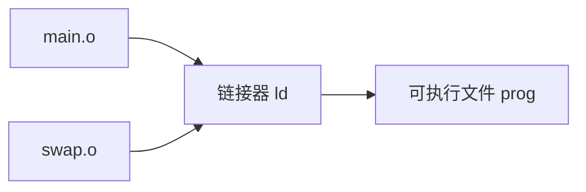

# GCC编译器的静态链接过程（可执行文件的生成）

## 从分离的模块到完整的可执行文件

写一个 C 程序时，我们常把它拆成多个 `.c` 源文件。比如 `main.c` 调用 `swap.c` 里的 `swap()` 函数。编译时，GCC 先把每个 `.c` 各自变成 `.o`（可重定位目标文件），它们彼此独立，`main.o` 里调用 `swap` 的地方暂时填了一个“空地址”。

问题来了：链接器怎么把一堆 `.o` 拼成一个能直接运行的完整程序？

### 静态链接两步走

GCC 在静态链接阶段（通常由 `ld` 完成）主要做两件事，你可以理解成“对号入座”和“填写门牌号”。

#### 第一步：符号解析

编译器在 `.o` 里维护了一张**符号表**，记录了谁在“出口”（定义），谁在“找人”（引用）。

- `int x = 1;` → 定义符号 `x`
- `swap() { ... }` → 定义符号 `swap`
- `swap();` → 引用符号 `swap`

> [!IMPORTANT]
> 链接器任务：让每个符号引用都能精准匹配到唯一的符号定义。如果 `main.o` 引用了 `swap` 却没在任何 `.o` 里找到定义，就会报经典的 `undefined reference to 'swap'`。

#### 第二步：重定位

找到所有符号定义后，链接器开始“拼积木＋写地址”：

1.  **节合并**：把所有 `.o` 中同类型节（如 `.text` 代码节、`.data` 数据节）分别合并成一个**段**。
2.  **地址分配**：在虚拟地址空间中为每个符号（函数、全局变量）计算唯一的运行时绝对地址。
3.  **地址修正**：回头把所有引用处原先留下的空地址，填成上一步算好的真实地址。

> [!WARNING]
> 静态链接时，像 `printf` 这类库函数代码也会从 `libc.a` 拷贝到可执行文件里，导致文件体积变大。

### 一个算对了的例子

用课件里的题来走一遍完整流程。

已知 `main.o` 大小 0x600 B，`swap.o` 大小 0x300 B。假设代码从地址 `0x8048000` 开始，数据从 `0x804a000` 开始。

- `main.o` 的 `.data` 节（0x40 B）里有全局变量 `buf[2]`（占 8 B）；`.text` 节里 `main()` 调用 `swap` 的地址需要重定位。
- `swap.o` 的 `.data` 节（0x80 B）里有全局指针 `bufp0`（指向 `buf[0]`）。

链接器执行过程：

| 步骤 | 操作 | 结果 |
| :--- | :--- | :--- |
| **合并 `.text`** | 安排 `main` (0x600) 后接 `swap` (0x300) | 代码段从 `0x8048000`，`main` 在 `0x8048000`，`swap` 在 `0x8048000 + 0x600 = 0x8048600` |
| **合并 `.data`** | 安排 `main.o` 数据 (0x40) 后接 `swap.o` 数据 (0x80) | 数据段从 `0x804a000`，`buf` 在 `0x804a000`，`bufp0` 在 `0x804a000 + 0x40 = 0x804a040` |
| **重定位指针** | `bufp0` 应指向 `buf[0]` | 链接器将 `swap.o` 中 `bufp0` 初始值改为 `0x804a000` |
| **重定位调用** | `main` 中 `call` 指令原本指 `swap` 偏移 | 指令地址改为绝对地址 `0x8048600` |

> [!TIP]
> 考试时，算符号绝对地址先记首址，再累加前一个模块的长度。数据指针重定位容易漏掉，记得检查定义里有 `&buf[0]` 这类取地址操作。

最终生成的可执行文件不再是“零散零件”，而是拥有确定入口地址 `_start`（进而调用 `main`）、所有地址都写死的完整程序映像。这就是静态链接的核心产出。
