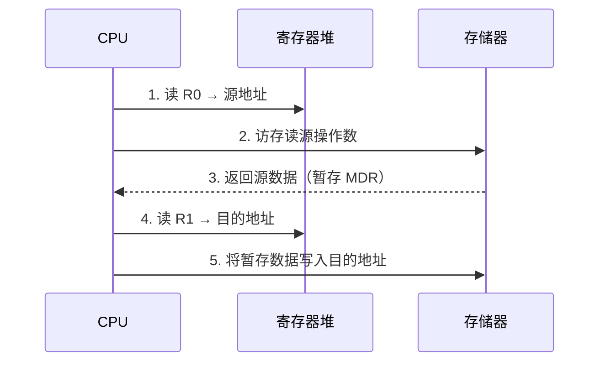

# 寻址方式（寄存器直接寻址、立即数寻址、基准地址寻址等）

## 寻址方式

在指令系统中，一条指令通常要告诉CPU两件事：**做什么**（操作码）和**在哪做**（操作数地址）。寻址方式就是用来确定“操作数到底在哪里”的规则。

我们先从指令执行的核心问题说起——CPU怎么找到操作数？

- 操作数就在指令里 → ==立即数寻址==
- 操作数在寄存器里 → ==寄存器直接寻址==
- 操作数在内存里 → 需要计算地址，于是衍生出多种内存寻址方式

下面对南邮考试中高频出现的几种寻址方式逐一拆解。

---

### 立即数寻址

操作数直接编码在指令里，无需访问寄存器或内存。

- **执行过程**：取指令的同时就拿到了操作数
- **特点**：速度最快，但操作数是常量，无法修改
- **MIPS 归属**：I 型指令（指令中包含 16 位立即数）

[!IMPORTANT]
> 立即数寻址的操作数是指令的一部分，**取指即取数**，不产生额外的访存操作。

---

### 寄存器直接寻址

指令中给出的就是寄存器的编号，操作数存放在该寄存器中。

- **执行过程**：从指令字段提取寄存器号 → 读取寄存器堆
- **MIPS 归属**：==R 型指令==（三地址均为寄存器）

**真题回顾**：MIPS32 有 32 个通用寄存器，需要几位地址码？

32 = $2^5$，每个寄存器需要 **5 位**编码。指令中若涉及三个寄存器（rs、rt、rd），共需 15 位。

[!TIP]
> 寄存器直接寻址根本不产生访存操作，是除立即数外最快的寻址方式。MIPS 的 `add $t0, $t1, $t2` 三操作数全是寄存器直接寻址。

---

### 基址寻址（基址 + 偏移）

有效地址 = **基址寄存器内容** + **指令中的偏移量**（立即数）。

- **用途**：访问结构体成员、局部变量（基于帧指针 `$fp`）、数组元素
- **MIPS 归属**：==I 型指令==（rs 提供基址，立即数字段提供偏移）
- **典型指令**：`lw $t0, 8($s3)` → 有效地址 = `$s3 + 8`

**执行步骤**（以 `lw $t0, offset($base)` 为例）：

[!WARNING]
> 偏移量是 **16 位带符号数**，计算前必须做 **符号扩展** 到 32 位。忘记符号扩展是考试中的高频扣分点。

---

### 变址寻址

变址寻址与基址寻址在计算方式上完全一致——寄存器加偏移，但 **语义角色不同**：

| 对比项 | 基址寻址 | 变址寻址 |
|--------|----------|----------|
| 寄存器角色 | 基地址（不变） | 变址量（随循环变化） |
| 偏移角色 | 小范围偏移 | 数组首地址 |
| 典型场景 | 局部变量、结构体 | 数组遍历 `A[i]` |

在 MIPS 中，两者都用 `lw $t0, offset($reg)` 实现，底层机制相同。

---

### PC 相对寻址

有效地址 = ==PC 当前值 + 偏移量==（经符号扩展后左移 2 位）。

- **为什么左移 2 位**：MIPS 指令字长 4 字节，地址始终 4 字节对齐，低 2 位恒为 0，可以省略存储
- **归属**：==I 型指令==（分支指令 `beq`、`bne`）
- **寻址范围**：16 位偏移 → ±128 KB

---

### 伪直接寻址

用于 J 型无条件跳转指令（`j`、`jal`）。

- **构造方式**：PC 高 4 位 + 指令中 26 位立即数 + 00（左移 2 位）= 28 位地址
- **为什么叫“伪”直接**：并非直接用指令中的 26 位拼成完整地址，而是 **拼接 PC 高 4 位**

[!CAUTION]
> 伪直接寻址属于 ==J 型指令==，跳转范围 256 MB，但只能在 **同一 256 MB 区域内跳转**，跨越区域需用其他方式。

---

### 真题演练：`MOV (R0), (R1)` 执行步骤

这道简答题考察的是 **寄存器间接寻址**（源和目的都是寄存器指向的内存）。

**分步执行流程**：

**完整步骤描述**：
1. 取指令 → 译码
2. 读寄存器 R0，得到 **源操作数的内存地址**
3. 以该地址访问存储器，读出源操作数，暂存于 MDR
4. 读寄存器 R1，得到 **目的操作数的内存地址**
5. 将 MDR 中的数据写入存储器对应单元

[!TIP]
> 这种“寄存器里存的是地址，常用内存当操作数”的方式就是 **寄存器间接寻址**。标志性特征：指令中看到 `(Rn)` 括号，括号表示“去内存里找”。

---

### 寻址方式与 MIPS 指令类型速查

| 寻址方式 | MIPS 指令类型 | 典型指令 |
|----------|:------------:|----------|
| 寄存器直接寻址 | R  | `add $t0, $t1, $t2` |
| 立即数寻址 | I | `addi $t0, $t1, 5` |
| 基址/变址寻址 | I | `lw $t0, 8($sp)` |
| PC 相对寻址 | I | `beq $t0, $t1, label` |
| 伪直接寻址 | ==J== | `j target` |
| 寄存器间接寻址 | I / R | `lw $t0, 0($t1)` |

[!IMPORTANT]
> 考试口诀：**R 型全是寄存器，I 型带立即数或偏移，J 型只管跳。** 从真题选择 7～10 来看，MIPS 指令类型与寻址方式的绑定关系是必考点。
