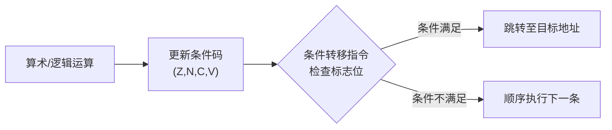

# 编译if语句与循环条件的实现

## 编译 if 语句与循环条件的实现

在计算机组成原理中，高级语言的 `if-else` 分支和 `while/for` 循环并非直接由硬件“理解”，而是被编译器翻译为**条件转移指令**。这一过程的核心在于利用运算器产生的状态信息来控制程序计数器（PC）的流向。

> [!IMPORTANT]
> ==核心机制==：高级语言的控制结构 $\rightarrow$ 比较指令（更新条件码） $\rightarrow$ 条件转移指令（根据条件码跳转）。

### 为什么需要条件码寄存器？

CPU 执行算术或逻辑运算（如 `SUB A, B`）后，不仅得到结果，还会自动更新**条件码寄存器（CCR）**中的标志位。这些标志位反映了运算结果的性质，是后续判断的依据。

常见的标志位包括：
- $Z$ (Zero)：结果为 0。
- $N$ (Negative)：结果为负。
- $C$ (Carry)：进位/借位。
- $V$ (Overflow)：溢出。

### 怎么做：从代码到指令

以 `if (a > b) goto L1;` 为例，编译器通常生成两条指令：
1. **比较指令**：`CMP a, b`（实质是做 $a-b$，不存结果，只改标志位）。
2. **转移指令**：若 $a>b$（即无借位且结果非零等，具体取决于架构），则 PC $\leftarrow$ L1。

对于循环 `while (i < 10)`，结构类似：
1. 比较 `i` 与 `10`。
2. 若 `i >= 10`，跳出循环（跳转到循环体后）。
3. 否则，进入循环体，末尾跳回比较处。

> [!TIP]
> **解题技巧**：看到“控制转移”必找“条件码”；看到“运算结果状态”必找“触发器”。

### 真题解析与常见坑

回顾南邮考题填空 115：
> 运算器不论复杂还是简单，均有条件码寄存器。条件码寄存器的一部分通常由各种 **A** 运算结果状态触发器组成，利用触发器的信息，可以提供 **B** 判断条件，以实现程序的 **C** 控制转移。

**正确答案**：
- A：**标志位**（或 状态标志 / Flag）
- B：**分支**（或 条件）
- C：**流程**（或 程序 / 指令流）

> [!WARNING]
> **易错点辨析**：
> 1. **CMP 不修改通用寄存器**：`CMP` 指令只做减法更新 CCR，**不**保存差值到寄存器。
> 2. **有符号 vs 无符号**：判断 $a>b$ 时，若为无符号数看 $C$ 标志，若为有符号数需结合 $N$ 和 $V$ 标志（$N \oplus V = 0$ 表示大于等于）。混淆两者会导致逻辑错误。

| 概念 | 作用 | 硬件支持 |
| :--- | :--- | :--- |
| **条件码寄存器** | 存储运算状态 | 触发器组 |
| **条件转移指令** | 根据状态改 PC | 多路选择器 + 加法器 |
| **无条件转移** | 直接改 PC | 无需检查 CCR |

==总结==：掌握 `if/loop` 的底层实现，关键在于理解**运算结果如何转化为标志位**，以及**标志位如何决定 PC 的值**。这是连接软件逻辑与硬件数据通路的桥梁。
