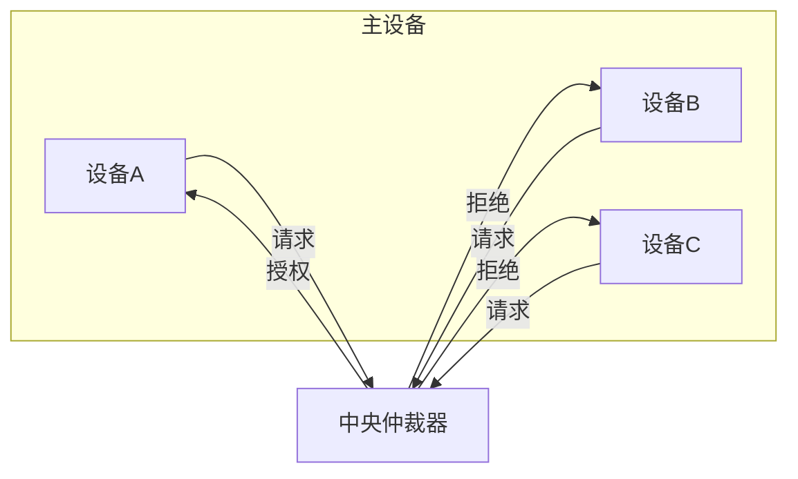
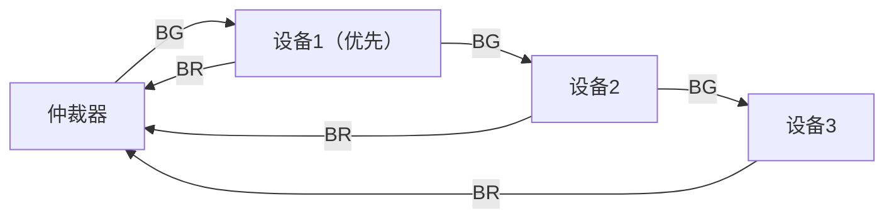
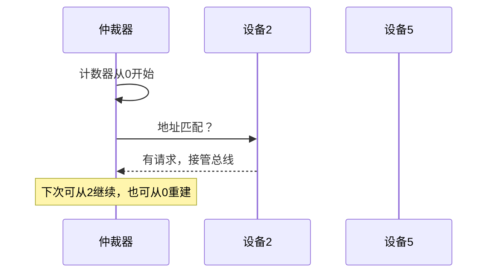
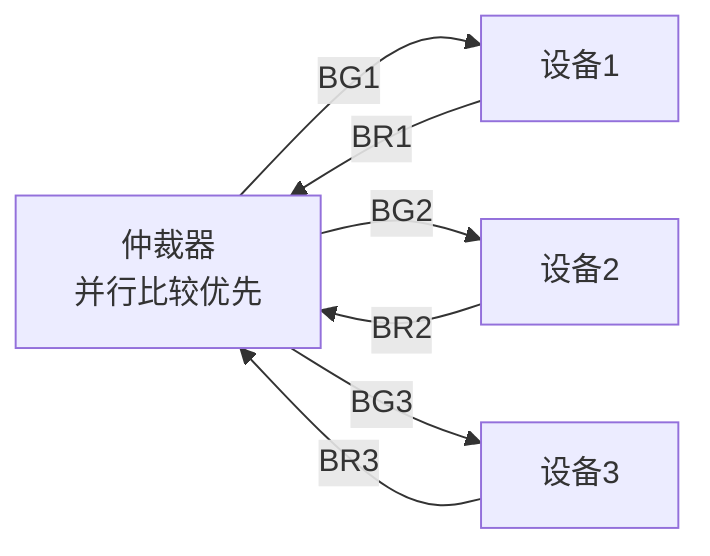

# 集中式总线仲裁方式（链式查询方式、计数器定时查询方式、独立请求方式的优缺点）

## 集中式总线仲裁

### 为什么需要总线仲裁

一条系统总线上接着多个主设备（CPU、DMA 控制器等）。当两个以上的主设备==同时请求总线控制权==时，必须由一套规则决定谁先用总线——这套规则就是**总线仲裁**。

> [!IMPORTANT]
> 仲裁针对的是“主设备”，从设备永远被动等待，不会发起竞争。填空题常考“多个 **主设备** 同时竞争总线 **控制权**”。

集中式仲裁的核心思想：所有总线请求送到一个**中央仲裁器**，由它按策略只允许一个设备获得总线。

### 链式查询方式

**工作原理：** 所有设备共用一条“总线请求”线 BR 和一条“总线忙”线 BS。仲裁器收到请求后，若总线空闲就发出**总线允许信号 BG**。BG 沿设备链**从高到低逐级传递**：离仲裁器最近的设备先看到 BG，如果它没发请求，就把 BG 继续往后传；如果它发了请求，就截住 BG，接管总线。

| 优点 | 缺点 |
|------|------|
| 线路少，只需 3 根控制线（BR、BS、BG）+ 少量地线 | ==各设备优先级固定==，离仲裁器近的设备永远优先，远的可能**饿死** |
| 扩展设备容易，新增设备只需串入链条 | BG 信号逐级传递，后面设备响应慢 |
| 逻辑简单，成本低 | ==对电路故障最敏感==：链上任一点断线，后面所有设备都无法收到 BG |

> [!WARNING]
> 考试反复考的点：**链式查询对电路故障最敏感**。原因是 BG 信号靠逐级硬件链路传递，链路某处断了，后续全部瘫痪。

### 计数器定时查询方式

**工作原理：** 去掉链式查询的 BG 串联线，改为仲裁器提供一组**设备地址线**（$\log_2 n$ 根地址线可接 $n$ 个设备）。计数器的值就是“当前可以向哪个设备发允许”。仲裁器从某个起点开始**循环加 1 计数**，把计数值输出到地址线上；当某设备的编号与计数值匹配、且它发出了请求时，该设备获得总线，计数器停止。

| 优点 | 缺点 |
|------|------|
| ==优先级可以改变==：每次起始计数位置可不同（可设为“从上次停止处继续”实现循环均等，或每次从 0 开始恢复固定优先级） | 地址线数量多，设备数为 $n$ 时需要 $\lceil \log_2 n \rceil$ 根地址线 |
| 某设备故障不会影响后续设备获得授权 | 仍比独立请求方式响应慢 |
| 比链式公平 | 控制逻辑比链式复杂 |

> [!NOTE]
> 对比记忆：链式查询是“**线路敏感型**”——故障最敏感；计数器定时查询是“**计数驱动型**”——优先级可编程。

### 独立请求方式

**工作原理：** 每个设备有**自己专用**的请求线 BR$_i$ 和授权线 BG$_i$，直接接到中央仲裁器上，不再级联。仲裁器同时收到所有请求，根据内部优先级逻辑（如并联判优电路）==并行比较==，立即选中优先级最高的设备发出授权。

| 优点 | 缺点 |
|------|------|
| ==响应时间最快==：不逐级传递，并行判优 | 控制线数量最多：每个设备要 1 根请求线 + 1 根授权线 |
| 优先级由仲裁器内部逻辑设定，可灵活编程 | 仲裁逻辑最复杂 |
| 某设备故障不影响其他设备（隔离性最好） | 成本最高 |

### 三种方式横向对比

| 维度 | 链式查询 | 计数器定时查询 | 独立请求 |
|------|----------|----------------|----------|
| 请求线/授权线数量 | $1+1$（共用） | $\log_2 n + 1$ | $2n$（每设备 2 根） |
| 响应速度 | 慢 | 中 | ==最快== |
| 优先级可否改变 | 否（固定） | 可（计数器起始值可变） | 可（仲裁器编程） |
| 电路故障敏感性 | ==最敏感== | 低 | 低 |
| 成本/复杂度 | 最低 | 中 | 最高 |

### 弄懂一道真题

> 在集中式总线仲裁中，（）方式响应时间最快，（）方式对电路故障最敏感。

- 响应时间最快 → **独立请求方式**：每个设备单独连仲裁器，并行比较，没有逐级传递延迟。
- 对电路故障最敏感 → **链式查询方式**（有些教材叫“菊花链”）：BG 信号沿链传递，任一点断线，后续设备全部失效。

> [!TIP]
> 考场速记：**“快”想“独立”，因为各自有专用线，不排队；“敏”想“链”，因为全靠一条链传允许信号。** 口诀：“**独立快，链敏感**”。
