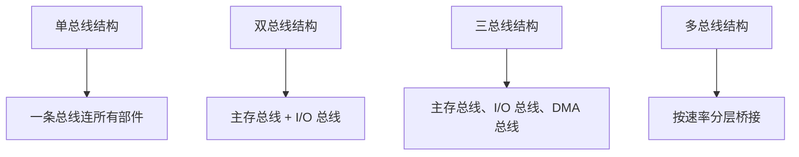

# 总线的基本概念、特性、标准化与结构形态

## 总线的基本概念

总线是连接计算机各功能部件（CPU、主存、I/O 接口等）的**公共信息传输通道**，各部件通过它传送数据、地址和控制信号。用总线替代点对点的专线互连，可以==大幅减少连线数量、便于部件扩展与互换==。

按照总线传输信息的不同，系统总线分为三类，这是本章最常考的填空题：

| 分类 | 简称 | 传输内容 | 方向特点 |
|------|------|----------|----------|
| 数据总线 | DB | 各部件间的数据 | ==双向== |
| 地址总线 | AB | 主存单元或 I/O 端口地址 | 单向（CPU 发出） |
| 控制总线 | CB | 命令、请求、仲裁、中断信号 | 每根有确定方向 |

> [!TIP]
> 记忆口诀：==“数据、地址、控制”==。注意“通信总线”是连接计算机系统之间（或计算机与外部设备）的总线，**不属于**按系统总线传输信息划分的这三类。

## 总线的特性

为了使各部件能正确地接到同一组总线上，总线必须明确以下四方面特性：

- **物理特性**：总线的物理连接方式，如根数、插头插座的形状、引脚排列等。
- **功能特性**：每根传输线的功能划分——是数据线、地址线还是控制线。控制总线包括 CPU 发出的各种命令、请求和仲裁信号、中断信号等。
- **电气特性**：每根线的信号传递方向、有效电平范围（如高电平有效还是低电平有效）。
- **时间特性**：各信号在什么时间有效，即信号之间的时序关系。

> [!IMPORTANT]
> 答题时四种特性常考名词解释或填空：==物理特性、功能特性、电气特性、时间特性==，顺序不能和“数据/地址/控制”三组概念混淆。

## 总线的标准化

一个值得思考的问题：相同指令系统、相同功能的部件，不同厂家的实现方法几乎都不相同，为什么它们却能互换使用？

原因就在于==各厂家都遵守了相同的系统总线标准==，这就是总线的标准化问题。总线标准统一规定了上述四种特性（插头尺寸、引脚定义、电平、时序等），使得：

- 各厂家按标准设计的部件可以互换、即插即用；
- 系统设计时可以灵活选购不同厂商的模块。

常见的标准总线有 ISA、EISA、PCI、PCI-Express、USB 等。

## 总线的结构形态

按系统中总线的组织层次，常见结构形态有：

- **单总线结构**：所有部件挂接在同一条总线上。结构最简单、成本低，但==同一时刻只允许一对部件通信==，高速与低速设备互相拖累，易形成瓶颈。
- **多总线结构**：把高速部件与低速部件分别接到不同层次的总线上，层与层之间通过“桥”连接。速度越快的总线离 CPU 越近，==不同总线上的传输可以并行进行==，整体效率高，是现代微机的典型形态（如北桥/南桥结构）。

> [!WARNING]
> 常见坑：单总线结构并非“只有一根线”，而是只有**一组（一套）总线**，仍包含数据、地址、控制三部分；其缺点是共享争用、吞吐受限，而不是线数少。

## 典型例题

**例（填空）**：按照系统总线传输信息的不同，可以分成______总线、______总线、______总线。

**解**：数据总线（DB）、地址总线（AB）、控制总线（CB）。三个答案顺序不限，但名称必须是“数据、地址、控制”，写“通信总线”不得分。

**例（选择）**：按系统总线传输信息分类，下面哪项不属于这三类？——答案选 **D. 通信总线**，因为通信总线是按**连接范围/用途**划分的类别，与“控制/地址/数据”这一按信息类型的划分标准不在同一层次。
