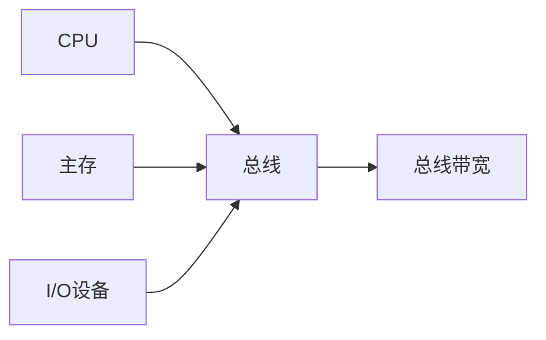

# 总线的性能指标（总线带宽计算：数据宽度D×总线时钟频率f）

如果 CPU 运算速度极快，但各个部件之间交换数据的“公路”又窄又堵，整机性能还能提上去吗？显然不能。衡量这条“公路”通行能力的核心指标，就是总线带宽。

> [!IMPORTANT]
> 衡量总线性能的重要指标是==总线带宽==，它定义为总线本身所能达到的==最高传输速率==。

## 总线带宽是什么

总线带宽是指单位时间内总线上能够传送的最大数据量。在计算机系统中，CPU、主存、I/O 设备都挂在总线上，总线带宽直接决定了各子系统间信息交互的极限速度。采用总线结构的主要优点是便于实现积木化，同时减少了信息传输线的条数，但这也意味着大家必须共享有限的传输通道。

## 怎么计算总线带宽

计算总线带宽的核心公式为：

$$W = D \times f$$

其中：
- $W$：总线带宽（通常单位为 MB/s）
- $D$：总线数据宽度（即每个时钟周期能并行传输的字节数，单位 Byte）
- $f$：总线时钟频率（单位 MHz，即每秒百万个时钟周期）

> [!TIP]
> 记忆技巧：把总线想象成马路，$D$ 是“车道数”（每次并排过几辆车），$f$ 是“绿灯闪烁频率”（每秒放行几次）。车道越宽、放行越快，通过的总车数就越多。

**算对的一个例子：**
回顾课件中的经典填空题：PCI 总线的时钟频率 $f = 33\text{ MHz}$，数据宽度为 64 位（即 $D = 8\text{ Byte}$）。
代入公式计算：
$$W = 8\text{ Byte} \times 33\text{ MHz} = 264\text{ MB/s}$$
因此，PCI 总线的带宽可达 ==264MB/s==。

## 与相近概念的区别

很多同学容易将“总线带宽”、“数据传输率”和“总线位宽”混淆。

| 概念 | 含义 | 关注点 |
| :--- | :--- | :--- |
| **总线数据宽度 $D$** | 单次传输的数据位数/字节数 | 物理通道的“粗细” |
| **总线时钟频率 $f$** | 总线工作的时钟节拍频率 | 信号变化的“快慢” |
| **总线带宽 $W$** | $D \times f$ 的理论上限 | 整体吞吐的“极限” |
| **实际传输率** | 某次具体传输测得的速率 | 受协议开销等影响，$\le W$ |

> [!NOTE]
> 像 IEEE1394 这样的高速串行总线，其数据传输率可以是 100兆位/秒、200兆位/秒或 400兆位/秒。注意这里用的是“兆位/秒（Mbps）”，而 PCI 总线带宽常用“兆字节/秒（MB/s）”，对比时务必统一单位。

## 常见的坑

> [!WARNING]
> **位（bit）与字节（Byte）的换算陷阱！**
> 题目给出的数据宽度往往是“位”（如 32位、64位），而最终要求的带宽单位通常是 MB/s。必须先将位除以 8 转换为字节（Byte），再代入公式 $W = D \times f$ 计算，否则结果会偏大 8 倍。

> [!CAUTION]
> **不要把总线带宽和存储器带宽混为一谈。** 交叉存储器是一种模块式存储器，能并行执行多个独立的读写操作，提高的是访存速度；而总线带宽解决的是部件间互连的瓶颈。

## 带宽在整机优化中的位置

从计算机的各个子系统角度来看，提高整机速度的措施是多维度的。针对 I/O 系统，可以运用 DMA 技术减少 CPU 干预，或者==采用多总线技术==来分散流量、提升总带宽。此外，还可以结合 Cache-主存层次设计、指令流水、超标量技术以及改进运算方法（如进位链）等手段，让整机性能得到全面提升。
