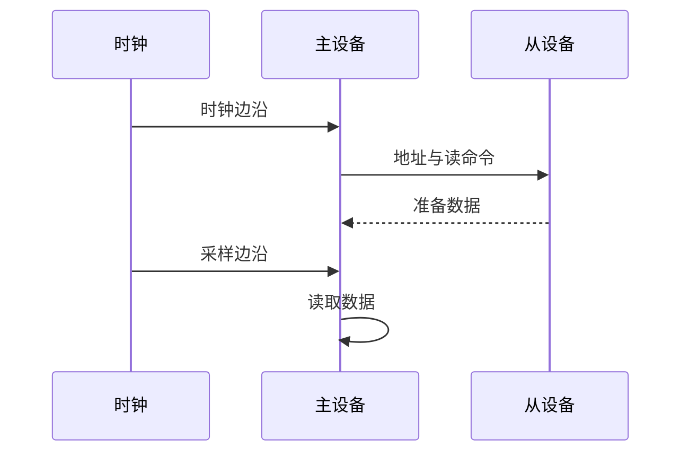
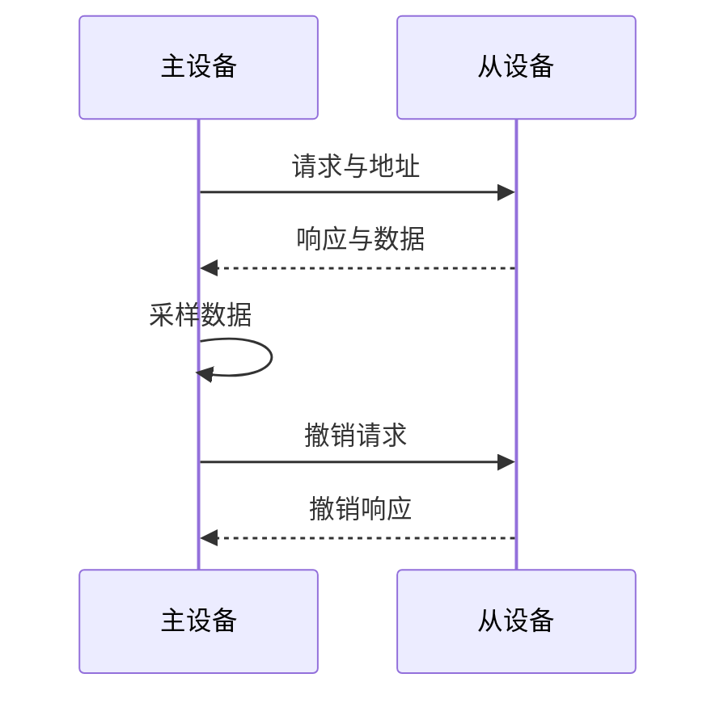

# 总线的定时和数据传送模式（同步定时协议、异步定时协议及时序图分析）

总线把多个部件连在一起，但“数据已经放到总线上”并不等于“对方已经正确收到”。发送方何时撤掉数据、接收方何时采样、慢设备尚未准备好怎么办，都要由**总线定时协议**规定。它本质上是在协调总线事件的先后顺序。

## 同步定时协议

在同步定时协议中，==事件出现在总线上的时刻由总线时钟信号确定==，因此总线中包含时钟信号线。一次读操作可理解为：

1. 主设备在规定时钟边沿送出地址和读命令；
2. 从设备在约定时间内译码并准备数据；
3. 主设备在指定时钟边沿采样数据；
4. 双方按时钟约定撤销信号，完成一次传送。

其优点是控制简单、传送速度较快；缺点是传送时间通常按较慢设备安排，速度差异大的设备难以充分发挥各自性能。它适合速度接近、时序关系固定的部件。

## 异步定时协议

异步协议没有统一时钟来规定各事件发生的固定时刻，而采用==“请求—响应”握手==：一个事件发生后，才允许下一个事件发生。以全互锁方式为例：

主设备收到响应后才能采样；从设备看到请求撤销后才能撤销响应。这样，快设备不必空等固定时间，慢设备也不会因尚未准备好而丢数据，适合主存与速度不同的外围设备共用总线的场合。代价是握手信号和控制过程较复杂，一次传送往往需要更多交互。

## 时序图怎样分析

看时序图时，不要只背“同步有时钟、异步没时钟”，应按下面顺序检查：

- 先找主设备何时给出地址、命令或请求；
- 再找数据何时有效，以及接收方在哪个边沿或哪个信号之后采样；
- 最后检查地址、数据、请求和响应的撤销顺序。

若采样时刻由时钟边沿指定，是同步思路；若必须等待对方应答才继续，是异步思路。异步图中的信号持续多久，取决于对方何时响应，不能擅自按固定时钟周期计算。

| 对比项 | 同步定时 | 异步定时 |
|---|---|---|
| 定时依据 | 总线时钟 | 请求、响应信号 |
| 传送时刻 | 预先约定 | 由双方就绪情况决定 |
| 控制与速度 | 较简单、较快 | 较复杂、握手有开销 |
| 设备适应性 | 速度接近、关系固定 | 速度差异较大 |
| 主要风险 | 慢设备来不及准备 | 应答缺失可能一直等待 |

> [!IMPORTANT]
> 核心区别不是“有没有任何时钟”，而是==总线事件是否由统一总线时钟规定发生时刻==。异步通信的双方内部仍可以各自使用时钟。

> [!WARNING]
> 异步不等于“不需要联络”，也不等于“随时都能采样”。必须等数据有效且响应到达；全互锁中还要完成请求、响应的撤销过程。

## 与 I/O 联络方式及 DMA 的区别

CPU 与 I/O 之间常概括为立即响应（查询）、同步、异步三种联络方式：查询适合很慢或很简单的设备；同步适合双方有固定时钟关系的场合；异步适合速度不匹配、需要握手协调的场合。这里的“查询”强调 CPU 主动检查状态，不能把它与异步握手混为一谈。

另外，总线定时解决“一次总线传送怎样协调”，DMA 解决“谁控制总线并直接交换主存与 I/O 数据”，二者不是同一层问题。例如考题“采用 DMA 方式传送数据时，每传送一个数据要占用什么时间”，答案是==一个存取周期==。因为每传一个字都要完成一次主存访问；不能选“一个时钟周期”，也不能因 DMA 占用总线就选“一个总线周期”。

> [!TIP]
> 解题口诀：同步看时钟边沿，异步看请求响应；DMA 每传一字，抓住一次主存存取。
