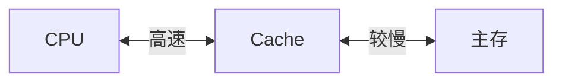

# Cache基本原理（命中率、访问效率、容量与块长对命中率的影响）

> [!IMPORTANT]
> Cache（高速缓冲存储器）位于 CPU 和主存之间，利用局部性原理提高数据访问速度，==缓解 CPU 速度快而主存速度慢的矛盾==。Cache/主存系统的地址映射与替换由**纯硬件**管理，对程序员透明。

## 为什么需要 Cache

CPU 运算速度极快，而主存容量大（如 4GB）但读写慢。如果每次取指令或数据都直接访问主存，CPU 将大量时间浪费在等待上。怎么解决？在二者之间插入一个“速度接近 Cache、容量接近外存”思想下的小容量高速存储器——Cache。

## 命中率与平均访问时间

当 CPU 要读一个字时，先查 Cache：
- **命中**：直接在 Cache 中读出，耗时 $t_c$。
- **未命中**：需从主存调入 Cache 再读出，耗时 $t_m$（$t_m \gg t_c$）。

命中率 $h$ 是访问 Cache 成功的概率。平均访问时间公式为：

$$T_a = h \cdot t_c + (1 - h) \cdot t_m$$

> [!TIP]
> 只要 $h$ 足够高（如 95% 以上），$T_a$ 就非常接近 $t_c$，系统整体速度大幅提升。

## 影响命中率的因素

Cache 的命中率和什么相关？答案包含四个核心要素：

| 因素 | 如何影响命中率 |
| :--- | :--- |
| **Cache 容量** | 容量越大，能装下的块越多，命中率越高；但大到一定程度后提升变缓且成本剧增。 |
| **块大小（块长）** | 块增大可利用空间局部性提高命中率；但==块过大会导致 Cache 行数减少，反而降低命中率==。 |
| **映射方式** | 全相联冲突最少命中率最高，直接映射冲突最多命中率最低，组相联折中。 |
| **替换算法** | LRU 等优秀算法能保留高频块，提高命中率。 |

> [!WARNING]
> 常见误区：认为“块越大命中率一定越高”。实际上块长存在一个最优值，过大反而会因容量被少数大块占满而导致频繁替换。

## Cache 总容量的计算

考试常考“Cache 总容量”，很多同学只算数据部分就交卷了。注意：==Cache 总容量 = 数据存储容量 + 标记阵列容量==。标记阵列不仅包含主存字块标记（Tag），还要加上有效位，若采用回写（Write Back）法还需加脏位（修改位）。

来看一道典型例题：

**题目**：假定主存地址为 32 位，按字节编址，主存和 Cache 之间采用直接映射方式，主存块大小为 4 个字，每字 32 位，采用回写（Write Back）方式，则能存放 4K 字数据的 Cache 的总容量的位数至少是多少？

**解析步骤**：
1. **求块内地址**：块大小 $= 4 \times 32\text{b} = 16\text{B} = 2^4\text{B}$，故块内地址占 $4$ 位。
2. **求 Cache 行号**：Cache 存 4K 字，每块 4 字，共 $1\text{K} = 2^{10}$ 个 Cache 行，行号占 $10$ 位。
3. **求标记位（Tag）**：主存地址 32 位，标记位 $= 32 - 4 - 10 = 18$ 位。
4. **求标记项总位数**：回写方式需脏位，标记项 $= 18(\text{Tag}) + 1(\text{有效位}) + 1(\text{脏位}) = 20$ 位。
5. **算总容量**：
   - 标记阵列容量 $= 2^{10} \times 20\text{b} = 20\text{Kb}$
   - 数据存储容量 $= 4\text{K} \times 32\text{b} = 128\text{Kb}$
   - 总容量 $= 128\text{Kb} + 20\text{Kb} = ==148\text{Kb}==$

> [!CAUTION]
> 如果题目改为“全写法（Write Through）”，则不需要脏位，标记项就只有 19 位！做题前务必看清替换策略。

## 与相近概念的区别

| 对比维度 | Cache | 虚拟存储器（主存-辅存） |
| :--- | :--- | :--- |
| **目的** | 解决 CPU 与主存的**速度**不匹配 | 解决主存**容量**不足的问题 |
| **管理者** | 纯硬件自动管理 | 操作系统（软件）+ 硬件支持 |
| **对程序员** | 完全透明 | 不透明（需 OS 参与页面调度） |
