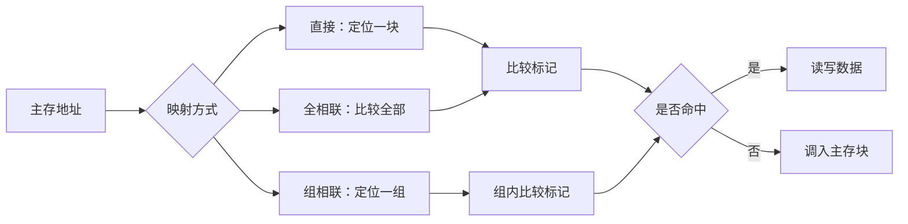

# Cache地址映射与变换（全相联映射、直接映射、组相联映射）

## 为什么需要地址映射

Cache 容量远小于主存，CPU 给出主存地址时，必须回答两个问题：数据应放在 Cache 的哪里？Cache 中现有数据是否就是所需数据？地址映射就是主存块与 Cache 块之间的放置规则；地址变换则把主存地址拆成若干字段，用于查找和比较。

设主存按字节编址，块大小为 $B$ 字节，则

$$
\text{块内地址位数}=\log_2 B
$$

若 Cache 有 $N$ 块，采用 $E$ 路组相联，则组数 $G=N/E$，组地址位数为 $\log_2G$。剩余高位都是主存字块标记。

## 三种映射方式

| 映射方式 | 主存块可放位置 | 主存地址格式 | 特点 |
|---|---|---|---|
| 直接映射 | 唯一 Cache 块 | 标记、Cache 字块地址、块内地址 | 硬件简单，冲突失效较多 |
| 全相联映射 | 任意 Cache 块 | 标记、块内地址 | 最灵活，比较器开销大 |
| 组相联映射 | 指定组内任意块 | 标记、组地址、块内地址 | 兼顾命中率与硬件成本 |

直接映射可理解为“主存分组、组内分块”，主存块号对 Cache 块数取模，得到唯一 Cache 块号。全相联映射中，主存和 Cache 都只分块、不分组，查找时需比较所有 Cache 块的标记。组相联映射中，Cache 每 $E$ 块组成一组，主存块先映射到唯一组，再放入组内任意空闲块；直接映射和全相联映射可分别看作 $1$ 路组相联和 $N$ 路组相联。

> [!IMPORTANT]
> 三种方式的地址字段不同，但==块内地址位数只由块大小决定==；组相联的组地址位数由“组数”决定，而不是由 Cache 块数直接决定。

## 一个完整计算例

设主存容量为 $256K\times8$，Cache 容量为 $2K\times8$，块长为 $4$，采用八路组相联映射。按字编址，主存地址共 $18$ 位。

Cache 可装入的块数为

$$
\frac{2K}{4}=\frac{2048}{4}=512\text{ 块}
$$

八路组相联表示每组 $8$ 块，因此组数为

$$
G=\frac{512}{8}=64=2^6
$$

故组地址为 $6$ 位；每块含 $4$ 个字，块内地址为 $\log_2 4=2$ 位；主存字块标记为

$$
18-6-2=10\text{ 位}
$$

所以主存地址格式为：**主存字块标记 $10$ 位、组地址 $6$ 位、块内地址 $2$ 位**。

## 常见坑与相关考点

> [!WARNING]
> “Cache 容量”若指数据区容量，通常不含标记、有效位等；若问“总容量的位数至少”，还要计入每块标记和有效位，采用回写法时通常还需计入修改位。全写法一般不需要修改位。

求 Cache 总容量时，先算数据位数，再加每块控制信息。例如直接映射中，标记位数为“主存地址位数－Cache 字块地址位数－块内地址位数”，不能误把 Cache 数据字节数当作全部容量。

Cache 命中率与 ==Cache 容量、块大小、替换算法、映射方式==有关。直接映射不需要组内替换算法；全相联和组相联在目标位置已满时，才需要按替换算法选择被换出的块。
