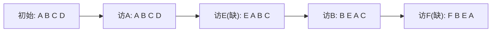

# Cache替换策略（LFU最不经常使用算法、LRU近期最少使用算法、随机替换）

当 Cache 已满且发生缺失时，应该淘汰哪一块？这直接决定了后续访问的命中率。不同的替换策略本质上是对“未来哪个块最可能被访问”这一问题的不同猜测。

## 三种核心替换策略

> [!IMPORTANT]
> ==LRU 是南邮考试绝对重点==，必须掌握其替换图绘制与状态更新逻辑；LFU 与随机替换侧重概念辨析。

| 策略 | 核心依据 | 硬件开销 | 性能特点 |
| :--- | :--- | :--- | :--- |
| LRU | 近期最久未使用 | 高（需计数器/栈） | 接近最优，==常考画图== |
| LFU | 历史访问次数最少 | 中（需计数器） | 可能误杀新块 |
| 随机 | 无特定规律 | 极低 | 实现简单，性能不稳定 |

**LRU（近期最久未使用）** 基于时间局部性原理：最近被访问过的块，短期内很可能再次被访问。因此淘汰“最长时间未被访问”的块。硬件上常用计数器法或堆栈法实现。

**LFU（最不经常使用）** 认为访问次数少的块未来也少用。但存在致命缺陷：刚调入的新块计数为 1，若此时发生替换，极易被==错误淘汰==。需定期右移计数器衰减历史权重来缓解。

**随机替换** 完全随机选择淘汰块。虽无局部性优化，但避免了复杂硬件开销，在某些特殊负载下反而表现尚可。

## LRU 替换图怎么画

简答题常要求画出 LRU 替换过程。关键原则：==每次命中或调入后，将该块移至“最新”端==。

> [!TIP]
> 画图口诀：==命中上提，缺失替底==。左侧为最新，右侧为最旧；替换时永远淘汰最右端块。

以上图为例：初始顺序 A(新)→D(旧)；访问 A 后 A 移到最左；E 缺失，淘汰最右 D，E 插入最左；B 命中，B 上提至最左；F 缺失，淘汰当前最右 C，F 插入最左。全程保持“左新右旧”。

## 命中率的影响因素

> [!NOTE]
> Cache 命中率由四要素共同决定：==容量、块大小、替换算法、映射方式==。替换算法只是其一，不可孤立看待。

例如全相联映射配合 LRU 通常命中率最高，但硬件代价大；直接映射虽快，冲突缺失多。实际设计中需在性能与成本间权衡。

## 常见误区警示

> [!WARNING]
> LFU ≠ LRU！LFU 看“累计次数”，LRU 看“最近时间”。新调入块在 LFU 下危险，在 LRU 下安全。

> [!CAUTION]
> LRU 画图时切勿忘记==命中也要更新位置==。仅缺失时调整顺序是典型错误，会导致后续替换对象判断完全错误。

正确示例验证：序列 A-B-C-A-E-B-F，Cache 3 块 LRU。A/B/C 依次调入；A 命中上提→[A,C,B]；E 缺失替 B→[E,A,C]；B 缺失替 C→[B,E,A]；F 缺失替 A→[F,B,E]。最终 Cache 内容为 F、B、E，淘汰顺序为 B→C→A。
