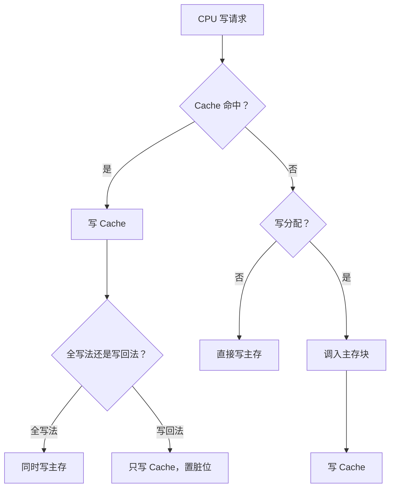
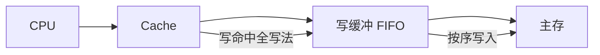

# Cache写操作策略（全写法/写直达、写回法、写分配、写缓冲）

## 写不写、怎么写、什么时候写

CPU 执行 `store` 指令时，数据要写入 Cache。但 Cache 只是主存的副本，最终必须保证主存里的数据和 Cache 一致。什么时候把脏数据写回主存、要不要先把数据块调入 Cache，就是 Cache 写操作策略要解决的问题。

先想一个问题：**CPU 写某个地址时，如果这个地址所在的主存块根本不在 Cache 里，怎么办？**

两个选择：

- ==写分配（Write Allocate）==：先把该主存块从主存调入 Cache，再在 Cache 中修改。
- ==非写分配（No-Write Allocate）==：不调入 Cache，直接写主存。

再想第二个问题：**CPU 写 Cache 命中时，主存什么时候更新？**

- ==全写法 / 写直达（Write Through）==：每次写 Cache 的同时，立即写主存。Cache 和主存始终一致。
- ==写回法（Write Back）==：只写 Cache，不立即写主存，给该块做个 “脏位（dirty bit）” 标记。等到该块被替换出 Cache 时，才把整块写回主存。

> [!IMPORTANT]
> 全写法保证 Cache 与主存的==每个字节都实时一致==；写回法只有在被替换或显式写回时才会同步主存，存在“Cache 新、主存旧”的窗口。

## 四种组合与配套关系

写策略不是孤立选一个，而是两个维度配合使用：

| 写命中策略 | 常用搭配 | 原因 |
|---|---|---|
| 全写法 | 非写分配 | 反正每次命中都要穿透写主存，写不命中直接写主存最省事 |
| 写回法 | 写分配 | 写不命中时先把块调入 Cache，后续多次写同一块只命中不访存，减少总线压力 |

> [!TIP]
> 记法：**“全写法 + 非写分配”** 像每次写都直达主存；**“写回法 + 写分配”** 像先把数据搬到 Cache 里集中改，最后一起提交。

## 写缓冲：让全写法不再“卡”

全写法的缺点是每次写都要访问主存，CPU 必须等主存写完成才能继续。==写缓冲（Write Buffer）==就是在 Cache 和主存之间加一个 FIFO 队列：

CPU 把数据写入 Cache 的同时，把要写主存的数据放进写缓冲，就可以继续执行后续指令，由存储控制器慢慢把缓冲里的数据写入主存。

> [!WARNING]
> 写缓冲会引入一个**新的不一致窗口**：数据在写缓冲里排队，主存暂时还是旧值。如果此时 DMA 设备读主存，可能读到旧数据；这类情况需要“写缓冲排空”或硬件一致性处理。

## 一个算对了的例子

题：主存地址 32 位，按字节编址；Cache 最多存放 128 个主存块；采用直接映射、全写法；块大小为 64B。求 Cache 容量。

关键：==Cache 容量 = 数据容量 + 标记阵列 + 有效位等附加位==。本题只问“多少字节”，默认按“存储数据区的字节数”算：

$$
\text{容量} = 128 \times 64\text{B} = 8192\text{B} = 8\text{KB}
$$

但如果题目问“总容量”并要求计算 SRAM 总位数，则还要加上每块的 tag 位数和有效位：

- 块内偏移：$\log_2 64 = 6$ 位；
- Cache 共 128 块，直接映射的 Cache 行索引：$\log_2 128 = 7$ 位；
- tag = $32 - 6 - 7 = 19$ 位；
- 每行附加位：tag 19 位 + 有效位 1 位 = 20 位；
- 总容量 = $128 \times (64 \times 8 + 20)$ 位 $= 128 \times 532$ 位 $= 68096$ 位 $= 8512\text{B}$。

> [!NOTE]
> 全写法下不需要脏位，所以这里附加位只算了 tag 和有效位；如果是写回法，每行还要加 1 位脏位。

## 常见的坑

- 把 Cache 容量直接当主存容量算，忘了 Cache 按块组织、还有 tag 阵列。
- 全写法误以为不需要写缓冲就万事大吉，实际上 ==写缓冲决策的是“写主存时 CPU 等不等”==，不是“写不写主存”。
- 写回法替换脏块时，必须先把整块写回主存再覆盖，否则数据丢失。
- 只记住 “写回法快”，忘记它引入“脏位”之后，Cache 和主存==长期不一致==，DMA 和多处理器场景需要额外一致性协议。
