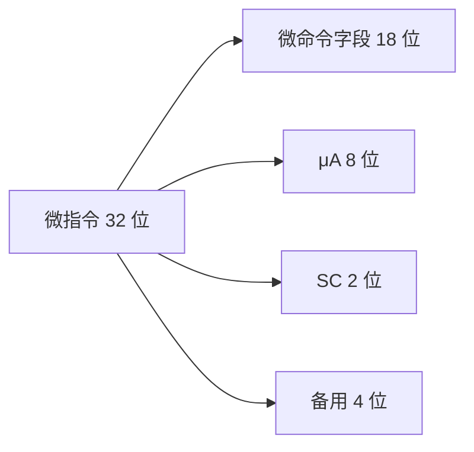

# CM控制存储器设置的一般原则与微指令字长（操作字段+下地址字段）

## 微指令的“体型”是怎么定的

微指令要完成一件事：在本拍发出若干微命令，并指出下一拍该去哪条微指令。所以一条微指令天然要分成两大块——**操作控制字段**（干什么）和**顺序控制字段**（接下来去哪）。南邮课件的 32 位例子正是这个结构：

| 字段 | 位数 | 作用 |
|---|---|---|
| 微命令字段 | 18 位 | 13 个控制信号 → 数据通路控制 |
| 微地址字段 μA | 8 位 | 给出下一条微指令的地址 |
| 顺序控制字段 SC | 2 位 | 标明 μA 的形成方式（如顺序、转移、转子程序等） |
| 备用 | 4 位 | 暂时不用，可扩展 |



> [!IMPORTANT]
> 微指令字长 $=$ 操作控制字段 $+$ 顺序控制字段（$+$ 备用位）。==“断定方式”的本质是由微指令自己给出下地址==，而不是靠一个计数器简单加 1。

## 为什么“水平型”往往更长

微命令的编码方式直接决定操作字段的长度。若想让微命令互相不打架、能并行发出，最直观的做法是**每个微命令占 1 位**，这就是“直接控制（水平型）”。它并行性最好，但微指令字长会很长。

如果有 30 个微命令直接编码，操作字段就需 30 位；加上下地址字段，微指令总长会很可观。为了压缩字长，通常先“互斥归组”。

> [!NOTE]
> 互斥类内的微命令在同一拍最多只能有一个有效，所以一个类只需编码为一个码点，类内用译码器还原出具体微命令。

## 一个算对了的例子

某机微指令字长 24 位，水平型编码 + 断定方式。共有微命令 30 个，构成 4 个互斥类，各类分别含 5、8、14、3 个微命令，外部条件 3 个。

**操作控制字段**：每组用二进制编码表示“不发”或“发其中一个”：

| 互斥类 | 微命令数 | 状态数（含“不发出”） | 需位数 |
|---|---|---|---|
| 1 | 5 | 6 | 3 位 |
| 2 | 8 | 9 | 4 位 |
| 3 | 14 | 15 | 4 位 |
| 4 | 3 | 4 | 2 位 |

所以操作字段 $=3+4+4+2=13$ 位。

**顺序控制字段**：断定方式下需要给出下地址。外部条件 3 个意味着判断字段需 $\lceil \log_2 4\rceil=2$ 位。剩下的位数就是可寻址的微地址范围：

$$24-13-2=9\ \text{位}$$

即控制存储器可容纳 $2^9=512$ 条微指令。

> [!TIP]
> 碰到这类题先分类求“状态数 $=$ 微命令数 $+1$”，再取 $\lceil \log_2(\text{状态数})\rceil$ 求和；顺序字段用“外部条件数 $+1$”取对数。

## 容易踩的坑

> [!WARNING]
> - **互斥类中忘了“不发出”这一种状态**：状态数不是微命令个数，而是 $n+1$，所以 14 个微命令要 4 位而不是 $\lceil \log_2 14\rceil=4$ 位（此题恰好一样，但 8 个的组若忘加 1 会错算成 3 位）。
> - **把断定方式与 μPC 加 1 混淆**：断定方式的下地址来自微指令的地址字段与判别逻辑，不是简单地顺序加 1。
> - **水平型不等于“每命令 1 位”**：只有不互斥的直接控制才每个微命令占 1 位；字段编码（互斥类编码）仍属于水平型微指令。
> - **微指令字长 ≠ 微程序长度**：字长是一条微指令的位数；控制存储器能存多少条微指令由地址位数决定。

```mermaid
flowchart TD
    A["24 位微指令"] --> B["操作字段 13 位"]
    A --> C["判断字段 2 位"]
    A --> D["下址 9 位 → 512 条"]
