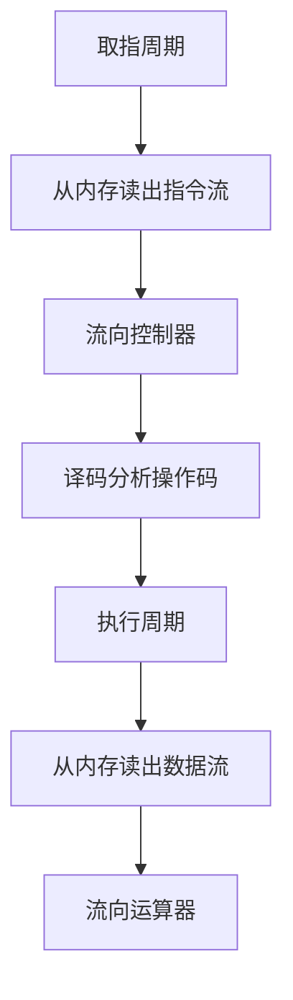
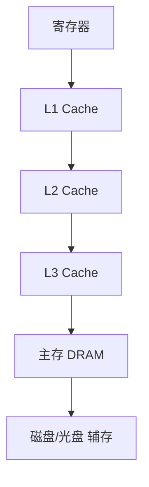

# 计算机组成五大部件（运算器、控制器、存储器、输入设备、输出设备）

## 计算机组成五大部件

### 它是什么

现代电子计算机硬件由**运算器、存储器、控制器、适配器（I/O 接口）、总线和输入/输出设备**组成，其中最核心的概念是冯·诺依曼提出的"存储程序"原理：==指令和数据都以二进制形式存放在存储器中==，控制器按程序规定的顺序自动取出并执行指令。

五大部件各司其职：

| 部件 | 核心功能 |
|------|----------|
| 运算器 | 完成算术运算与逻辑运算 |
| 控制器 | 指挥各部件按指令序列协调工作 |
| 存储器 | 存放程序和数据（内存 + 辅存） |
| 输入设备 | 将外部信息变换为二进制形式送入机器 |
| 输出设备 | 将处理结果变换为人或其他设备可识别的形式 |

其中运算器与控制器合称**中央处理器（CPU）**，输入/输出设备通常称为**外围设备**。

### 控制器如何区分指令和数据

这是初学者最容易困惑的问题。指令和数据在内存中都是二进制码，形式上没有区别，但**控制器能准确区分它们**，靠的是**时间阶段**的不同：

- **取指周期**：从内存读出的信息流是==指令流==，流向控制器
- **执行周期**：从内存读出的信息流是==数据流==，由内存流向运算器

> [!IMPORTANT]
> 区分指令和数据的依据是**所处周期不同**，而非二进制编码形式不同。

### 存储器层次：速度与容量的矛盾

为什么需要 L1/L2/L3 缓存、主存、辅存这么多层？因为用户对存储器有两个相互矛盾的需求：**希望速度快，又希望容量大、价格低**。单一存储器无法同时满足，于是用层次结构来折中。

| 层次 | 速度 | 容量 | 价格/位 | 特性 |
|------|------|------|---------|------|
| L1 Cache | 最快 | 最小 | 最高 | SRAM，集成在 CPU 内 |
| L2/L3 Cache | 快 | 较小 | 高 | SRAM，缓解 CPU 与主存速度差 |
| 主存 | 较快 | 中等 | 中 | DRAM，**易失性** |
| 辅存 | 慢 | 最大 | 最低 | 磁盘/光盘，**非易失性** |

同一时期，速度最快的是**寄存器/缓存层**，容量最大的是**辅存（磁盘）**。

> [!TIP]
> 记忆口诀：**越靠近 CPU，越快越小越贵；越远离 CPU，越慢越大越便宜**。Cache 的核心目的就是缓解 CPU 与主存之间的速度不匹配问题。

### 关键术语辨析

| 术语 | 定义 |
|------|------|
| **机器字长** | CPU 运算器一次能完成的二进制运算位数，决定寄存器和数据总线位数（8/16/32/64 位） |
| **存储容量** | 存储器中所有存储单元总数，单位 $K=2^{10}$、$M=2^{20}$、$G=2^{30}$、$T=2^{40}$，$B=8$ 位 |
| **存储器带宽** | 单位时间内从存储器读出的信息量，字节/秒 |
| **存取时间** | 从收到读写命令到完成读出/写入的时间 |
| **存取周期** | 连续访问中一次完整存取操作的总时间 = 存取时间 + 恢复时间 |

> [!WARNING]
> 易错点：存储容量单位是 $2$ 的幂（$1KB=2^{10}B$），不是 $10$ 的幂；存取周期**大于**存取时间，因为还要加上恢复时间。

### 典型例题

**题目**：目前的计算机，从原理上讲（ ）

A. 指令以二进制形式存放，数据以十进制形式存放  
B. 指令以十进制形式存放，数据以二进制形式存放  
C. 指令和数据都以二进制形式存放  
D. 指令和数据都以十进制形式存放  

**答案**：C

**解析**：存储程序原理的核心就是**指令和数据都以二进制形式存放在存储器中**，控制器通过取指周期和执行周期来区分当前读出的是指令还是数据。
