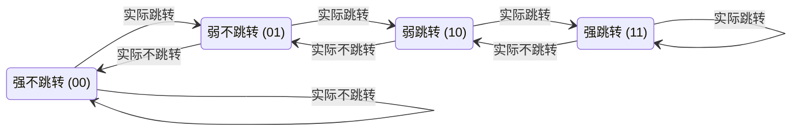

# 控制冒险与分支预测（1-Bit预测位缺点、2-Bit预测位、分支延迟槽）

## 控制冒险与分支预测

在流水线CPU中，**控制冒险**（Control Hazard）是三大冒险之一。它发生在遇到分支/跳转指令（如`beq`、`j`）时——下一条指令该去哪，取决于当前指令的执行结果。如果等结果出来再取指，流水线就得暂停，白白浪费时钟周期。

> [!IMPORTANT]
> ==控制冒险的根源：程序计数器（PC）的流向不确定。== 取指阶段不知道目标地址，只能等。

### 三大冒险对比

| 冒险类型 | 产生原因 | 典型场景 |
|---------|---------|---------|
| ==结构冒险== | 硬件资源争用 | 指令和数据共享同一存储器 |
| ==数据冒险== | 指令间数据依赖 | RAW（先写后读）依赖 |
| ==控制冒险== | 分支目标需计算 | `beq`跳转、`j`指令 |

三个空正对应这三个：**结构相关、数据相关、控制相关**。

### 为什么需要分支预测？

等分支结果出来，流水线已经取进了后续指令。如果猜错了，必须==**冲刷流水线**==（Flush），把错误指令清掉，重新取指，造成性能损失。预测就是为了**少猜错**。

### 1-Bit预测：最简单的尝试

核心思想：记住该分支**上一次**的跳转方向，下次还按上次走。
它用一个1位历史位记录`Taken`（跳转）或`Not Taken`（不跳转）。

> [!WARNING]
> **1-Bit预测的致命缺点：双重循环中，连续两次预测错误。**
> 例如内层循环末尾分支：执行顺序是 T→T→…→NT（退出）。1-Bit预测在第一次进入时若预测 NT，错；退出那次又预测 T，又错。它**对模式变化过于敏感**。

### 2-Bit预测：更聪明的选择

2-Bit用**两个历史位**（4个状态）引入“容忍度”。只有连续两次预测错误，才改变预测方向，避免了一次偶然不同就翻转预测。

> [!TIP]
> 记忆口诀：“错一次改弱，错两次改向”。2-Bit预测在循环结构中表现远优于1-Bit，是经典动态预测的基石。

### 何时预测？分支延迟槽

即便有预测，流水线还得**等分支目标地址计算**完才能取新指令。**分支延迟槽**（Branch Delay Slot）是另一种思路：==把分支后紧跟的一条或多条指令（延迟槽）照常执行，不冲刷。== 由编译器把**无论分支是否跳转都应执行**的指令（或借助重排）填入该槽。

> [!CAUTION]
> 延迟槽是**编译器可见**的体系结构特性，MIPS中常见。找不到合适指令时，只能填`nop`，白白浪费了槽位。

### 一个算对的例子

假设一条分支指令，实际行为规律是：`TTTNTTTN...`（三次跳转，一次不跳转，循环）。

- **1-Bit预测**：从NT开始。第1次T→错，改为T；2、3次T→对；第4次NT→错，改为NT；第5次T→错……进入内外层切换时频繁犯错。预测准确率约 **50%**。
- **2-Bit预测**：从SNT(00)开始。第1次T→WNT(01)（预测NT，错）；第2次T→WT(10)（预测NT，错！注意：此时状态变为WT，预测方向改为T）；第3次T→ST(11)（预测T，对）；第4次NT→WT(10)（预测T，错，但方向暂未变）；第5次T→ST(11)（预测T，对）。一个循环周期5次里准确率可达 **80%**。

结论：2-Bit通过引入“弱状态”成功吸收了偶发转折，显著减少了预测失误。
