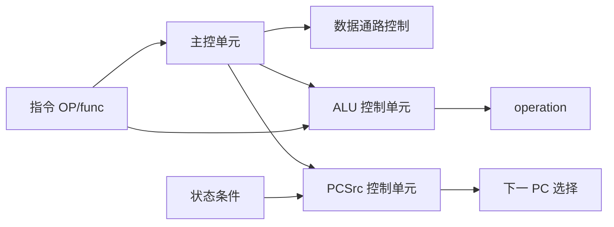

# 单周期主控单元设计（ALU控制单元、PCSrc控制单元、真值表与逻辑式）

## 为什么要把主控单元拆开设计

单周期 CPU 中，每条指令都在一个时钟周期内完成，因此控制信号不能逐拍变化，而应由==当前指令及状态条件经组合逻辑直接产生==。若把全部控制信号混在一张大真值表中，设计容易混乱；通常先划分主控单元、ALU 控制单元和 PCSrc 控制单元，再分别完成“真值表→逻辑式→组合逻辑电路”。

## ALU 控制单元：由 aluop 与 func 决定 operation

主控单元先根据指令操作码产生 `aluop`，说明本条指令需要哪一类 ALU 操作；ALU 控制单元再结合 `func`，产生送往 ALU 的 `operation`。这样，主控单元不必直接处理所有 R 型指令的功能码。

设计步骤如下：

1. 明确输入为 `aluop`、`func`，输出为 `operation`。
2. 按指令逐行填写真值表：例如取数、存数需要加法，比较类操作需要减法，R 型指令再由 `func` 区分具体操作。
3. 标出无关项。课件指出 `func[5:3]` 是无关项，不使用，因此只需利用 `func[2:0]`。
4. 分别写出 `operation` 各输出码位的逻辑式，化简后画出组合逻辑。

> [!IMPORTANT]
> `aluop` 表示“操作类别”，`func` 用于进一步译码，`operation` 才是 ALU 实际执行的操作编码，三者不能混用。

验证时，将 `aluop[2:0]=100`、`func[2:0]=000` 代入所得逻辑式，应得到

$$
operation=0010
$$

与真值表一致；其余有效编码也应逐项验证。

## PCSrc 控制单元：决定是否改变顺序执行

PCSrc 控制单元解决“下一条指令地址从哪里来”。顺序执行时通常选择 $PC+4$；分支或跳转成立时选择相应目标地址。其输入包括主控单元给出的分支、跳转类控制信息，以及 ALU 产生的状态条件，如 `zero`。

以条件分支为例，可抽象为

$$
PCSrc=Branch\cdot zero
$$

其中 $PCSrc=1$ 表示选择分支目标地址，$PCSrc=0$ 表示选择 $PC+4$。实际设计仍应以课件真值表为准，尤其要检查分支条件是“等于零”还是“不等于零”。

> [!WARNING]
> `Branch=1` 只说明当前是分支指令，不代表一定跳转；还必须结合 `zero` 等状态条件。无条件跳转则不应再错误地与 `zero` 相与。

## 主控单元：从真值表得到全部控制逻辑

主控单元以指令操作码译码结果为主要输入，输出 RegWrite、MemRead、MemWrite、ALUSrc、MemtoReg、Branch、aluop 等控制信号。课件要求最终输出 **10 种共 12 位控制信号**，因此应分别写出共 12 个逻辑式，而不能把多位信号只当作一个布尔量。

通用流程是：

- 按指令类型逐行填写各输出信号；
- 对每一位输出，找出其取 1 的输入组合并写成逻辑式；
- 利用无关项化简，再组合成硬布线控制电路。

| 设计对象 | 主要输入 | 主要输出 | 核心任务 |
|---|---|---|---|
| 主控单元 | 指令操作码 | 各类控制信号、aluop | 控制整条数据通路 |
| ALU 控制单元 | aluop、func | operation | 确定 ALU 具体操作 |
| PCSrc 控制单元 | 分支/跳转信息、状态条件 | PC 来源选择 | 确定下一 PC |

> [!NOTE]
> 单周期设计主要依据指令译码直接产生控制信号；多周期设计还要加入状态或节拍信息。微程序设计则把控制信息组织成微指令，二者不要混写。

## 一个完整的写表与验证例子

若某条件分支指令要求 `zero=1` 时跳转，则真值表中只有 `Branch=1、zero=1` 这一行使 $PCSrc=1$，其余情况均为 0，于是得到 $PCSrc=Branch\cdot zero$。代入 `Branch=1、zero=0`，结果为 0，选择 $PC+4$；代入 `Branch=1、zero=1`，结果为 1，选择分支目标地址。

> [!TIP]
> 考试作图或写逻辑式前，先圈出每个信号的“输入、输出、有效电平、无关项”。最后用一组典型编码反代验证，可同时检查真值表和逻辑式。
