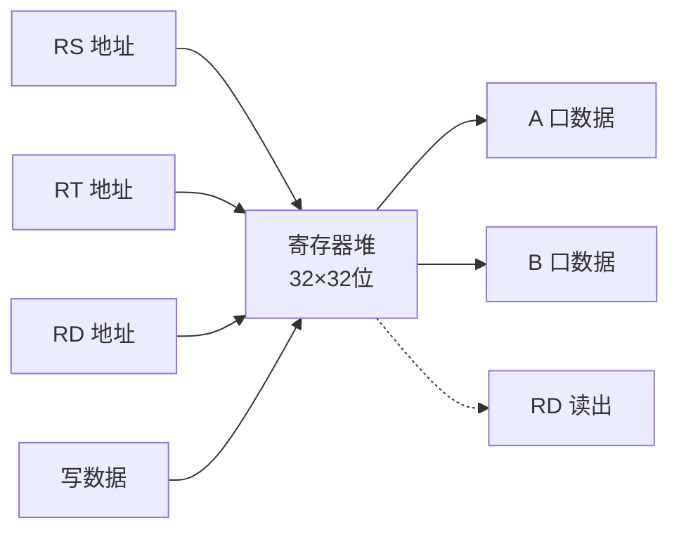
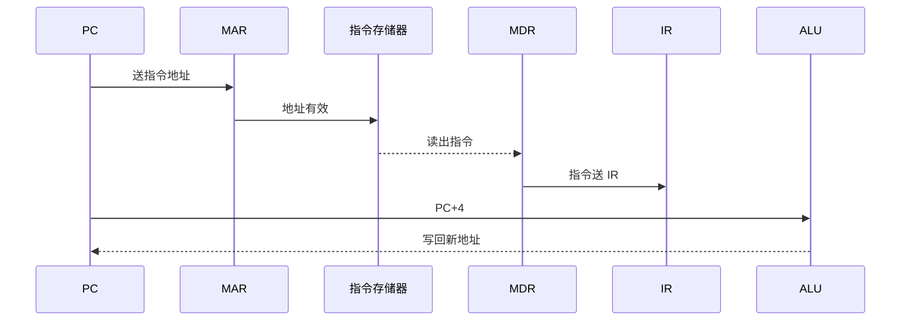

# CPU基本部件选型（PC、IR、MAR、MDR、ALU、通用寄存器堆、多路选择器）

## 是什么：CPU 的"器官"各管一件事

数据通路（Data Path）是 CPU 内部传送和处理数据的硬件线路，由 **ALU + 若干寄存器 + 多路选择器 + 总线** 组成。每个部件只干一件事，选型就是"这件事需要多宽的寄存器、几个端口"。

| 部件 | 全称 | 干什么 | 关键选型参数 |
|---|---|---|---|
| PC | 程序计数器 | 存下一条指令地址 | 位数 = 指令地址宽度 |
| IR | 指令寄存器 | 存当前正在执行的指令 | 位数 = 指令字长 |
| MAR | 存储器地址寄存器 | 访存时先送地址 | 位数 = 地址总线宽 |
| MDR | 存储器数据寄存器 | 访存时暂存数据 | 位数 = 数据总线宽 |
| ALU | 算术逻辑单元 | 加减、与或非、比较 | 支持哪些操作 |
| 通用寄存器堆 | Register File | 暂存操作数与结果 | 容量 + 读/写端口数 |
| 多路选择器 | MUX | 从多路信号中选一路 | 输入路数 |

> [!IMPORTANT]
> 选型原则一句话：**寄存器位数对齐"它要存的量"，寄存器堆端口对齐"指令要同时读几个操作数"**。

## 为什么：两个真实考题的推导

**寄存器堆要几个读口？** 一条 R 型指令如 `add $s0, $s1, $s2` 要同时读出 `$s1`、`$s2` 两个源操作数。所以寄存器堆必须**两个读口（A 口、B 口）+ 一个写口**——这就是"多端口存储器"（考题答案 A）。

**寻址寄存器要几位地址？** MIPS32 有 32 个通用寄存器，地址码位数 $n$ 满足 $2^n \ge 32$，得 $n=5$ 位（考题答案 B）。

**读口地址信号叫什么？** 看寄存器堆结构图：A 口由 **RS** 字段驱动，B 口由 **RT** 字段驱动。要读出 03 号寄存器给 A，就让 `RS=03`（考题答案 A）。

## 怎么做：取指周期里的部件配合

FT（Fetch，取指周期）是每条指令的第一个 CPU 周期，干两件事：**取指令 + 算下址**。以 MIPS 为例：

注意顺序：先 `M→IR` 把指令取进来，同时 `PC=PC+4`（MIPS 按字编址；若按字节编址则 +1）。两条微操作可以并行，因为互不依赖。

> [!TIP]
> 记"**先取指，后改址**"——IR 必须先稳住当前指令，PC 才能放心去指向下一条。

## 相近概念与易混点

**PC vs MAR**：PC 只管指令地址，自动 +1/+4；MAR 是"万能地址口"，取指、取数、存数都靠它中转。

**指令存储器 vs 数据存储器**：哈佛结构下，==指令存储器只读，数据存储器可读可写==（考题答案 B）。这保证了程序不会被当数据改写。

**IR vs 通用寄存器**：IR 是专用寄存器，程序员不可见；通用寄存器堆（`$0`~`$31`）是可见资源。

> [!WARNING]
> 别被选项顺序骗：有的题把 `PC=PC+1` 写在 `M→IR` 前面，看似都行，但若问"FT 周期为什么存在"，标准答案是**取指周期（A）**，因为 FT 的本质任务就是取指。

## 一个算对的例子

MIPS32 的 `lw $t0, 8($s1)` 执行时，寄存器堆、ALU、MAR/MDR 如何配合？

1. **译码**：RS = `$s1` 编号（5 位），RT = `$t0` 编号，立即数 = 8。
2. **地址计算**：A 口读出 `$s1` 内容送 ALU，B 口接扩展后的 8，ALU 做加法得 `$s1+8`。
3. **访存**：结果送 MAR，MDR 从数据存储器读出数据，再按 RT 编号写入寄存器堆。

整个过程中，寄存器堆提供了**两个独立读口**（RS、RT 同时有效），这正是"多端口存储器"的价值——单端口存储器一次只能读一个数，R 型指令就得跑两拍，性能直接减半。
