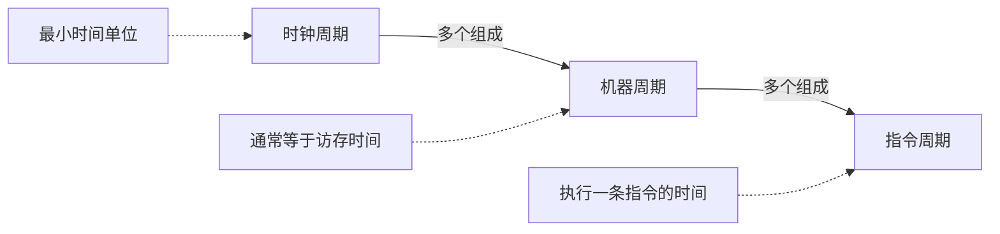

# CPU执行时间与性能计算公式

CPU 执行时间，是指 CPU 执行一段程序所占用的 CPU 时间。衡量一台计算机“快不快”，不能只凭感觉，必须用公式量化。

那么问题来了：决定一段程序跑多久的因素有哪些？是主频越高越快吗？还是指令条数越少越好？实际上，==CPU 执行时间由三个核心因素共同决定==：程序的指令条数、每条指令平均所需的时钟周期数（CPI），以及每个时钟周期的时长。

## 核心公式与时间层级

计算公式如下：

$$T_{CPU} = I_C \times CPI \times T_c = \frac{I_C \times CPI}{f}$$

其中：
- $I_C$：程序包含的总指令条数（Instruction Count）
- $CPI$：执行一条指令平均需要的时钟周期数（Cycles Per Instruction）
- $T_c$：时钟周期（$T_c = 1/f$）
- $f$：主频

要理解这个公式，必须先理清计算机内部的时间层级关系：

> [!IMPORTANT]
> ==三者大小关系：时钟周期 < 机器周期 ≤ 指令周期==。机器周期通常以主存中读取一个数据字的最长时间来规定，以保证 CPU 在最慢情况下也能可靠完成访存操作。

## 相近概念辨析

考试中常把几个“速度指标”混在一起考，务必区分清楚：

| 指标 | 含义 | 公式 |
| :--- | :--- | :--- |
| **MIPS** | 每秒执行百万条指令数 | $MIPS = \frac{f}{CPI \times 10^6}$ |
| **MFLOPS** | 每秒执行百万次浮点运算 | 仅衡量浮点性能，不反映整机速度 |
| **CPU执行时间** | 跑完程序的真实耗时 | $T_{CPU} = \frac{I_C}{MIPS \times 10^6}$ |

> [!NOTE]
> MIPS 高不代表程序跑得一定快！如果指令集不同，完成同一任务所需的 $I_C$ 差异巨大。只有在==同构架构下比较 MIPS 才有意义==。

## 常见易错坑

> [!WARNING]
> 计算时极易混淆“时钟周期”、“机器周期”和“指令周期”。题目若给出“每个机器周期含 4 个时钟周期”，求指令周期时必须逐层相乘，切勿直接用主频去除指令数。

> [!CAUTION]
> 单位换算陷阱：$\mu s$ 与 $ns$、MHz 与 Hz。记住 $1\mu s = 10^{-6}s$，$1MHz = 10^6Hz$。

> [!TIP]
> 解题口诀：“先求时钟，再乘倍数得机器，最后乘个数得指令；倒数就是 MIPS。”

## 真题演练

**题目**：某 CPU 主频为 $10\text{MHz}$，每个机器周期平均包含 $4$ 个时钟周期，平均指令执行速度为 $1\text{MIPS}$。求该机的平均指令周期及每个指令周期含几个机器周期？

**解答过程**：

1. **求时钟周期**：
   $$T_c = \frac{1}{f} = \frac{1}{10 \times 10^6} = 0.1\mu s = 100ns$$

2. **求机器周期**：
   $$T_m = 4 \times T_c = 4 \times 0.1\mu s = 0.4\mu s$$

3. **求平均指令周期**：
   已知速度为 $1\text{MIPS}$（即每秒 $10^6$ 条指令），则：
   $$T_i = \frac{1}{1\text{MIPS}} = \frac{1}{10^6} = 1\mu s$$

4. **求每个指令周期包含的机器周期数**：
   $$k = \frac{T_i}{T_m} = \frac{1\mu s}{0.4\mu s} = 2.5 \text{ 个}$$

> [!TIP]
> 算出 $2.5$ 个不要慌，这是“平均值”。实际单条指令的机器周期数是整数，但整段程序平均下来可以是小数。
