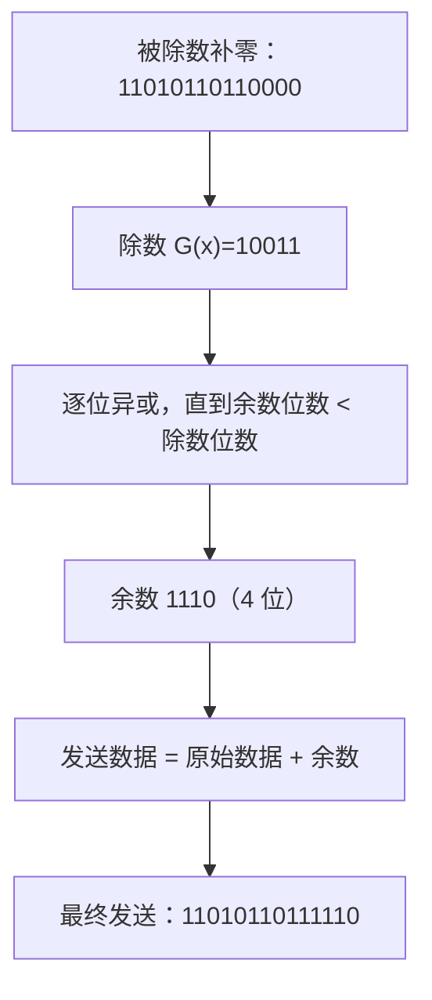

# CRC校验（循环冗余校验）

## 什么是 CRC 校验

你有没有想过：数据在信道上传输时，如果受到干扰，接收方怎么知道收到的数据对不对？

最简单的方法是**奇偶校验**——在数据后面加一个“1”或“0”，让整个数据中 1 的个数是奇数或偶数。但这只能查出奇数个位出错，偶数个位同时翻转就查不出来，更无法纠正错误。

==CRC（Cyclic Redundancy Check，循环冗余校验）是一种更强、应用更广的检错方法==——它把整个数据块当作一个大整数，用一个约定的生成多项式去“除”，将余数附在数据末尾。接收方用同样的多项式去“除”接收到的数据，余数为 0 则传输正确。

[!IMPORTANT]
> CRC 只能**检错**，不能**纠错**。它的核心思想是：数据传输时额外附加冗余信息，接收方通过除法运算验证数据完整性。

## 为什么需要 CRC

| 校验方式 | 能检错的情况 | 不能检错的情况 |
|---------|------------|--------------|
| 奇偶校验 | 奇数个位出错 | 偶数个位出错 |
| CRC 校验 | 突发错误、随机多位错误 | 极低概率的特定模式 |

CRC 能检测出：
- 所有单比特错误
- 所有双比特错误（只要生成多项式选取合适）
- 所有长度 ≤ 生成多项式次数的突发错误

因此在计算机网络（以太网帧）、存储系统（硬盘、光盘）、压缩文件中对数据完整性要求高的场景，CRC 是标准配置。

## 怎么做：手工计算 CRC

计算 CRC 的关键是**模 2 除法**——也就是用**异或**代替减法的除法。

### 核心步骤

1. 约定一个**生成多项式** $G(x)$。例如 CRC-4 常用 $x^4+x+1$，写成二进制就是 `10011`。
2. 在待发送数据后面补**生成多项式最高次个 0**。
3. 用模 2 除法，将被除数除以生成多项式。
4. 得到的**余数**（补足最高次位）作为校验码，替换掉补的那些 0。

发送数据 = 原始数据 + 余数（校验码）

接收方用同样的生成多项式去除接收到的完整数据，余数为 0 即正确。

[!TIP]
> 记不住的看口诀：**补零、异或除、得余数**。模 2 除法的口诀：**同 0 异 1，不看高位**。

### 一个算对的例子

题目：发送数据 `1101011011`，生成多项式 $G(x)=x^4+x+1$（二进制 `10011`），求传输的完整数据。

**1）补零**
生成多项式最高次是 4，所以在数据末尾补 4 个 0：
被除数 = `1101011011 0000`

**2）模 2 除法**



逐步演算：
```
11010110110000 ÷ 10011

首先对齐最高位：
11010 ⊕ 10011 = 01001 （最高位 1-1=0，舍去）
剩下：10011 0110000
10011 ⊕ 10011 = 00000
剩下：10110000
10110 ⊕ 10011 = 00101
剩下：101000
1010 ⊕ 10011 = 1010 （4 位，小于除数 5 位，停止）
```

最终余数为 `1110`（不足 4 位时前面补 0 至 4 位）。

**3）形成发送数据**

原始数据 `1101011011` + 余数 `1110` = `11010110111110`

[!WARNING]
> 余数位数必须等于生成多项式最高次。如果余数不足，**高位补 0**，不能省略。省略高位 0 会导致接收方校验出错。

## 接收方如何校验

接收方收到完整数据（包含校验码），用同一个生成多项式做模 2 除法：

- 余数为 0：传输无误
- 余数非 0：传输出错，丢弃重传

用上面的例子，接收方收到 `11010110111110`，除以 `10011`，余数为 0，验证通过。

## 常见误区

[!CAUTION]
> **误区 1：模 2 减法和普通减法混淆**  
> 模 2 减法就是异或运算，不借位、不进位。`1-1=0`，`1-0=1`，`0-1=1`，`0-0=0`。

[!CAUTION]
> **误区 2：补零个数搞错**  
> 补零个数 = 生成多项式最高次幂，不是位数减 1。$x^4+x+1$ 最高次是 4，补 4 个 0。

[!CAUTION]
> **误区 3：余数位数不足不补零**  
> 余数必须严格等于补零个数，不足则高位补 0，否则校验码位数不对，接收方无法正确校验。
