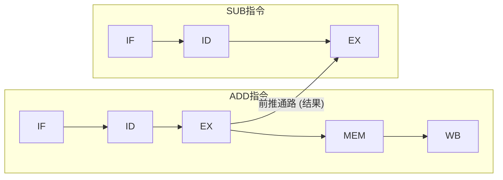

# 数据冒险与前推/旁路技术（含装载-使用型数据冒险检测与阻塞）

## 流水线中的数据冒险

计算机提高性能的一个核心方法是让多条指令在流水线中重叠执行。但指令之间往往存在依赖关系，这种依赖一旦破坏顺序执行，就会引发“冒险”。

### 为什么会出现数据冒险？

考虑两条相邻的加法指令：

```assembly
ADD R1, R2, R3  ; R1 = R2 + R3
SUB R4, R1, R5  ; R4 = R1 - R5
```

SUB 指令需要读取 R1 的值。在经典五段流水线中，ADD 指令要到 **写回 (WB) 阶段** 的时钟周期末尾才会真正更新 R1 寄存器。而 SUB 指令在 **译码/取数 (ID) 阶段** 就需要读出 R1。这就发生了 **“先读后写 (Read After Write, RAW)”** 冲突，即 ==数据冒险==。

>[!IMPORTANT]
> **数据冒险的本质**：后续指令需要的源操作数，恰好是前一条尚未写回的指令的目的操作数。

### 解决之道：前推/旁路技术

等待写回是低效的。事实上，ADD 的运算结果在 **执行 (EX) 阶段** 结束时就已经由 ALU 产生，之后只是在流水段寄存器间传递。

==**前推 (Forwarding)**==，也称旁路 (Bypassing)，就是将内部产生的中间结果直接“抄近路”送给需要它的指令，而不是等它写入寄存器后再读取。

下图展示前推如何省去等待时间。SUB 的输入可以直接从 ADD 的 EX/MEM 流水段寄存器获取，从而避免停顿。



>[!TIP]
> **记忆核心**：前推不是等数据“落地”（写入寄存器），而是从流水线后面的段，直接向前面的段“空投”数据。

### 前推无法消除的阻塞：装载-使用型冒险

如果前一条指令不是运算指令而是 **装载 (Load)** 指令，情况就不同了。

```assembly
LOAD R1, 0(R2)   ; 从存储器取数到 R1
ADD  R3, R1, R4  ; 立即使用刚取回的数
```

Load 指令只有在 **访存 (MEM) 阶段** 结束时才能从存储器得到数据。而紧跟其后的 ADD 指令在 **EX 阶段** 就需要这个数据。即使将前推路径提前到 MEM 阶段输出，数据到达时 ADD 的 EX 阶段早已开始。

```mermaid
gantt
    title 装载-使用型冒险时序
    dateFormat X
    axisFormat %s
    section LOAD
    IF   :done, 0, 1
    ID   :done, 1, 2
    EX   :done, 2, 3
    MEM  :crit, 3, 4
    WB   :4, 5
    section ADD
    IF   :1, 2
    ID   :2, 3
    EX   :crit, 3, 4
    MEM  :4, 5
    WB   :5, 6
```



这种被困住的情况称为 ==装载-使用型数据冒险==。单纯依靠前推无法解决，硬件必须检测并在 ADD 的 EX 阶段前插入一个 **流水线气泡 (Bubble)**，即 ==阻塞一个时钟周期==。

>[!WARNING]
> **易错点**：很多同学认为前推能解决一切数据冒险。务必记住，Load 指令的结果至少在下个时钟周期才能获得。当后续指令立即使用该结果时， ==必须阻塞一个周期==，哪怕实现了完整的前推逻辑。

### 算例演示

沿用 4 段流水线（IF, ID, EX, WB，周期 100ns），指令依然是 ADD 和 SUB。若不采取前推，SUB 需等待 ADD 的 WB 完成，需推迟 `2 个周期 = 200ns`。若采用前推技术，ADD 在 EX 末尾的结果可通过旁路直接送入 SUB 的 EX 输入端，此时只需推迟 ==1 个周期 (100ns)== 或不发生停顿。

### 辨析与总结

- **结构相关**：硬件资源不够用。
- **数据相关**：数据还没准备好，前推解决多数、装载阻塞解决剩余。
- **控制相关**：分支导致不知道取哪条指令。

>[!CAUTION]
> 寄存器堆的设计很巧妙：在同一个时钟周期内，写寄存器发生在时钟上升沿，读寄存器在下降沿（或反之）。这样一条指令的 WB 和另一条指令的 ID 即使在同一周期，也能正确读到更新值，但这仍需额外设计支持。
