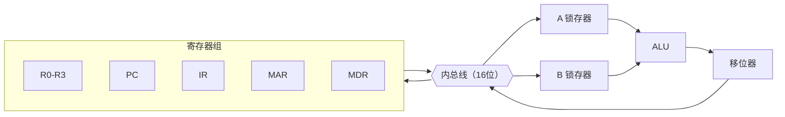
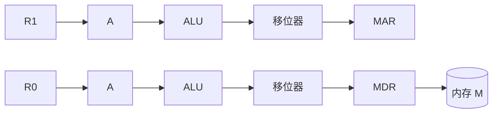

# 16位原型机的数据通路结构（内总线、非编程寄存器、运算部件设置）

## 16 位原型机的数据通路结构

一台 CPU 要执行指令，必须有**数据流动的通路**：操作数从哪来、进哪个运算器、结果送到哪去。16 位原型机（教学简化模型）把这一切画成一张清楚的图，方便理解后来复杂 CPU 的雏形。

### 总体结构：内总线 + 寄存器 + ALU

几个关键点：

- **内总线**：16 位宽，所有寄存器共用一根（或一组）内部数据总线，靠==分时复用==传递数据。
- **非编程寄存器**：MAR、MDR、A、B、IR 等程序员**不可见、不参与寻址**，只用于支撑取指、访存和运算。注意和通用寄存器 R0~R3 区分。
- **运算部件**：ALU 前设 A、B 两个**锁存器**，后接**移位器**；ALU 可做直通、加、减、逻辑运算等，移位器负责左移、右移或直传。

> [!NOTE]
> 为什么 ALU 前要 A、B 锁存器？因为内总线是共享的，一次只能送出一个数；先把两个操作数分别"扣"在 A、B 里，ALU 才能同时拿到两个输入。

### 数据通路：一次"寄存器间传送"怎么走

想把 R0 的值存到 R1，数据怎么流动？

- 从 R0 出来，进入 **A 锁存器**（或 B）；
- ALU 设为 ==直通==（即输出等于 A 输入）；
- 移位器设为 **直传**；
- 结果经内总线回写到 R1，控制信号给 ==CPR1==（R1 的写入使能）。

即 **R0 → A → ALU → 移位器 → R1**（对应考试选项 A 的路径）。

> [!IMPORTANT]
> 信号层面的对应：==A 路选择器选 R0== → ALU 直通 → 移位器直传 → **CPR1 有效**。注意目的寄存器信号是 CPR1，不是 CPR0、CPR2。

### 访存数据通路：寄存器间接寻址存数

"把 R0 存入 R1 指向的内存单元"，是**间接寻址 Store**，要分两步：

- **算地址**：R1 → A → ALU（直通）→ 移位器 → MAR；
- **送数据**：R0 → A → ALU（直通）→ 移位器 → MDR，再由 MDR 写入内存。

对应信号组合：==EMDR = 1==（让 MDR 输出到数据总线）、==R/W = 0/1==（写模式，按图示编码）、EMAR = 1（让 MAR 输出地址）。

> [!WARNING]
> 常见坑：**把"地址通路"和"数据通路"搞混**。间接寻址里 MAR 装的是 R1（地址），MDR 装的是 R0（数据），顺序不能反。

### 与相近概念的区别

| 概念 | 说明 | 典型例子 |
| --- | --- | --- |
| 通用寄存器 | 程序员可见、可寻址 | R0~R3 |
| 非编程寄存器 | 硬件内部支撑，程序员不可见 | MAR、MDR、A、B、IR |
| 内总线 | CPU 内部数据通路 | 16 位共享总线 |
| 系统总线 | CPU 与外部互连 | 地址/数据/控制总线 |

> [!TIP]
> 记忆：==通用寄存器"给用户用"，非编程寄存器"给硬件用"==。看到 MAR/MDR 就想到"地址、数据缓冲"，看到 A/B 就想到"ALU 输入锁存"。

### 一个完整的例子

执行 `MOV (R1), R0`（R0 存入 R1 指向的内存）：

1. R1 内容 → A → ALU 直通 → 移位器 → MAR（==EMAR=1==）；
2. R0 内容 → A → ALU 直通 → 移位器 → MDR（==EMDR=1==）；
3. R/W 置写模式（==0/1==），内存写入完成。

> [!CAUTION]
> 若只给 EMDR = 1 而忘给 EMAR = 1，地址不在总线上，内存不知道写到哪里——**地址与数据两条通路必须都打通**。
