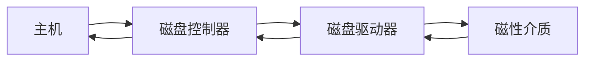
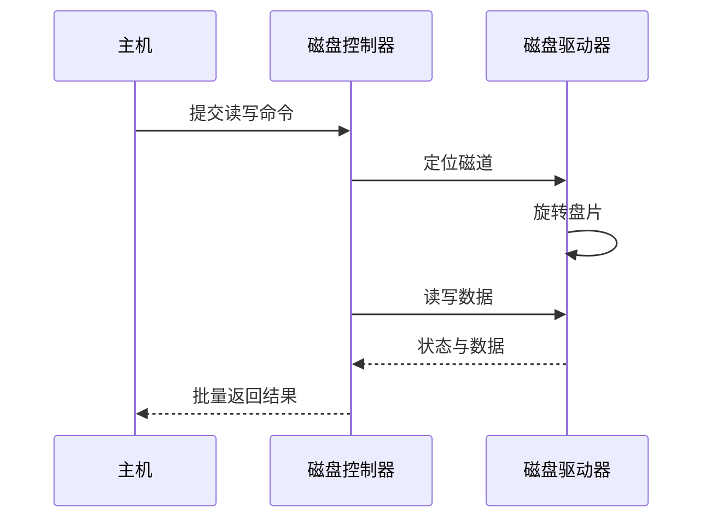

# 磁盘驱动器和控制器的功能

## 它是什么

磁盘存储器由两部分组成：

- **磁盘驱动器**：完成磁盘的机械运动和信号转换。
- **磁盘控制器**：充当主机与磁盘驱动器之间的接口，控制数据交换。

可以将二者理解为：==驱动器负责“存取磁盘”，控制器负责“组织并转运数据”==。

## 磁盘驱动器的组成

磁盘驱动器是精密的电子与机械装置。各类磁盘结构虽有差异，但基本都包括三大系统：

| 系统 | 主要功能 | 关键部件 |
|---|---|---|
| 定位驱动系统 | 使磁头移动到指定磁道和扇区 | 执行机构、步进电机、磁头 |
| 主轴系统 | 使盘片以稳定速度旋转 | 主轴电机、轴承 |
| 数据转换系统 | 完成信号转换、编码与检测 | 磁头、读/写电路、编解码电路 |

磁头为什么必须“定位”？因为盘片表面被划分为若干同心磁道，记录的信息分布在不同磁道和扇区中。定位系统先把磁头移到目标磁道，主轴系统再使目标扇区转到磁头下方，数据转换系统才能完成读写。

> [!TIP]
> 记忆口诀：**定位找磁道，主轴转盘片，转换读写信号。**

> [!NOTE]
> 对温盘驱动器，磁头与盘片距离极小，通常还需在超净环境中组装，以避免尘埃造成磁头碰撞或信号异常。

## 磁盘控制器的功能

磁盘控制器位于主机和驱动器之间，主要负责：

1. **接收并解释主机命令**，如寻道、读、写、格式化。
2. **控制驱动器动作**，如选择磁头、移动磁头、控制主轴和磁头读写。
3. **进行数据缓冲与格式转换**，将主机数据转换为适合磁盘记录的形式。
4. **检测传输状态**，向主机报告完成、错误或异常。

由于磁盘是高速外存设备，控制器可利用数据缓冲，把主机的一次操作与盘片的实际机械动作在时间上协调起来，因此主机与磁盘存储器通常采用==成批交换数据方式==，而不是一次只传送很少的数据。

## 控制器与接口标准

“磁盘控制器”和“接口标准”并非同一概念：

| 名称 | 作用 |
|---|---|
| 磁盘控制器 | 主机与具体设备之间的控制逻辑 |
| SCSI | 一种主机与外设通信的接口标准 |
| ESDI | 早期主机与磁盘控制器之间的接口标准 |

若把磁盘控制器的功能全部转移到设备内部，使设备相对独立，主机与设备之间就应采用标准化接口。题中给出的答案是 **SCSI**。SCSI 不只用于磁盘，也可连接磁带机、光驱等设备；ESDI 则主要用于连接磁盘控制器与主机。

## 常见坑

> [!WARNING]
> 不要把“磁盘存储器采用成批交换”误认为“磁盘控制器属于磁盘驱动器内部”。控制器是主机与驱动器之间的接口，逻辑上位于二者之间。

> [!CAUTION]
> 磁道定位、主轴旋转和信号转换分别属于不同系统，不要混为一谈；定位到正确磁道也不代表已经读到目标扇区，还必须等目标扇区转到磁头下方。

## 例题

**题目：**为了使设备相对独立，磁盘控制器的功能全部转移到设备中，主机与设备间采用哪种接口？

**答案：A. SCSI**

**解析：**SCSI 将传统由主机侧承担的部分设备控制功能转移到外设控制器中，使主机通过统一标准命令访问不同外设，因而能够提高设备的独立性和兼容性。ESDI 是专用于磁盘系统的早期接口，适用范围较窄。
