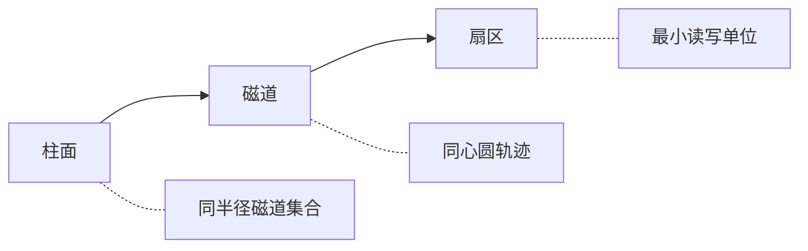

# 磁盘上信息的分布与记录格式（柱面、磁道、扇区编号、扇标脉冲）

## 磁盘信息的物理分布与编址

如果磁头每次读写都要从最外圈跑到最内圈，效率岂不是极低？为了解决机械运动带来的延迟瓶颈，磁盘在物理上被划分为==柱面、磁道、扇区==三级结构。这种分层不仅定义了数据的存放位置，更直接决定了寻址方式和存取时间的计算模型。

### 三级地址结构与柱面概念

磁盘记录面由一系列同心圆组成，这些同心圆称为**磁道**。所有盘面相同半径的磁道构成了一个**柱面**。每个磁道又被等分为若干个弧段，即**扇区**。

> [!IMPORTANT]
> ==磁盘地址由记录面号（磁头号）、磁道号（柱面号）、扇区号三部分组成==。寻址时优先在同一柱面内切换磁头，因为电子切换远快于机械移动。

*   **磁道编号**：从外向内依次编号，最外圈为0磁道，最内圈为n磁道。n磁道以内的区域不记录信息。
*   **固定头 vs 活动头**：固定头磁盘每道对应一个磁头，省去找道时间；活动头磁盘组则需通过移动臂定位柱面。
*   **索引标志**：磁道上设有起始位置标记，传感器检索到该位置时产生脉冲信号，用于确定磁道起点。

### 扇标脉冲与记录格式

磁头如何知道当前读到了哪个扇区的开头？这依赖于**扇标脉冲**。

> [!NOTE]
> 每个扇区开始时由磁盘控制器产生一个扇标脉冲，==两个扇标脉冲之间的区域即为一个扇区==。它是定长数据块记录格式下识别数据边界的物理基准。

| 指标 | 定义 | 单位 | 备注 |
| :--- | :--- | :--- | :--- |
| 道密度 | 半径方向单位长度的磁道数 | 道/英寸 (TPI) | 决定柱面数量 |
| 位密度 | 磁道单位长度记录的二进制位数 | 位/英寸 (BPI) | 内层最高，外层最低 |
| 格式化容量 | 用户实际可用的存储总量 | Byte | 扣除间隙与校验位 |

### 常见误区与辨析

> [!WARNING]
> *   **外圈面积大≠容量大**：采用定长记录格式时，内外磁道扇区数相同，==尽管外圈周长更长，但存储容量与内圈相等==。
> *   **最小交换单位**：一次操作最多交换一个柱面信息，最少读写一个扇区，而非单个字节。
> *   **文件存放策略**：若文件超过单磁道容量，应优先记录在==同一柱面==的不同记录面上，而非同一面的相邻磁道，以避免额外的找道开销。

### 计算实例：六片式磁盘组参数求解

某磁盘组有6片磁盘，每片2个记录面，最上最下面不用。存储区内径22cm，外径33cm，道密度40道/cm，内层位密度400位/cm，转速6000转/分。求柱面数、总容量及传输率。

**解题关键点**：有效存储区域是半径之差，而非直径之差；位密度以内层为准计算每道容量（因内层周长最短，位密度最高）。

1.  **柱面数**：有效半径 $= (33-22)/2 = 5.5\,\text{cm}$，柱面数 $= 40 \times 5.5 = ==220==$。
2.  **总容量**：内层周长 $= 2\pi \times 11 \approx 69.08\,\text{cm}$。每道字节数 $= 400 \times 69.08 / 8 \approx 3454\,\text{B}$。可用面数 $= 6\times2 - 2 = 10$。总容量 $= 3454 \times 220 \times 10 = ==7,598,800\,\text{B}==$。
3.  **数据传输率**：转速 $r = 6000/60 = 100\,\text{转/秒}$。$D_r = r \times N = 100 \times 3454 = ==345,400\,\text{B/s}==$。

> [!TIP]
> 平均存取时间 $= T_s + \frac{1}{2r} + \frac{b}{rN}$。其中 $\frac{1}{2r}$ 是平均等待时间（旋转半圈），$\frac{b}{rN}$ 是传送b字节所需时间。计算时务必统一单位为“转/秒”。
